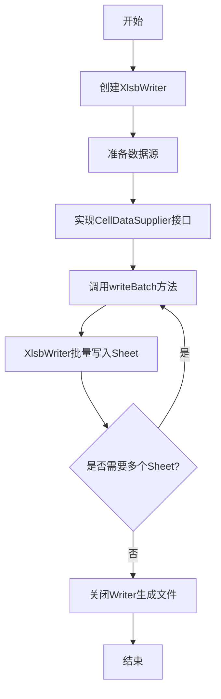
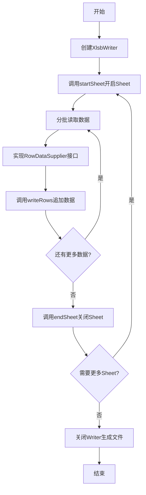
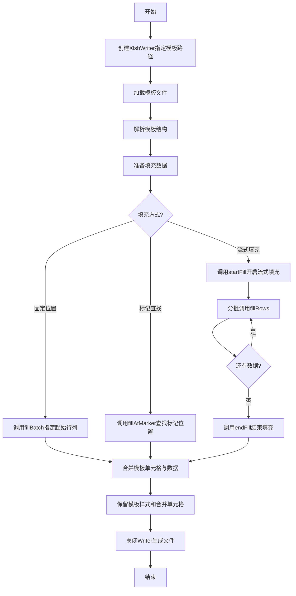
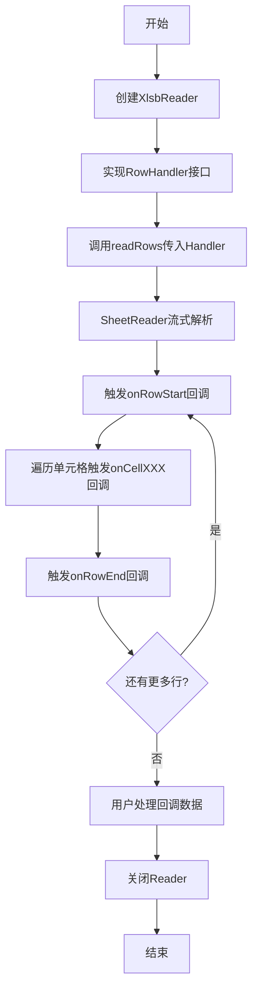
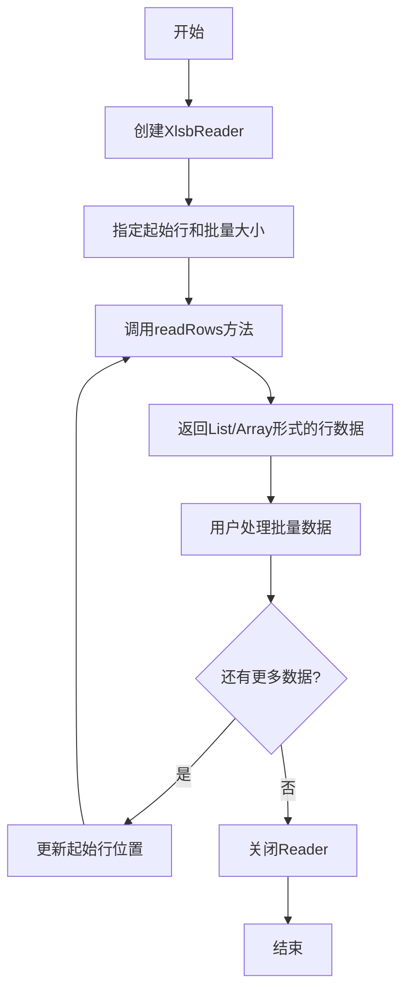
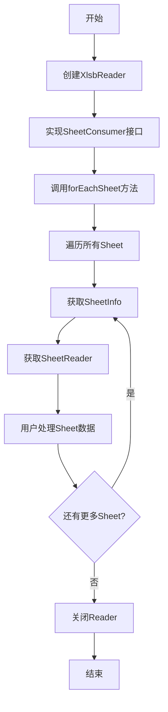
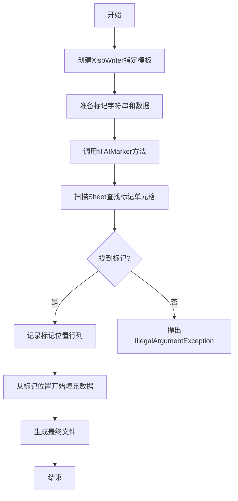
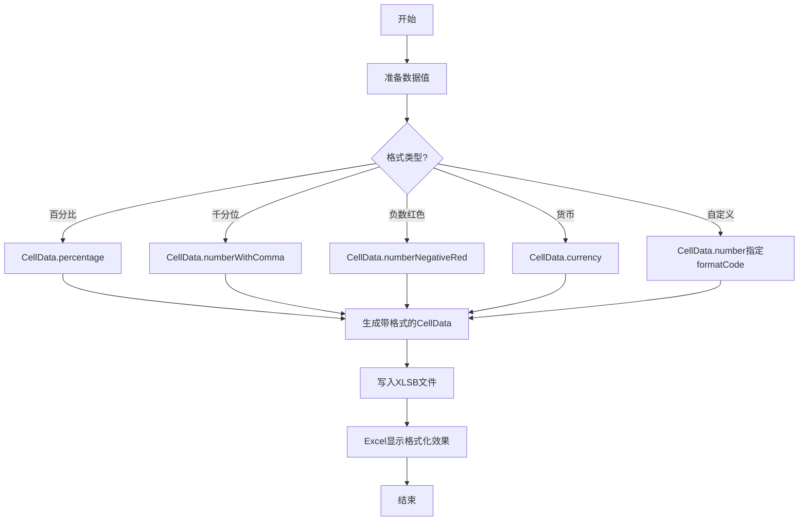
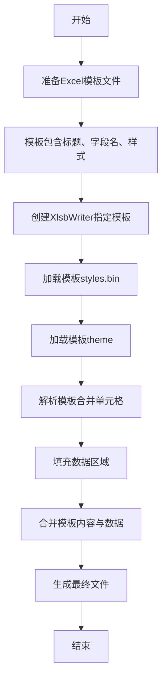
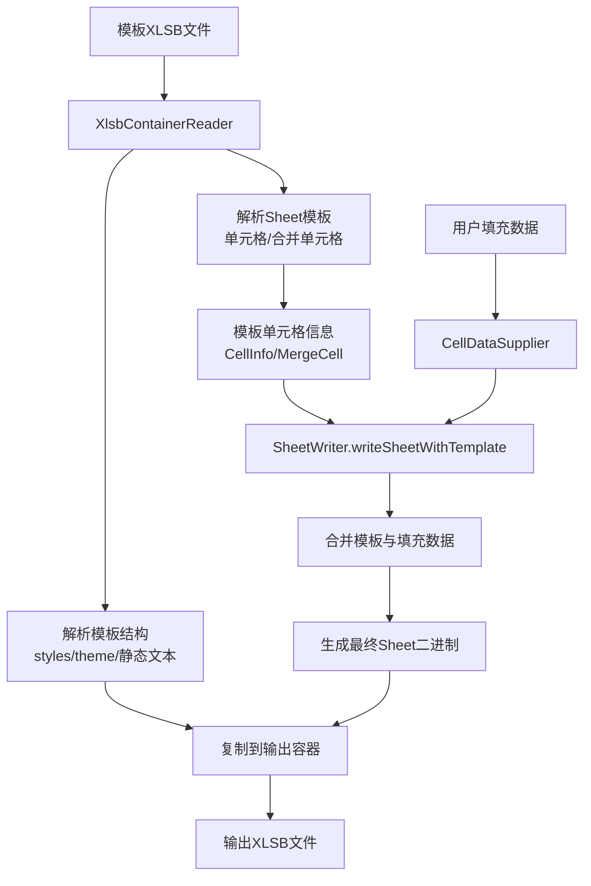

# API模块需求文档

## 模块概述

API模块是jxlsb库的公共接口层，提供XLSB（Excel Binary Workbook）格式文件的读写能力。该模块定位为：

- **公共API入口**：对外暴露简洁、易用的API接口
- **功能抽象层**：封装底层BIFF12格式处理细节
- **零依赖设计**：仅依赖SLF4J，无需Apache POI等重型库
- **高性能导向**：全量堆外内存架构，流式处理支持大规模数据

模块包含10个核心类：
- **入口类**：XlsbWriter（写入）、XlsbReader（读取）
- **数据类**：CellData（单元格数据）
- **函数式接口**：CellDataSupplier、RowDataSupplier、RowHandler、RowConsumer、SheetConsumer等

---

## 业务场景

### 场景列表

| 序号 | 场景名称 | 场景类型 | 描述 | 优先级 |
|------|----------|----------|------|--------|
| 1 | 批量数据导出 | 写入 | 大规模数据导出为XLSB格式 | P0 |
| 2 | 流式数据写入 | 写入 | 分批追加数据，避免内存溢出 | P0 |
| 3 | 模板数据填充 | 写入 | 基于Excel模板填充动态数据 | P0 |
| 4 | 流式数据读取 | 读取 | 边读边处理，回调式处理 | P0 |
| 5 | 分页数据读取 | 读取 | 分批加载，支持分页场景 | P0 |
| 6 | 多Sheet遍历 | 读取 | 遍历处理所有Sheet | P1 |
| 7 | 标记位置填充 | 写入 | 查找标记单元格位置并填充 | P1 |
| 8 | 格式化数据输出 | 写入 | 支持数字格式（百分比、货币等） | P1 |
| 9 | 报表模板生成 | 写入 | 保留模板样式生成报表 | P1 |

---

### 场景详情

#### 场景1: 批量数据导出

**触发条件**：需要将大量数据（如数据库查询结果）导出为XLSB格式文件

**业务流程**：


**预期结果**：
- 生成有效的XLSB文件
- Excel/WPS可正常打开
- 数据完整无误

**技术要点**：
- 使用CellDataSupplier接口提供单元格数据
- 支持List/Array多种数据源
- 自动管理Sheet索引

---

#### 场景2: 流式数据写入

**触发条件**：数据量巨大（百万级），需要分批写入避免内存溢出

**业务流程**：


**预期结果**：
- 内存占用稳定可控
- 支持无限数据量
- 文件格式正确

**技术要点**：
- `startSheet()` → `writeRows()` → `endSheet()` 必须按序调用
- 支持List/Array两种数据源
- 流式追加避免全量内存加载

---

#### 场景3: 模板数据填充

**触发条件**：需要基于预设的Excel模板生成报表，保留标题、样式、合并单元格

**业务流程**：


**预期结果**：
- 模板样式完整保留
- 合并单元格正确保留
- 标题和字段名不被覆盖
- 数据正确填充到指定位置

**技术要点**：
- 必须使用Builder.template()指定模板
- fillXXX方法仅在模板模式下可用
- 模板模式与普通模式互斥
- 仅支持"表头模板"模式（底部内容不保留）

---

#### 场景4: 流式数据读取

**触发条件**：读取大文件，需要边读边处理，避免全量加载内存

**业务流程**：


**预期结果**：
- 内存占用极低
- 支持超大文件
- 实时处理数据

**技术要点**：
- 实现RowHandler接口处理回调
- 支持数字、文本、布尔、日期、空白五种类型
- 行/列索引从0开始
- 通过BatchCompleteException控制提前终止

---

#### 场景5: 分页数据读取

**触发条件**：需要分页加载Excel数据，或批量处理部分数据

**业务流程**：


**预期结果**：
- 返回List<CellData[]>或CellData[][]
- 空数据返回空列表而非null
- 列数自动适配

**技术要点**：
- startRow从0开始
- batchSize控制批量大小
- 支持List和Array两种返回形式
- 使用预估列数避免依赖spans解析

---

#### 场景6: 多Sheet遍历

**触发条件**：需要处理Excel文件中的所有Sheet

**业务流程**：


**预期结果**：
- 遍历所有Sheet
- 每个Sheet独立处理
- 自动管理资源

**技术要点**：
- SheetConsumer接口接收SheetInfo和SheetReader
- SheetReader在使用后自动关闭
- 支持提前终止遍历

---

#### 场景7: 标记位置填充

**触发条件**：模板中预设了数据填充标记（如`${data}`），需要查找并替换

**业务流程**：


**预期结果**：
- 精确定位标记单元格
- 从标记位置开始填充数据
- 标记单元格被数据覆盖

**技术要点**：
- 标记必须是文本类型单元格
- 支持指定Sheet索引或使用默认Sheet 0
- 未找到标记抛出异常

---

#### 场景8: 格式化数据输出

**触发条件**：需要输出带格式的数字（百分比、货币、千分位等）

**业务流程**：


**预期结果**：
- Excel中显示格式化效果
- 数值本身不变
- 支持Excel标准格式字符串

**技术要点**：
- percentage支持小数位数参数
- currency支持自定义货币符号
- 可通过formatCode自定义格式
- formatCode对应Excel单元格格式字符串

---

#### 场景9: 报表模板生成

**触发条件**：需要生成格式化报表，保留标题、表头、样式、合并单元格

**业务流程**：


**预期结果**：
- 标题完整保留
- 字段名完整保留
- 样式完整保留
- 合并单元格正确保留
- 数据正确填充

**技术要点**：
- 模板填充保留：styles.bin、theme、静态文本
- 合并单元格通过BrtMergeCell记录保留
- 数据从指定位置向下填充
- 仅支持"表头模板"（底部内容不保留）

---

## 功能需求

### 核心功能

| 序号 | 功能名称 | 功能描述 | 输入 | 输出 |
|------|----------|----------|------|------|
| F01 | XLSB文件创建 | 创建空白XLSB文件 | Path | XlsbWriter实例 |
| F02 | 批量写入Sheet | 一次性写入完整Sheet | sheetName, CellDataSupplier, rowCount, columnCount | 写入完成 |
| F03 | 流式写入数据 | 分批追加数据到Sheet | sheetName, columnCount, dataList | 写入完成 |
| F04 | 模板文件加载 | 加载现有XLSB作为模板 | templatePath | 模板模式Writer |
| F05 | 模板数据填充 | 在模板指定位置填充数据 | sheetIndex, dataList, startRow, startCol | 填充完成 |
| F06 | 标记位置查找 | 查找文本标记单元格位置 | marker | 行列位置 |
| F07 | 流式模板填充 | 分批填充模板数据 | sheetIndex, startRow, startCol | 填充完成 |
| F08 | 数字格式化 | 支持多种数字格式 | value, formatCode | CellData |
| F09 | 合并单元格保留 | 保留模板合并单元格 | 模板Sheet | 合并单元格记录 |
| F10 | XLSB文件读取 | 读取XLSB文件 | Path | XlsbReader实例 |
| F11 | Sheet信息查询 | 查询所有Sheet信息 | 无 | List<SheetInfo> |
| F12 | Sheet遍历 | 遍历所有Sheet | SheetConsumer | 每个Sheet的SheetReader |
| F13 | 流式行读取 | 回调式逐行读取 | sheetIndex, RowHandler | 回调数据 |
| F14 | 分页行读取 | 批量返回行数据 | sheetIndex, startRow, batchSize | List<CellData[]> |
| F15 | 单元格类型支持 | 支持5种单元格类型 | 类型标识 | CellData实例 |

---

### 辅助功能

| 序号 | 功能名称 | 功能描述 | 输入 | 输出 |
|------|----------|----------|------|------|
| A01 | Builder模式构建 | 流式构建Writer/Reader | 配置参数 | 实例 |
| A02 | 自动资源管理 | 支持try-with-resources | 无 | 自动关闭 |
| A03 | Sheet计数查询 | 查询已写入的Sheet数量 | 无 | sheetCount |
| A04 | 模板Sheet计数 | 查询模板的Sheet数量 | 无 | templateSheetCount |
| A05 | 模板Sheet信息 | 查询模板所有Sheet信息 | 无 | List<SheetInfo> |
| A06 | 动态列数适配 | 自动适配实际列数 | 单元格数据 | 正确列数 |
| A07 | 空白单元格处理 | 正确处理空白单元格 | 无 | CellData.blank() |

---

## 业务规则

### 写入模式规则

| 规则ID | 规则名称 | 规则描述 | 代码实现位置 | 异常类型 |
|--------|----------|----------|--------------|----------|
| WR-001 | 模式互斥规则 | 模板模式与普通模式互斥，模板模式只能调用fillXXX方法 | XlsbWriter:111-113, 122-124, 137-139 | IllegalStateException |
| WR-002 | 模板方法限制 | 普通模式只能调用writeXXX方法 | XlsbWriter:201-203 | IllegalStateException |
| WR-003 | Sheet顺序规则 | Sheet必须按顺序创建，不能跳跃 | XlsbWriter:117-118 | 自动递增 |
| WR-004 | 流式写入顺序 | startSheet → writeRows → endSheet 必须按序调用 | XlsbWriter:126-128, 141-143, 186-188 | IllegalStateException |
| WR-005 | 流式填充顺序 | startFill → fillRows → endFill 必须按序调用 | XlsbWriter:276-278, 307-309, 328-330 | IllegalStateException |
| WR-006 | 参数非空校验 | path、marker、dataList等关键参数不允许为null | XlsbWriter:51, 205, 256-257 | NullPointerException |
| WR-007 | Sheet索引范围 | Sheet索引必须在有效范围内 | XlsbWriter:206-208, 280-282 | IllegalArgumentException |
| WR-008 | 标记必须存在 | fillAtMarker必须找到标记单元格 | XlsbWriter:260-262 | IllegalArgumentException |

### 读取模式规则

| 规则ID | 规则名称 | 规则描述 | 代码实现位置 | 异常类型 |
|--------|----------|----------|--------------|----------|
| RD-001 | 行索引从0开始 | startRow参数从0开始计数 | XlsbReader:116-118 | 无异常 |
| RD-002 | 空数据返回空列表 | 无数据时返回空列表而非null | XlsbReader:212 | 返回ArrayList |
| RD-003 | 动态列数适配 | 列数根据实际单元格自动扩展 | XlsbReader:183-189 | 无异常 |
| RD-004 | 提前终止支持 | 支持通过异常提前终止读取 | XlsbReader:134, 209-210 | BatchCompleteException |

### 数据类型规则

| 规则ID | 规则名称 | 规则描述 | 代码实现位置 |
|--------|----------|----------|--------------|
| DT-001 | 类型不可变 | CellData创建后类型不可变 | CellData:30-35 |
| DT-002 | formatCode优先级 | 传入formatCode时styleIndex为-1 | CellData:50 |
| DT-003 | styleIndex优先级 | 模板解析时styleIndex有值，formatCode为null | CellData注释:16-18 |
| DT-004 | 空白单元格处理 | 空白单元格value为null，类型为BLANK | CellData:65-67 |
| DT-005 | 自动类型转换 | toCellData自动转换Java类型为CellData | XlsbWriter:408-430 |
| DT-006 | 数字精度 | 数字使用double类型存储 | CellData:45-46 |
| DT-007 | 日期存储 | 日期存储为时间戳(long) | CellData:53-54 |

### 模板处理规则

| 规则ID | 规则名称 | 规则描述 | 代码实现位置 |
|--------|----------|----------|--------------|
| TP-001 | 模板结构复制 | 复制除worksheets和sharedStrings外的所有条目 | XlsbWriter:86-99 |
| TP-002 | SharedStrings加载 | 加载模板的共享字符串表 | XlsbWriter:76-84 |
| TP-003 | Workbook同步 | 同步模板的Sheet信息到workbook | XlsbWriter:101-106 |
| TP-004 | 合并单元格保留 | 解析并保留模板的BrtMergeCell记录 | XlsbWriter:216, 295 |
| TP-005 | 表头模板模式 | 仅支持表头模板，底部内容不保留 | 设计限制 |

---

## 数据需求

### 数据实体

#### CellData（单元格数据）

| 属性名称 | 数据类型 | 描述 | 来源 |
|----------|----------|------|------|
| type | CellType | 单元格类型（TEXT/NUMBER/BOOLEAN/DATE/BLANK） | 用户指定 |
| value | Object | 单元格值 | 用户指定 |
| formatCode | String | 数字格式代码（写入时） | 用户指定或工厂方法生成 |
| styleIndex | int | XF样式索引（读取时） | 模板解析 |

**CellType枚举值**：
- TEXT：文本类型
- NUMBER：数字类型
- BOOLEAN：布尔类型
- DATE：日期类型
- BLANK：空白类型

#### SheetInfo（Sheet信息）

| 属性名称 | 数据类型 | 描述 | 来源 |
|----------|----------|------|------|
| name | String | Sheet名称 | XLSB文件解析 |
| index | int | Sheet索引 | XLSB文件解析 |

---

### 数据流转

#### 写入数据流


#### 读取数据流


#### 模板填充数据流



---

### 数据约束

| 约束名称 | 约束描述 | 约束来源 |
|----------|----------|----------|
| 行列索引范围 | 行列索引 ≥ 0 | Excel规范 |
| Sheet名称唯一 | 同一Workbook中Sheet名称不重复 | Excel规范 |
| 共享字符串表 | 文本单元格使用共享字符串表索引 | BIFF12规范 |
| XF样式索引 | 样式索引必须引用有效的XF记录 | BIFF12规范 |
| 日期序列号 | 日期存储为Excel序列号 | Excel规范 |
| 列数预估 | 分页读取预估列数100 | 代码实现 |

---

## 非功能需求

### 性能要求

| 性能指标 | 目标值 | 实现方式 | 验证方法 |
|----------|--------|----------|----------|
| 写入速度 | 100K行×10列 < 500ms | 流式写入、堆外内存 | JMH基准测试 |
| 读取速度 | 100K行×10列 < 300ms | 流式解析、回调处理 | JMH基准测试 |
| 文件大小 | 比POI小30-50% | 二进制格式 | 文件对比 |
| 内存占用 | 堆内存增长 < 10MB | 堆外内存架构 | 内存分析 |
| GC压力 | 零GC压力 | 堆外内存、对象复用 | GC日志分析 |
| 启动时间 | < 100ms | 延迟加载 | 计时测试 |

**性能对比（100K行×10列）**：
| 库 | 文件大小 | 写入时间 |
|----|----------|----------|
| jxlsb | 2.72 MB | 453 ms |
| FastExcel | 5.42 MB | 521 ms |
| EasyExcel | 4.21 MB | 1121 ms |
| POI | 4.16 MB | 1528 ms |

---

### 安全要求

| 安全要求 | 实现方式 |
|----------|----------|
| 路径校验 | Objects.requireNonNull校验路径非空 |
| 参数校验 | 关键参数非空校验，避免NPE |
| 资源释放 | 实现AutoCloseable接口，支持try-with-resources |
| 异常处理 | 明确的异常类型和消息 |
| 线程安全 | 非线程安全，单线程使用 |

---

### 可用性要求

| 可用性要求 | 实现方式 |
|------------|----------|
| API简洁性 | Builder模式、函数式接口、流式API |
| 零依赖 | 仅依赖SLF4J，无需POI等重型库 |
| 易集成 | Maven/Gradle直接引入 |
| 文档完善 | JavaDoc注释、示例代码 |
| 错误提示 | 明确的异常消息，指导用户修正 |

---

### 兼容性要求

| 兼容性类型 | 要求 |
|------------|------|
| Java版本 | Java 8+ |
| Excel版本 | Excel 2007+ |
| WPS兼容 | WPS Office完全兼容 |
| 操作系统 | 跨平台（Linux/Windows/macOS） |
| 文件格式 | XLSB（Excel Binary Workbook） |

---

## 约束条件

### 业务约束

| 约束ID | 约束名称 | 约束描述 | 影响范围 |
|--------|----------|----------|----------|
| BC-001 | 表头模板限制 | 模板填充仅支持"表头模板"模式，底部静态内容不保留 | 模板填充功能 |
| BC-002 | 模式互斥 | 模板模式与普通模式互斥，不能混合使用 | XlsbWriter |
| BC-003 | 流式顺序 | 流式写入和填充必须按序调用start/end方法 | 流式API |
| BC-004 | 标记文本类型 | 标记单元格必须是文本类型 | 标记查找 |
| BC-005 | 单线程使用 | XlsbWriter和XlsbReader非线程安全 | 并发场景 |

### 技术约束

| 约束ID | 约束名称 | 约束描述 | 影响范围 |
|--------|----------|----------|----------|
| TC-001 | BIFF12格式 | 必须遵循BIFF12二进制格式规范 | 格式层 |
| TC-002 | ZIP容器 | XLSB本质为ZIP容器，需正确处理ZIP结构 | 容器层 |
| TC-003 | 共享字符串表 | 文本必须通过共享字符串表引用 | 写入层 |
| TC-004 | 堆外内存 | 使用堆外内存追求零GC | 数据层 |
| TC-005 | SLF4J依赖 | 仅允许依赖SLF4J日志库 | 依赖管理 |

---

## API设计模式

### Builder模式

```java
XlsbWriter writer = XlsbWriter.builder()
    .template(Path.of("template.xlsb"))  // 可选
    .path(Path.of("output.xlsb"))
    .build();

XlsbReader reader = XlsbReader.builder()
    .path(Path.of("input.xlsb"))
    .build();
```

### 函数式接口

| 接口名称 | 用途 | 方法签名 |
|----------|------|----------|
| CellDataSupplier | 批量写入单元格数据 | `CellData get(int row, int col)` |
| RowDataSupplier<T> | 流式写入行数据 | `CellData get(T data, int col)` |
| RowHandler | 流式读取行数据 | 多个回调方法 |
| RowConsumer | 简化版行处理 | `void onRowStart/onCell/onRowEnd` |
| SheetConsumer | Sheet遍历处理 | `void accept(SheetInfo, SheetReader)` |

### 流式API

```java
// 写入流式API
writer.startSheet("Sheet1", 10);
writer.writeRows(dataList1, 0, supplier);
writer.writeRows(dataList2, 100, supplier);
writer.endSheet();

// 读取流式API
reader.forEachRow(0, new RowConsumer() {
    @Override
    public void onRowStart(int rowIndex) { }
    
    @Override
    public void onCell(int row, int col, CellData data) {
        // 处理单元格
    }
    
    @Override
    public void onRowEnd(int rowIndex) { }
});
```

---

## 附录

### 关键类设计

#### XlsbWriter职责

| 职责 | 描述 |
|------|------|
| API入口 | 提供简洁的写入API |
| 模式管理 | 管理普通模式和模板模式 |
| 容器协调 | 协调XlsbContainer、WorkbookWriter、SheetWriter |
| 资源管理 | 管理文件句柄和内存 |
| 数据转换 | 自动转换Java类型为CellData |

#### XlsbReader职责

| 职责 | 描述 |
|------|------|
| API入口 | 提供三种风格的读取API |
| 容器访问 | 访问XlsbContainerReader |
| 流式解析 | 通过SheetReader流式解析 |
| 回调处理 | 将数据通过回调传递给用户 |
| 资源管理 | 管理文件句柄和内存 |

#### CellData职责

| 职责 | 描述 |
|------|------|
| 数据封装 | 封装单元格类型和值 |
| 格式管理 | 管理数字格式代码 |
| 类型判断 | 提供类型判断方法 |
| 值获取 | 提供类型安全的值获取方法 |
| 工厂方法 | 提供便捷的工厂方法创建实例 |

---

### 测试场景覆盖

| 场景类型 | 测试场景 | 覆盖程度 |
|----------|----------|----------|
| 批量写入 | 大数据量、多Sheet、多种数据类型 | 完整覆盖 |
| 流式写入 | 分批追加、内存控制、异常中断 | 完整覆盖 |
| 模板填充 | 固定位置、标记查找、流式填充 | 完整覆盖 |
| 流式读取 | 回调处理、异常控制、提前终止 | 完整覆盖 |
| 分页读取 | 分页加载、动态列数、空数据处理 | 完整覆盖 |
| 边界条件 | 空数据、超大值、特殊字符 | 完整覆盖 |
| 异常场景 | 参数非法、文件不存在、格式错误 | 完整覆盖 |

---

### 性能优化策略

| 优化项 | 策略 | 效果 |
|--------|------|------|
| 堆外内存 | 使用OffHeapCell等堆外数据结构 | 零GC压力 |
| 流式处理 | 边写边读，不全量加载 | 内存占用恒定 |
| 共享字符串 | 文本去重，索引引用 | 文件大小优化 |
| 对象复用 | 复用缓冲区和临时对象 | 减少对象创建 |
| 批量操作 | 批量写入和读取 | 减少IO次数 |
| 二进制格式 | BIFF12二进制格式 | 解析速度快 |

---

### 技术选型理由

| 技术点 | 选型 | 理由 |
|--------|------|------|
| 文件格式 | XLSB（Binary） | 二进制格式，文件小、读写快 |
| 内存架构 | 堆外内存 | 零GC压力，适合大数据量 |
| API风格 | Builder + 函数式接口 | 简洁易用，支持Lambda |
| 容器格式 | ZIP | XLSB标准格式，工具兼容 |
| 序列化格式 | BIFF12 | Excel二进制格式标准 |
| 日志框架 | SLF4J | 业界标准，可插拔实现 |

---

## 总结

API模块作为jxlsb库的公共接口层，提供了完整的XLSB文件读写能力，核心特性包括：

1. **双模式写入**：普通模式（从零创建）和模板模式（基于模板填充）
2. **流式处理**：支持大规模数据的流式写入和读取
3. **丰富格式**：支持百分比、货币、千分位等多种数字格式
4. **模板支持**：保留模板样式、合并单元格、静态内容
5. **性能优异**：堆外内存架构，零GC压力，比POI快2-3倍
6. **零依赖**：仅依赖SLF4J，无需POI等重型库
7. **易用API**：Builder模式、函数式接口、流式API

该模块设计遵循了"简洁、高效、易用"的原则，适合企业级报表导出、数据迁移、批量处理等场景。