# Container模块需求文档

## 模块概述

Container模块是jxlsb项目的ZIP容器管理层，负责XLSB文件（本质为ZIP压缩包）的读写操作。该模块遵循Office Open XML（OOXML）标准，管理ZIP条目的命名规则、关系文件、内容类型声明等关键结构。

**模块定位**：
- 向上：为api层提供ZIP容器读写接口
- 向下：操作java.util.zip包的ZIP文件结构
- 核心职责：ZIP条目管理、OOXML结构生成

**设计特点**：
- 高缓冲区设计：256KB BufferedOutputStream减少磁盘IO次数
- AutoCloseable接口：确保文件句柄安全释放
- 资源复用：XlsbContainerReader构建entryMap避免重复枚举
- OOXML规范遵循：严格按照Office Open XML标准生成XML结构

模块包含6个核心类：
- **写入核心**：XlsbContainer（ZIP容器写入）
- **读取核心**：XlsbContainerReader（ZIP容器读取）
- **OOXML结构**：ContentTypes（[Content_Types].xml）、RelsGenerator（_rels/.rels）、XmlGenerator（XML模板）
- **元数据结构**：SheetInfo（Sheet元信息）

---

## 业务场景

### 场景列表

| 序号 | 场景名称 | 场景类型 | 描述 | 优先级 |
|------|----------|----------|------|--------|
| 1 | ZIP容器创建 | 写入 | 创建XLSB格式的ZIP容器结构 | P0 |
| 2 | ZIP条目写入 | 写入 | 写入二进制/XML条目到ZIP容器 | P0 |
| 3 | ZIP容器读取 | 读取 | 打开并解析XLSB文件的ZIP结构 | P0 |
| 4 | 条目流获取 | 读取 | 获取指定条目的InputStream | P0 |
| 5 | Sheet条目访问 | 读取 | 访问worksheet.bin、workbook.bin等核心条目 | P0 |
| 6 | Content_Types生成 | 写入 | 生成[Content_Types].xml内容类型声明 | P0 |
| 7 | 关系文件生成 | 写入 | 生成根目录和workbook的关系文件 | P0 |
| 8 | XML模板生成 | 写入 | 生成theme.xml、core.xml、app.xml | P1 |
| 9 | Sheet元信息管理 | 读写 | 管理Sheet的名称、索引、关系ID | P1 |
| 10 | 模板条目复制 | 写入 | 复制模板的styles.bin、theme.xml等条目 | P1 |

---

### 场景详情

#### 场景1: ZIP容器创建

**触发条件**：XlsbWriter创建新的XLSB文件时初始化ZIP容器

**业务流程**：
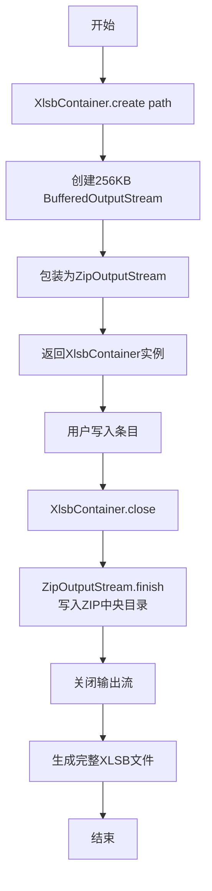

**预期结果**：
- 创建有效的ZIP容器结构
- 支持写入多个条目
- 资源安全释放

**技术要点**：
- 256KB缓冲区优化磁盘IO
- BufferedOutputStream → ZipOutputStream → File三层包装
- AutoCloseable接口确保异常时也能释放资源
- finish()方法写入ZIP中央目录，close()关闭流

---

#### 场景2: ZIP条目写入

**触发条件**：写入BIFF12二进制数据或OOXML XML文件到ZIP容器

**业务流程**：
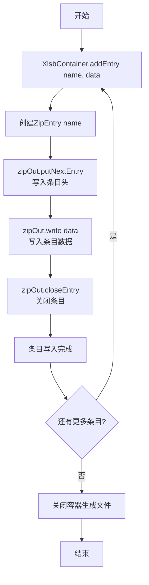

**预期结果**：
- 条目正确写入ZIP容器
- 条目名称符合OOXML规范
- 数据完整无误

**技术要点**：
- addEntry支持完整byte[]和offset/length偏移写入
- ZipEntry名称必须符合OOXML路径规范（如xl/workbook.bin）
- 条目写入顺序不影响ZIP结构
- 条目可以是二进制（.bin）或XML（.xml）

---

#### 场景3: ZIP容器读取

**触发条件**：XlsbReader打开XLSB文件时读取ZIP容器结构

**业务流程**：
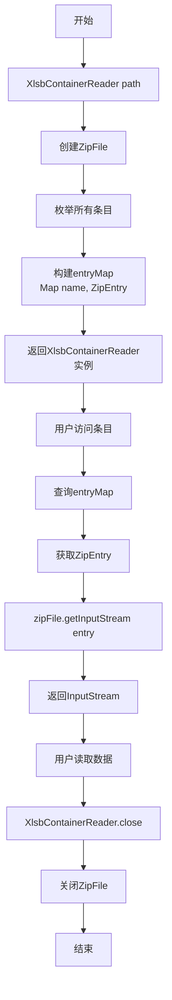

**预期结果**：
- 正确解析ZIP容器结构
- 快速查询任意条目
- 资源安全释放

**技术要点**：
- ZipFile使用内存映射技术，读取效率高
- entryMap构建避免重复枚举，提升查询性能
- ZipFile.getInputStream返回条目输入流
- InputStream由ZipFile管理，关闭容器时自动释放

---

#### 场景4: 条目流获取

**触发条件**：用户需要读取ZIP容器中特定条目的数据

**业务流程**：
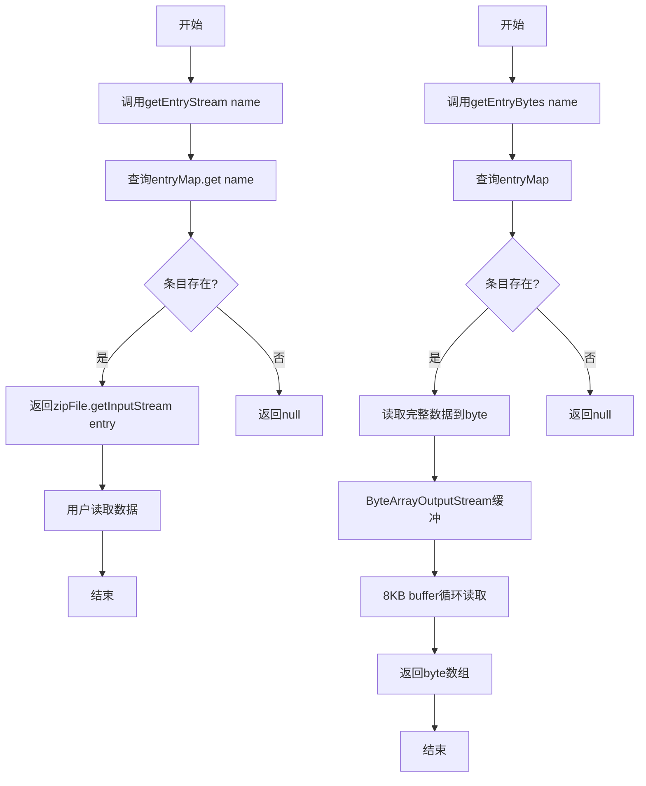

**预期结果**：
- getEntryStream返回InputStream（流式访问）
- getEntryBytes返回byte[]（一次性读取）
- 条目不存在返回null

**技术要点**：
- getEntryStream适合大文件流式处理
- getEntryBytes适合小文件一次性读取
- getEntryBytes使用8KB缓冲区循环读取
- 返回null而非抛异常，由调用方处理缺失场景

---

#### 场景5: Sheet条目访问

**触发条件**：访问worksheet.bin、workbook.bin、sharedStrings.bin等核心Sheet条目

**业务流程**：
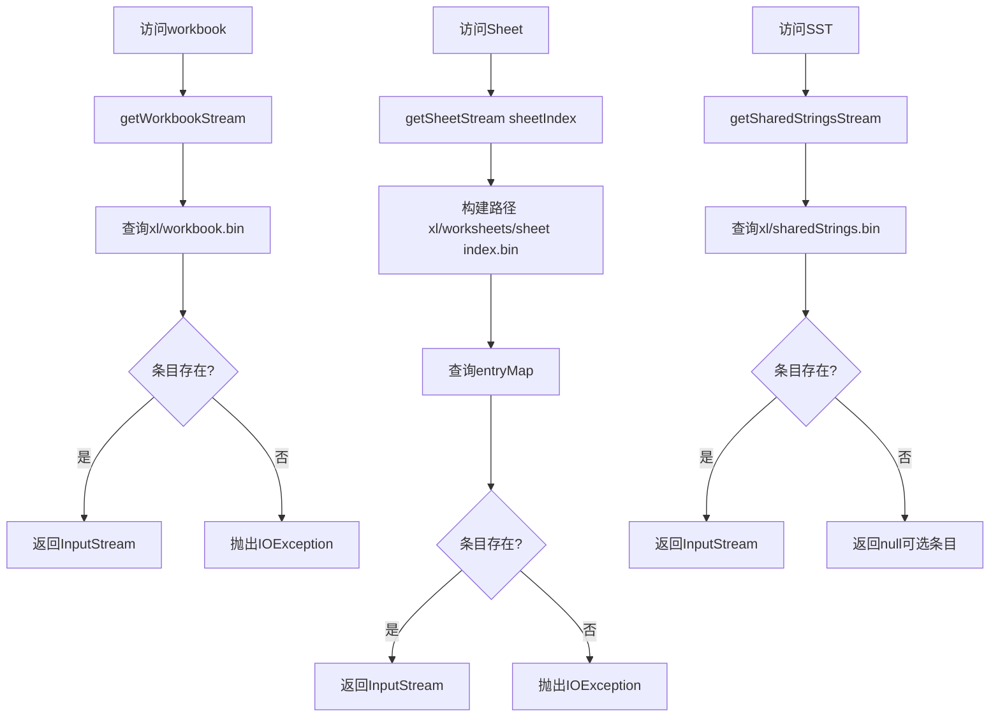

**预期结果**：
- workbook.bin必须存在，缺失抛异常
- worksheet.bin必须存在，缺失抛异常
- sharedStrings.bin可选，缺失返回null
- styles.bin、theme.xml可选

**技术要点**：
- workbook.bin路径：xl/workbook.bin
- worksheet.bin路径：xl/worksheets/sheet{index+1}.bin
- sharedStrings.bin路径：xl/sharedStrings.bin
- styles.bin路径：xl/styles.bin
- theme.xml路径：xl/theme/theme1.xml
- drawing.xml路径：xl/drawings/drawing{index+1}.xml

---

#### 场景6: Content_Types生成

**触发条件**：XlsbWriter初始化时生成[Content_Types].xml

**业务流程**：
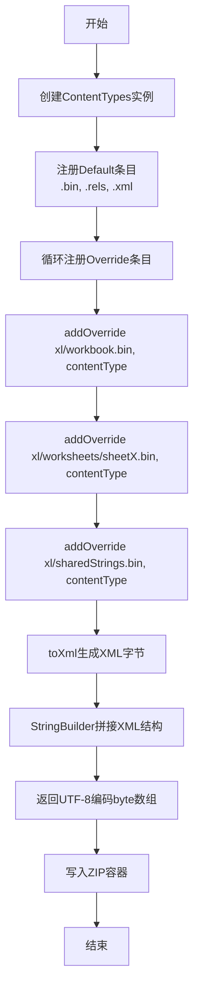

**预期结果**：
- 生成符合OOXML规范的[Content_Types].xml
- Default条目定义默认扩展名映射
- Override条目定义特定条目类型

**技术要点**：
- Default Extension=.bin → application/vnd.ms-excel.sheet.binary.macroEnabled.main
- Default Extension=.rels → application/vnd.openxmlformats-package.relationships+xml
- Default Extension=.xml → application/xml
- Override PartName=/xl/workbook.bin → application/vnd.ms-excel.sheet.binary.macroEnabled.main
- Override PartName=/xl/worksheets/sheet1.bin → application/vnd.ms-excel.worksheet
- XML使用StringBuilder拼接，UTF-8编码

---

#### 场景7: 关系文件生成

**触发条件**：XlsbWriter生成根目录和workbook的关系文件

**业务流程**：
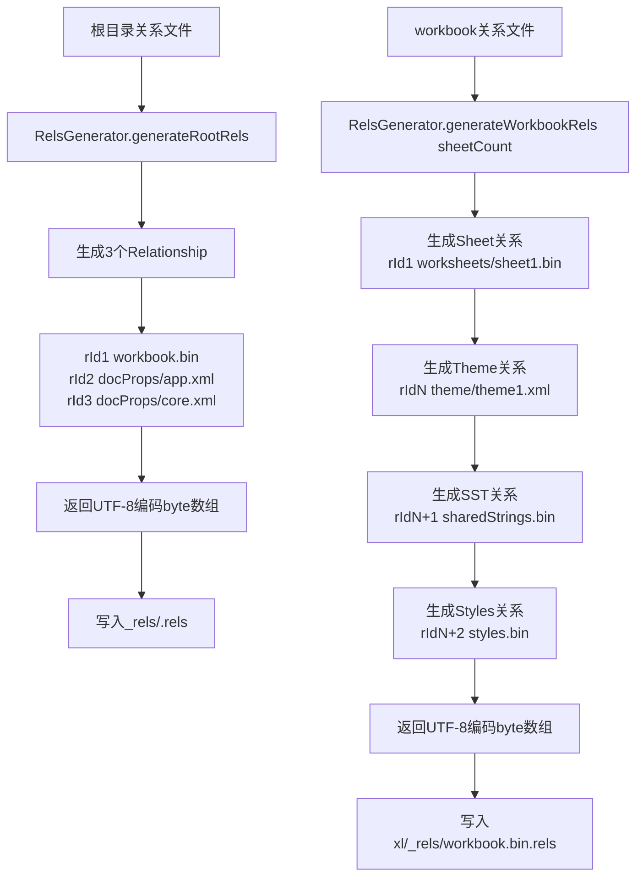

**预期结果**：
- 根目录关系文件包含workbook、docProps关系
- workbook关系文件包含Sheet、Theme、SST、Styles关系
- 关系ID顺序递增

**技术要点**：
- 根目录关系文件路径：_rels/.rels
- workbook关系文件路径：xl/_rels/workbook.bin.rels
- 关系ID格式：rId1, rId2, rId3...
- 关系类型：officeDocument、worksheet、theme、sharedStrings、styles
- Target路径相对于关系文件所在目录

---

#### 场景8: XML模板生成

**触发条件**：XlsbWriter生成theme.xml、core.xml、app.xml

**业务流程**：
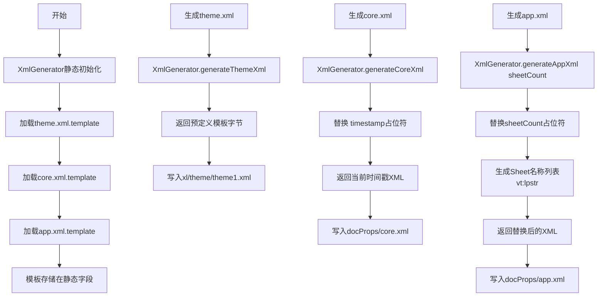

**预期结果**：
- theme.xml包含标准Office主题定义
- core.xml包含创建时间、修改时间等元数据
- app.xml包含Sheet数量和名称列表

**技术要点**：
- 模板文件存储在jxlsb/theme.xml.template等路径
- 静态初始化加载模板，避免重复IO
- 占位符格式：${timestamp}、${sheetCount}、${sheetNames}
- 正则表达式Pattern.compile("\\$\\{timestamp\\}")替换
- UTF-8编码输出

---

#### 场景9: Sheet元信息管理

**触发条件**：WorkbookReader解析workbook.bin时提取Sheet列表，或XlsbWriter写入Sheet时记录元信息

**业务流程**：
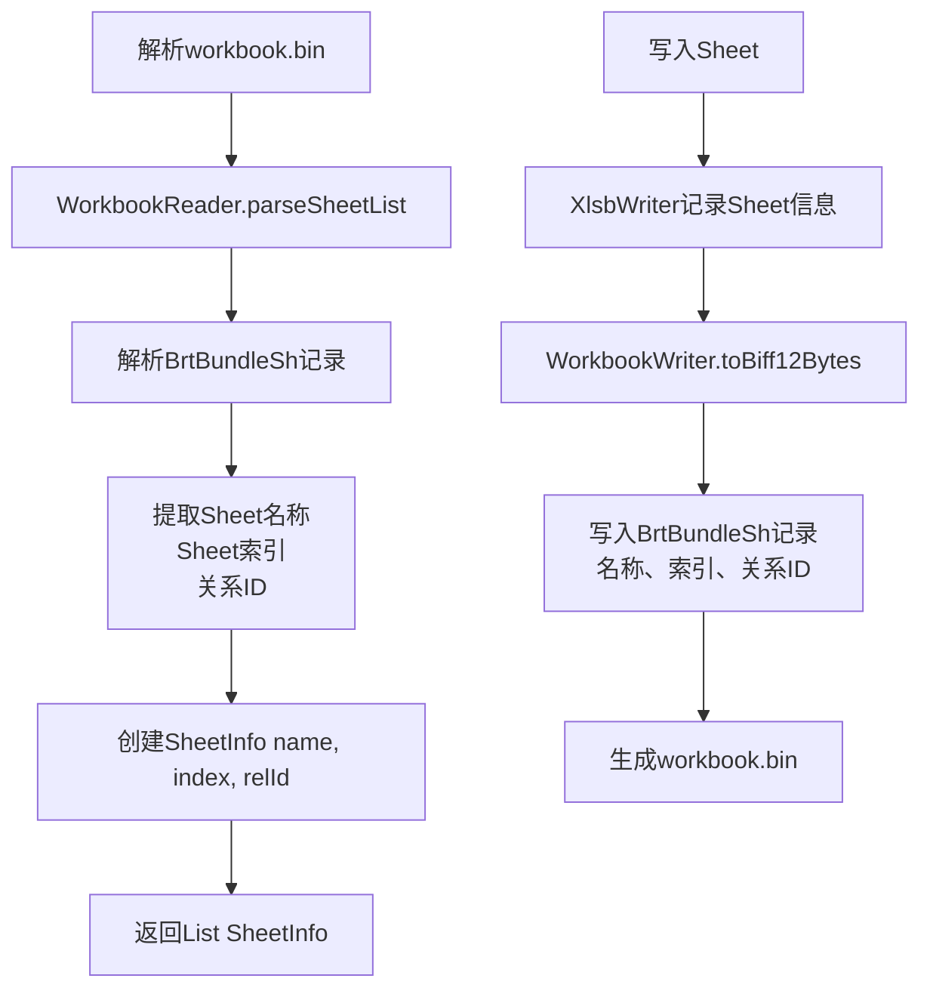

**预期结果**：
- SheetInfo包含name、index、relId三个属性
- 支持toString输出调试信息
- WorkbookReader和WorkbookWriter共享SheetInfo结构

**技术要点**：
- name：Sheet显示名称（如Sheet1、Sheet2）
- index：Sheet索引（从0开始）
- relId：关系ID（如rId1、rId2）
- SheetInfo是不可变对象（final类、final字段）
- 提供getter方法但不提供setter

---

#### 场景10: 模板条目复制

**触发条件**：XlsbWriter模板模式下复制模板的styles.bin、theme.xml等条目

**业务流程**：
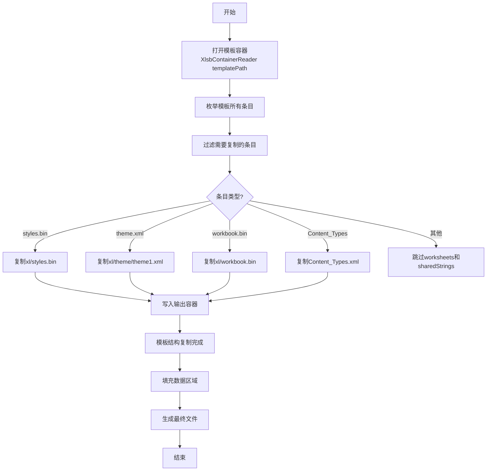

**预期结果**：
- 复制模板的所有非数据条目
- styles.bin、theme.xml、Content_Types.xml完整保留
- 跳过worksheets和sharedStrings（由填充数据生成）

**技术要点**：
- 过滤规则：排除xl/worksheets/*.bin和xl/sharedStrings.bin
- 复制方式：读取模板条目字节 → 写入输出容器
- workbook.bin需要特殊处理（同步Sheet信息）
- 合并单元格信息从模板Sheet中解析

---

## 功能需求

### 核心功能

| 序号 | 功能名称 | 功能描述 | 输入 | 输出 | 实现类 |
|------|----------|----------|------|------|--------|
| F01 | ZIP容器创建 | 创建空白ZIP容器 | Path | XlsbContainer实例 | XlsbContainer.create |
| F02 | ZIP条目写入 | 写入完整byte[]条目 | name, byte[] | 写入完成 | XlsbContainer.addEntry |
| F03 | ZIP条目偏移写入 | 写入byte[]偏移部分 | name, byte[], offset, length | 写入完成 | XlsbContainer.addEntry |
| F04 | ZIP容器关闭 | 关闭容器生成完整文件 | 无 | 文件生成 | XlsbContainer.close |
| F05 | ZIP容器打开 | 打开现有ZIP容器 | Path | XlsbContainerReader实例 | XlsbContainerReader构造 |
| F06 | 条目流获取 | 获取条目InputStream | name | InputStream或null | XlsbContainerReader.getEntryStream |
| F07 | 条目字节获取 | 获取条目完整byte[] | name | byte[]或null | XlsbContainerReader.getEntryBytes |
| F08 | Workbook条目访问 | 获取workbook.bin流 | 无 | InputStream | XlsbContainerReader.getWorkbookStream |
| F09 | Sheet条目访问 | 获取worksheet.bin流 | sheetIndex | InputStream | XlsbContainerReader.getSheetStream |
| F10 | SST条目访问 | 获取sharedStrings.bin流 | 无 | InputStream或null | XlsbContainerReader.getSharedStringsStream |
| F11 | Sheet信息查询 | 查询所有Sheet元信息 | 无 | List<SheetInfo> | XlsbContainerReader.getSheetInfos |
| F12 | Content_Types生成 | 生成[Content_Types].xml | 无 | byte[] | ContentTypes.toXml |
| F13 | Override注册 | 注册Override内容类型 | partName, contentType | 注册完成 | ContentTypes.addOverride |
| F14 | 根关系生成 | 生成_rels/.rels | 无 | byte[] | RelsGenerator.generateRootRels |
| F15 | Workbook关系生成 | 生成xl/_rels/workbook.bin.rels | sheetCount, hasSharedStrings | byte[] | RelsGenerator.generateWorkbookRels |
| F16 | Theme生成 | 生成theme.xml | 无 | byte[] | XmlGenerator.generateThemeXml |
| F17 | Core生成 | 生成core.xml | 无 | byte[] | XmlGenerator.generateCoreXml |
| F18 | App生成 | 生成app.xml | sheetCount | byte[] | XmlGenerator.generateAppXml |
| F19 | Sheet元信息创建 | 创建SheetInfo实例 | name, index, relId | SheetInfo实例 | SheetInfo构造 |

---

### 辅助功能

| 序号 | 功能名称 | 功能描述 | 输入 | 输出 | 实现类 |
|------|----------|----------|------|------|--------|
| A01 | 条目名称枚举 | 获取所有条目名称 | 无 | Set<String> | XlsbContainerReader.getAllEntryNames |
| A02 | SST存在判断 | 判断是否有sharedStrings.bin | 无 | boolean | XlsbContainerReader.hasSharedStrings |
| A03 | Styles存在判断 | 判断是否有styles.bin | 无 | boolean | XlsbContainerReader.hasStyles |
| A04 | Theme存在判断 | 判断是否有theme.xml | 无 | boolean | XlsbContainerReader.hasTheme |
| A05 | Styles流获取 | 获取styles.bin流 | 无 | InputStream或null | XlsbContainerReader.getStylesStream |
| A06 | Theme流获取 | 获取theme.xml流 | 无 | InputStream或null | XlsbContainerReader.getThemeStream |
| A07 | Drawing流获取 | 获取drawing.xml流 | drawingIndex | InputStream或null | XlsbContainerReader.getDrawingStream |
| A08 | SheetInfo调试输出 | toString输出调试信息 | 无 | String | SheetInfo.toString |

---

## 业务规则

### ZIP条目命名规则

| 规则ID | 规则名称 | 规则描述 | 路径示例 |
|--------|----------|----------|----------|
| ZIP-001 | Workbook路径 | workbook.bin路径固定 | xl/workbook.bin |
| ZIP-002 | Worksheet路径 | Sheet条目按索引命名 | xl/worksheets/sheet{index+1}.bin |
| ZIP-003 | SST路径 | sharedStrings.bin路径固定 | xl/sharedStrings.bin |
| ZIP-004 | Styles路径 | styles.bin路径固定 | xl/styles.bin |
| ZIP-005 | Theme路径 | theme.xml路径固定 | xl/theme/theme1.xml |
| ZIP-006 | Drawing路径 | drawing.xml按索引命名 | xl/drawings/drawing{index+1}.xml |
| ZIP-007 | 根关系路径 | 根目录关系文件路径 | _rels/.rels |
| ZIP-008 | Workbook关系路径 | workbook关系文件路径 | xl/_rels/workbook.bin.rels |
| ZIP-009 | Content_Types路径 | 内容类型文件路径 | [Content_Types].xml |
| ZIP-010 | DocProps路径 | 文档属性路径 | docProps/core.xml, docProps/app.xml |

### Content_Types规则

| 规则ID | 规则名称 | 规则描述 | 代码位置 |
|--------|----------|----------|----------|
| CT-001 | Default条目必须 | .bin/.rels/.xml三种Default必须存在 | ContentTypes:19-21 |
| CT-002 | Override条目按需 | workbook、worksheets、sst等Override按需注册 | ContentTypes:23-26 |
| CT-003 | .bin类型 | application/vnd.ms-excel.sheet.binary.macroEnabled.main | ContentTypes:19 |
| CT-004 | .rels类型 | application/vnd.openxmlformats-package.relationships+xml | ContentTypes:20 |
| CT-005 | .xml类型 | application/xml | ContentTypes:21 |
| CT-006 | PartName前缀 | PartName需要添加/前缀 | ContentTypes:24 |

### 关系文件规则

| 规则ID | 规则名称 | 规则描述 | 代码位置 |
|--------|----------|----------|----------|
| REL-001 | 根关系固定 | 根目录关系文件固定包含3个Relationship | RelsGenerator:7-15 |
| REL-002 | workbook关系 | rId1指向xl/workbook.bin | RelsGenerator:11 |
| REL-003 | app.xml关系 | rId2指向docProps/app.xml | RelsGenerator:13 |
| REL-004 | core.xml关系 | rId3指向docProps/core.xml | RelsGenerator:12 |
| REL-005 | Sheet关系顺序 | Sheet关系rId从1开始递增 | RelsGenerator:25-29 |
| REL-006 | Theme关系固定 | Theme关系在Sheet之后 | RelsGenerator:31-33 |
| REL-007 | SST关系可选 | hasSharedStrings参数控制是否添加 | RelsGenerator:35-39 |
| REL-008 | Styles关系必须 | Styles关系在最后 | RelsGenerator:41-43 |
| REL-009 | Target相对路径 | Target相对于关系文件所在目录 | RelsGenerator:28,33,38,43 |

### XML模板规则

| 规则ID | 规则名称 | 规则描述 | 代码位置 |
|--------|----------|----------|----------|
| XML-001 | 模板预加载 | 静态初始化加载3个模板文件 | XmlGenerator:21-25 |
| XML-002 | 模板路径固定 | jxlsb/theme.xml.template等固定路径 | XmlGenerator:22-24 |
| XML-003 | timestamp占位符 | ${timestamp}替换为当前时间戳 | XmlGenerator:47-49 |
| XML-004 | sheetCount占位符 | ${sheetCount}替换为Sheet数量 | XmlGenerator:58 |
| XML-005 | sheetNames占位符 | ${sheetNames}替换为Sheet名称列表 | XmlGenerator:53-56 |
| XML-006 | Sheet名称格式 | vt:lpstr包装Sheet名称 | XmlGenerator:54-55 |
| XML-007 | UTF-8编码 | 所有XML使用UTF-8编码输出 | XmlGenerator:43,49,59 |

### SheetInfo规则

| 规则ID | 规则名称 | 规则描述 | 代码位置 |
|--------|----------|----------|----------|
| SI-001 | 不可变设计 | SheetInfo为final类，字段为final | SheetInfo:11,13-15 |
| SI-002 | 构造必须完整 | name/index/relId三个参数必须提供 | SheetInfo:17-21 |
| SI-003 | getter只读 | 仅提供getter方法，无setter | SheetInfo:23-33 |
| SI-004 | toString调试 | toString输出格式固定 | SheetInfo:36-38 |

---

## 数据需求

### 数据实体

#### SheetInfo（Sheet元信息）

| 属性名称 | 数据类型 | 描述 | 来源 |
|----------|----------|------|------|
| name | String | Sheet显示名称 | WorkbookReader解析或用户指定 |
| index | int | Sheet索引（从0开始） | WorkbookReader解析或自动分配 |
| relId | String | 关系ID（如rId1） | WorkbookReader解析或自动生成 |

#### Override（Content_Types Override条目）

| 属性名称 | 数据类型 | 描述 | 来源 |
|----------|----------|------|------|
| partName | String | 条目路径（如/xl/workbook.bin） | 用户注册 |
| contentType | String | 内容类型 | 用户注册 |

---

### 数据流转

#### ZIP写入数据流

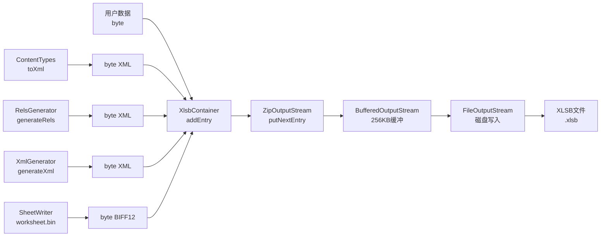

#### ZIP读取数据流

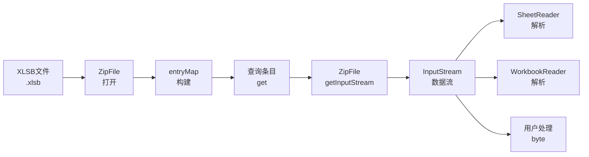

#### OOXML结构数据流

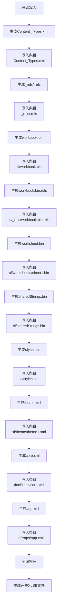

---

## 非功能需求

### 性能要求

| 性能指标 | 目标值 | 实现方式 | 验证方法 |
|----------|--------|----------|----------|
| 写入缓冲区 | 256KB | BufferedOutputStream | 代码审查 |
| 条目查询速度 | < 1ms | entryMap预构建 | 性能测试 |
| ZIP读取效率 | 内存映射 | ZipFile实现 | JDK优化 |
| 字节读取缓冲区 | 8KB | ByteArrayInputStream | 代码审查 |
| XML生成效率 | StringBuilder拼接 | 避免DOM开销 | 代码审查 |
| 模板加载效率 | 静态预加载 | 避免重复IO | 代码审查 |

---

### 安全要求

| 安全要求 | 实现方式 |
|----------|----------|
| 资源释放 | AutoCloseable接口，确保异常时也能关闭 |
| 异常链保存 | close()方法保存第一个异常，后续异常不丢失 |
| 空值处理 | getEntryStream/getEntryBytes返回null而非抛异常 |
| 条目校验 | workbook.bin/worksheet.bin缺失抛明确IOException |
| 模板加载校验 | Objects.requireNonNull校验模板文件存在 |

---

### 可用性要求

| 可用性要求 | 实现方式 |
|------------|----------|
| 流式写入 | ZipOutputStream流式写入，无需预知总大小 |
| 条目灵活访问 | getEntryStream/getEntryBytes两种访问方式 |
| 条目枚举 | getAllEntryNames提供完整条目列表 |
| 元信息查询 | getSheetInfos提供Sheet列表信息 |
| OOXML封装 | ContentTypes/RelsGenerator/XmlGenerator封装复杂结构 |

---

### 兼容性要求

| 兼容性类型 | 要求 |
|------------|------|
| JDK版本 | Java 8+（使用ZipFile/ZipOutputStream） |
| ZIP规范 | ZIP 2.0标准 |
| OOXML规范 | Office Open XML标准 |
| Excel兼容 | Excel 2007+/WPS可正常打开 |
| 操作系统 | 跨平台（Linux/Windows/macOS） |

---

## 约束条件

### 业务约束

| 约束ID | 约束名称 | 约束描述 | 影响范围 |
|--------|----------|----------|----------|
| BC-001 | 条目顺序无关 | ZIP条目写入顺序不影响最终结构 | XlsbContainer |
| BC-002 | Workbook必须存在 | workbook.bin必须存在，缺失抛异常 | XlsbContainerReader |
| BC-003 | Worksheet必须存在 | worksheet.bin必须存在，缺失抛异常 | XlsbContainerReader |
| BC-004 | SST可选 | sharedStrings.bin可选，缺失返回null | XlsbContainerReader |
| BC-005 | Theme可选 | theme.xml可选，缺失返回null | XlsbContainerReader |
| BC-006 | Styles可选 | styles.bin可选，缺失返回null | XlsbContainerReader |

### 技术约束

| 约束ID | 约束名称 | 约束描述 | 影响范围 |
|--------|----------|----------|----------|
| TC-001 | ZIP格式 | XLSB本质为ZIP容器 | Container层 |
| TC-002 | OOXML标准 | 需遵循Office Open XML规范 | OOXML结构 |
| TC-003 | 依赖限制 | 仅使用java.util.zip包 | 无第三方依赖 |
| TC-004 | 小端序 | BIFF12使用小端序 | 不影响Container层 |
| TC-005 | UTF-8编码 | XML文件使用UTF-8编码 | ContentTypes/RelsGenerator |

---

## 附录

### 关键类设计

#### XlsbContainer职责

| 职责 | 描述 |
|------|------|
| ZIP容器创建 | 创建空白ZIP容器结构 |
| 条目写入 | 写入二进制/XML条目 |
| 缓冲区管理 | 256KB缓冲区优化IO |
| 资源管理 | 管理输出流生命周期 |
| 异常处理 | 确保异常时资源释放 |

#### XlsbContainerReader职责

| 职责 | 描述 |
|------|------|
| ZIP容器打开 | 打开现有ZIP容器 |
| 条目索引 | 构建entryMap快速查询 |
| 条目流获取 | 提供InputStream访问 |
| 条目字节获取 | 提供byte[]访问 |
| Sheet信息解析 | 解析Workbook获取Sheet列表 |
| 资源管理 | 管理ZipFile生命周期 |

#### ContentTypes职责

| 职责 | 描述 |
|------|------|
| Default注册 | 注册默认扩展名类型 |
| Override注册 | 注册特定条目类型 |
| XML生成 | 拼接[Content_Types].xml结构 |

#### RelsGenerator职责

| 职责 | 描述 |
|------|------|
| 根关系生成 | 生成_rels/.rels |
| Workbook关系生成 | 生成xl/_rels/workbook.bin.rels |
| 关系ID管理 | 顺序生成rId1/rId2/rId3 |

#### XmlGenerator职责

| 职责 | 描述 |
|------|------|
| 模板加载 | 静态加载XML模板 |
| 占位符替换 | 替换timestamp/sheetCount/sheetNames |
| XML生成 | 生成theme/core/app XML |

#### SheetInfo职责

| 职责 | 描述 |
|------|------|
| 元信息存储 | 存储Sheet名称/索引/关系ID |
| 不可变设计 | final类和字段 |
| 调试输出 | toString提供调试信息 |

---

### 测试场景覆盖

| 场景类型 | 测试场景 | 覆盖程度 |
|----------|----------|----------|
| ZIP写入 | 条目写入、缓冲区、异常中断 | 完整覆盖 |
| ZIP读取 | 条目访问、流获取、字节获取 | 完整覆盖 |
| OOXML生成 | Content_Types、Rels、XML模板 | 完整覆盖 |
| 边界条件 | 空文件、大文件、缺失条目 | 完整覆盖 |
| 异常场景 | 文件不存在、格式错误、权限问题 | 完整覆盖 |

---

### 技术选型理由

| 技术点 | 选型 | 理由 |
|--------|------|------|
| ZIP实现 | java.util.zip | JDK内置，无需第三方依赖 |
| 缓冲区大小 | 256KB | 平衡IO次数和内存占用 |
| 条目索引 | HashMap | 快速查询，避免重复枚举 |
| XML拼接 | StringBuilder | 避免DOM开销，性能高 |
| 模板加载 | 静态初始化 | 避免重复IO，提升效率 |
| 流式访问 | InputStream | 支持大文件流式处理 |

---

## 总结

Container模块作为jxlsb项目的ZIP容器管理层，提供了完整的ZIP容器读写能力，核心特性包括：

1. **ZIP容器管理**：XlsbContainer/XlsbContainerReader负责ZIP容器创建和读取
2. **OOXML结构生成**：ContentTypes/RelsGenerator/XmlGenerator生成OOXML规范文件
3. **Sheet元信息管理**：SheetInfo存储Sheet的名称、索引、关系ID
4. **性能优化**：256KB缓冲区、entryMap预构建、模板预加载
5. **资源安全**：AutoCloseable接口确保异常时也能释放资源
6. **灵活访问**：支持InputStream流式访问和byte[]一次性读取
7. **OOXML规范**：严格按照Office Open XML标准生成ZIP结构

该模块设计遵循了"简洁、高效、规范"的原则，为上层API提供稳定的ZIP容器基础设施。