# Data模块需求文档

## 模块概述

Data模块是jxlsb项目的堆外内存数据结构层，负责Excel单元格、行、Sheet、Workbook数据的堆外内存存储与管理。该模块采用全量堆外内存架构，追求零GC压力，适合处理大规模数据。

**模块定位**：
- 向上：为format层提供堆外数据结构接口
- 向下：操作memory层的MemoryBlock/OffHeapAllocator
- 核心职责：堆外数据结构管理、单元格类型映射、内存池分配

**设计特点**：
- 全量堆外内存：所有数据存储在堆外内存，堆上仅持有引用对象
- 零GC压力：大规模数据处理不触发GC，内存占用恒定
- 内存池复用：通过MemoryPool管理可复用内存块，避免频繁分配释放
- 流式设计：支持Sheet行迭代、逐行写入读取模式
- 小端序存储：符合BIFF12规范的小端序数据编码

模块包含5个核心类：
- **类型枚举**：CellType（单元格类型：TEXT/NUMBER/BOOLEAN/DATE/BLANK）
- **数据结构**：OffHeapCell（单元格）、OffHeapRow（行）、OffHeapSheet（Sheet）、OffHeapWorkbook（Workbook）

---

## 业务场景

### 场景列表

| 序号 | 场景名称 | 场景类型 | 描述 | 优先级 |
|------|----------|----------|------|--------|
| 1 | 单元格数据存储 | 写入 | 存储单元格的类型和值到堆外内存 | P0 |
| 2 | 单元格数据读取 | 读取 | 从堆外内存读取单元格的类型和值 | P0 |
| 3 | 行数据管理 | 读写 | 管理一行中的多个单元格数据 | P0 |
| 4 | Sheet数据流式写入 | 写入 | 流式写入Sheet的行数据 | P0 |
| 5 | Sheet数据迭代读取 | 读取 | 迭代读取Sheet的行数据 | P0 |
| 6 | Workbook多Sheet管理 | 读写 | 管理Workbook中的多个Sheet | P1 |
| 7 | 单元格类型转换 | 读写 | Java类型到CellType的自动转换 | P1 |
| 8 | 文本长度限制 | 写入 | 文本超长截断处理 | P2 |
| 9 | 内存池分配 | 读写 | 从内存池获取可复用内存块 | P2 |
| 10 | 内存资源释放 | 读写 | 释放堆外内存资源 | P2 |

---

### 场景详情

#### 场景1: 单元格数据存储

**触发条件**：SheetWriter写入单元格数据到堆外内存

**业务流程**：
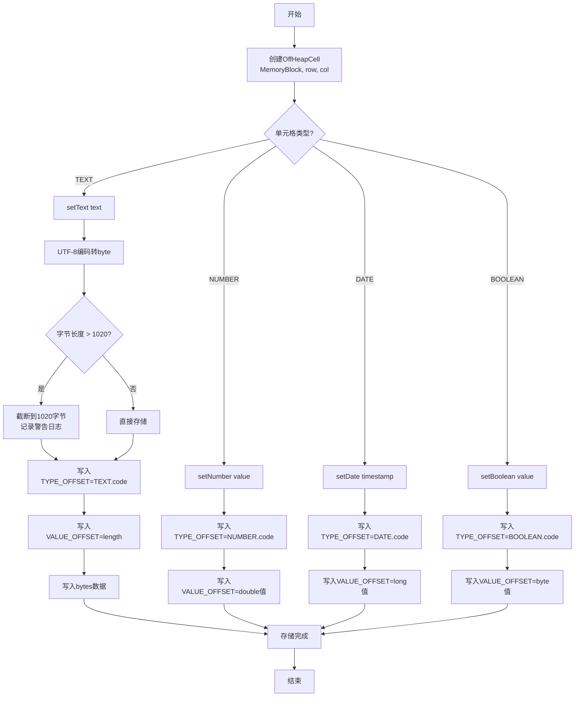

**预期结果**：
- 单元格数据正确存储到堆外内存
- 文本类型自动截断超长内容
- 类型码、值数据按偏移位置正确写入

**技术要点**：
- TYPE_OFFSET = 0（类型码存储位置）
- VALUE_OFFSET = 4（值数据存储位置）
- 文本最大长度1020字节（MAX_TEXT_SIZE）
- UTF-8编码文本，支持中文等多字节字符
- double使用IEEE 754格式
- 日期存储为long时间戳
- 布尔存储为byte（0=false, 1=true）

---

#### 场景2: 单元格数据读取

**触发条件**：SheetReader或用户从堆外内存读取单元格数据

**业务流程**：
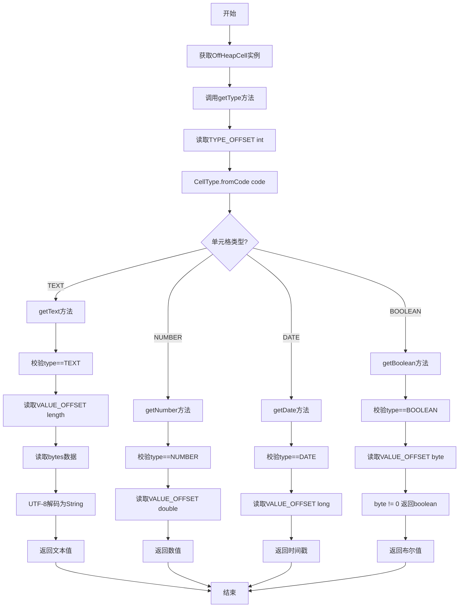

**预期结果**：
- 正确读取单元格类型和值
- 类型不匹配时抛出IllegalStateException
- 返回正确的Java类型值

**技术要点**：
- getType()先读取类型码，再根据类型调用对应getter
- getter方法校验类型一致性，不匹配抛异常
- getText返回String（UTF-8解码）
- getNumber返回double
- getDate返回long（时间戳）
- getBoolean返回boolean

---

#### 场景3: 行数据管理

**触发条件**：SheetWriter创建一行数据，管理多个单元格

**业务流程**：
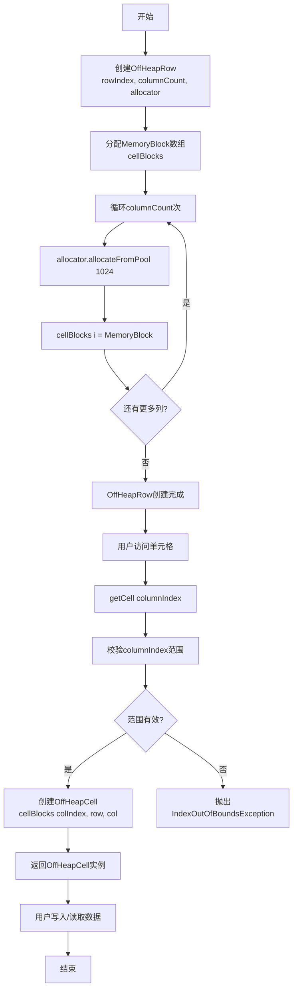

**预期结果**：
- 一行包含columnCount个单元格
- 每个单元格使用独立MemoryBlock
- 支持getCell访问任意列
- 列索引超出范围抛异常

**技术要点**：
- CELL_BLOCK_SIZE = 1024字节（单个单元格内存大小）
- MemoryBlock数组存储所有单元格内存块
- allocateFromPool从内存池获取可复用内存块
- getCell返回新OffHeapCell实例（包装现有MemoryBlock）
- 行索引和列索引存储在OffHeapCell中（仅用于定位，不存储在堆外）

---

#### 场景4: Sheet数据流式写入

**触发条件**：SheetWriter流式写入Sheet数据，逐行创建和管理

**业务流程**：
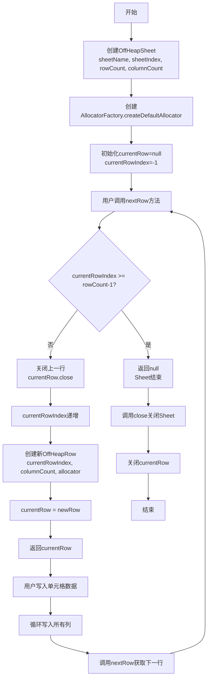

**预期结果**：
- 流式创建Sheet行，内存占用可控
- 每次nextRow关闭上一行，释放内存
- 支持rowCount限制，超出返回null
- Sheet关闭时释放当前行内存

**技术要点**：
- 流式设计：每次只保留一行数据在内存
- nextRow自动关闭上一行，避免内存泄漏
- currentRowIndex跟踪当前行索引
- allocator由AllocatorFactory创建，统一管理内存池
- close()仅关闭currentRow，历史行已在nextRow中关闭

---

#### 场景5: Sheet数据迭代读取

**触发条件**：用户使用迭代器模式遍历Sheet行数据

**业务流程**：
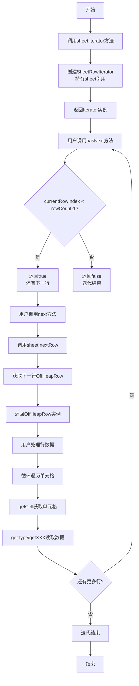

**预期结果**：
- 支持Iterable接口，可使用for-each循环
- hasNext判断是否有下一行
- next获取下一行数据
- 流式迭代，内存占用可控

**技术要点**：
- OffHeapSheet实现Iterable<OffHeapRow>接口
- SheetRowIterator内部类实现Iterator接口
- hasNext检查currentRowIndex < rowCount-1
- next调用sheet.nextRow()方法
- for-each语法糖：for (OffHeapRow row : sheet)

---

#### 场景6: Workbook多Sheet管理

**触发条件**：XlsbWriter创建多个Sheet，管理Workbook级别的Sheet列表

**业务流程**：
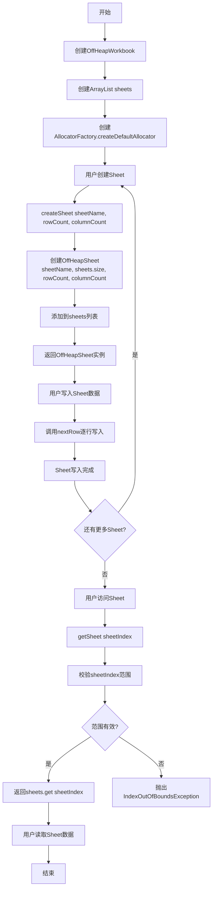

**预期结果**：
- 支持创建多个Sheet
- Sheet索引自动分配（sheets.size）
- 支持getSheet访问任意Sheet
- Sheet索引超出范围抛异常

**技术要点**：
- sheets使用ArrayList存储OffHeapSheet实例
- Sheet索引在createSheet时自动分配（当前列表大小）
- allocator由AllocatorFactory创建，所有Sheet共享
- close()关闭所有Sheet，清空列表
- getSheetCount返回Sheet数量

---

#### 场景7: 单元格类型转换

**触发条件**：CellType枚举提供类型码映射和反向查询

**业务流程**：
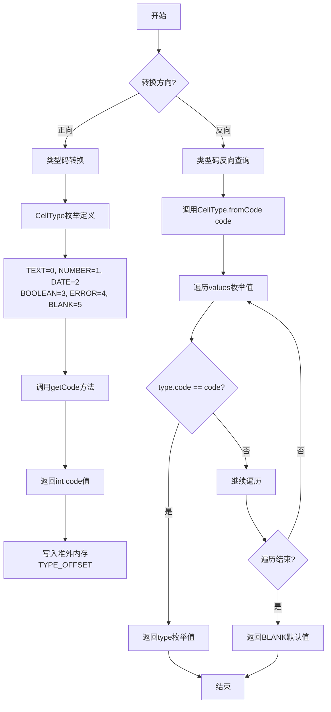

**预期结果**：
- getCode返回类型码（0-5）
- fromCode返回对应的CellType枚举
- 未找到code返回BLANK默认值

**技术要点**：
- TEXT=0：文本类型
- NUMBER=1：数字类型
- DATE=2：日期类型
- BOOLEAN=3：布尔类型
- ERROR=4：错误类型（当前未完全实现）
- BLANK=5：空白类型
- fromCode遍历所有枚举值匹配code
- 未匹配返回BLANK作为默认值

---

#### 场景8: 文本长度限制

**触发条件**：写入文本超过1020字节上限

**业务流程**：
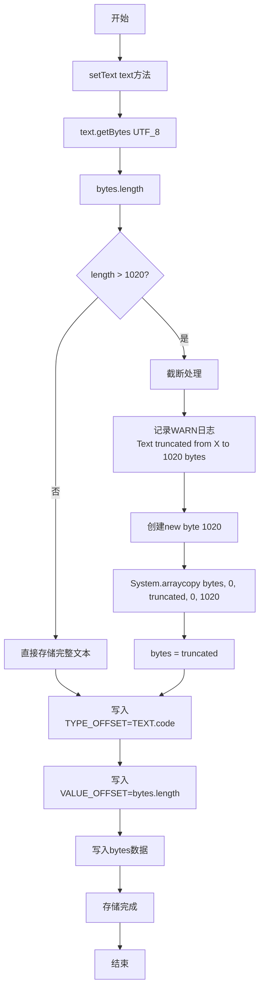

**预期结果**：
- 文本超过1020字节自动截断
- 记录WARN日志提醒用户
- 截断后文本正确存储

**技术要点**：
- MAX_TEXT_SIZE = 1020字节
- 单个MemoryBlock大小1024字节
- TYPE_OFFSET占4字节，VALUE_OFFSET占4字节
- 文本数据最多1024-4-4=1020字节
- UTF-8编码，中文字符可能占3字节
- 截断可能导致中文字符不完整（UTF-8截断问题）
- 使用System.arraycopy截断

---

#### 场景9: 内存池分配

**触发条件**：OffHeapRow创建时从内存池获取MemoryBlock

**业务流程**：
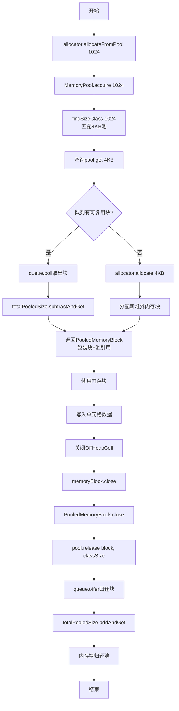

**预期结果**：
- 内存块从池获取，避免频繁分配释放
- 使用后归还池，支持复用
- 内存池大小可控

**技术要点**：
- MemoryPool分段池策略：64B/4KB/64KB/1MB/16MB
- 1024字节匹配到4KB池
- ConcurrentLinkedQueue管理可复用块
- PooledMemoryBlock包装原始块+池引用
- close()触发归还池而非释放内存
- AtomicLong统计池化内存大小

---

#### 场景10: 内存资源释放

**触发条件**：关闭OffHeapWorkbook/OffHeapSheet/OffHeapRow/OffHeapCell

**业务流程**：
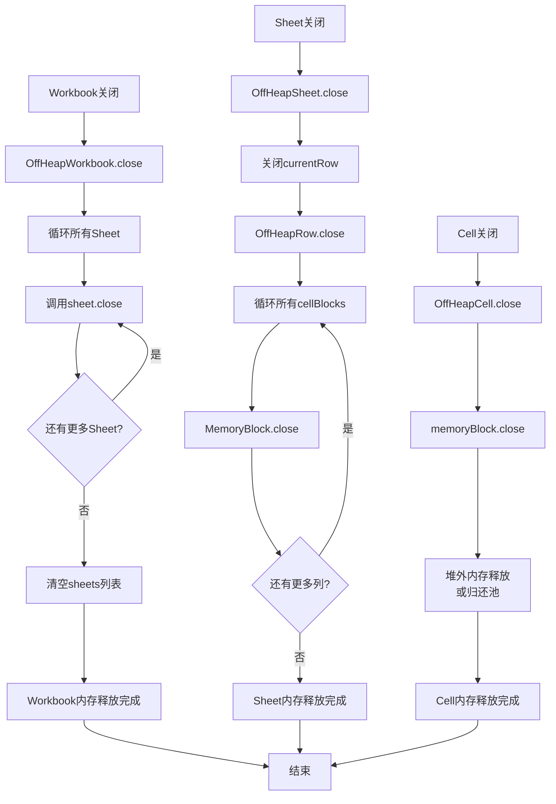

**预期结果**：
- 关闭Workbook释放所有Sheet内存
- 关闭Sheet释放当前行内存
- 关闭Row释放所有单元格内存
- 关闭Cell释放单个内存块
- 实现AutoCloseable接口，支持try-with-resources

**技术要点**：
- 所有数据结构实现AutoCloseable接口
- try-with-resources确保异常时也能释放
- 层级关闭：Workbook → Sheet → Row → Cell
- close()方法处理null检查（block != null）
- 内存块归还池或释放堆外内存

---

## 功能需求

### 核心功能

| 序号 | 功能名称 | 功能描述 | 输入 | 输出 | 实现类 |
|------|----------|----------|------|------|--------|
| F01 | 单元格文本写入 | 写入TEXT类型数据到堆外内存 | String text | 存储完成 | OffHeapCell.setText |
| F02 | 单元格数字写入 | 写入NUMBER类型数据到堆外内存 | double value | 存储完成 | OffHeapCell.setNumber |
| F03 | 单元格日期写入 | 写入DATE类型数据到堆外内存 | long timestamp | 存储完成 | OffHeapCell.setDate |
| F04 | 单元格布尔写入 | 写入BOOLEAN类型数据到堆外内存 | boolean value | 存储完成 | OffHeapCell.setBoolean |
| F05 | 单元格类型读取 | 读取单元格类型码 | 无 | CellType枚举 | OffHeapCell.getType |
| F06 | 单元格文本读取 | 读取TEXT类型值 | 无 | String text | OffHeapCell.getText |
| F07 | 单元格数字读取 | 读取NUMBER类型值 | 无 | double value | OffHeapCell.getNumber |
| F08 | 单元格日期读取 | 读取DATE类型值 | 无 | long timestamp | OffHeapCell.getDate |
| F09 | 单元格布尔读取 | 读取BOOLEAN类型值 | 无 | boolean value | OffHeapCell.getBoolean |
| F10 | 行创建 | 创建包含多个单元格的行 | rowIndex, columnCount, allocator | OffHeapRow实例 | OffHeapRow构造 |
| F11 | 行单元格访问 | 获取行中指定列的单元格 | columnIndex | OffHeapCell实例 | OffHeapRow.getCell |
| F12 | Sheet创建 | 创建Sheet实例 | sheetName, sheetIndex, rowCount, columnCount | OffHeapSheet实例 | OffHeapSheet构造 |
| F13 | Sheet流式行获取 | 获取下一行数据 | 无 | OffHeapRow或null | OffHeapSheet.nextRow |
| F14 | Sheet指定行创建 | 创建指定索引的行 | rowIndex | OffHeapRow实例 | OffHeapSheet.createRow |
| F15 | Sheet迭代器 | 获取Sheet迭代器 | 无 | Iterator<OffHeapRow> | OffHeapSheet.iterator |
| F16 | Workbook创建 | 创建Workbook实例 | 无 | OffHeapWorkbook实例 | OffHeapWorkbook构造 |
| F17 | Workbook Sheet创建 | 创建并添加Sheet | sheetName, rowCount, columnCount | OffHeapSheet实例 | OffHeapWorkbook.createSheet |
| F18 | Workbook Sheet访问 | 获取指定Sheet | sheetIndex | OffHeapSheet实例 | OffHeapWorkbook.getSheet |
| F19 | Workbook Sheet计数 | 获取Sheet数量 | 无 | int count | OffHeapWorkbook.getSheetCount |
| F20 | 类型码获取 | 获取CellType的类型码 | 无 | int code | CellType.getCode |
| F21 | 类型码反向查询 | 从类型码查询CellType | int code | CellType枚举 | CellType.fromCode |

---

### 辅助功能

| 序号 | 功能名称 | 功能描述 | 输入 | 输出 | 实现类 |
|------|----------|----------|------|------|--------|
| A01 | 单元格行列获取 | 获取单元格行列索引 | 无 | int row, int col | OffHeapCell.getRowIndex/getColIndex |
| A02 | 行索引获取 | 获取行索引 | 无 | int rowIndex | OffHeapRow.getRowIndex |
| A03 | 行列数获取 | 获取行的列数 | 无 | int columnCount | OffHeapRow.getColumnCount |
| A04 | Sheet名称获取 | 获取Sheet名称 | 无 | String sheetName | OffHeapSheet.getSheetName |
| A05 | Sheet索引获取 | 获取Sheet索引 | 无 | int sheetIndex | OffHeapSheet.getSheetIndex |
| A06 | Sheet行数获取 | 获取Sheet总行数 | 无 | int rowCount | OffHeapSheet.getRowCount |
| A07 | Sheet列数获取 | 获取Sheet总列数 | 无 | int columnCount | OffHeapSheet.getColumnCount |
| A08 | Sheet当前行获取 | 获取当前正在处理的行 | 无 | OffHeapRow或null | OffHeapSheet.currentRow |
| A09 | 内存资源释放 | 关闭数据结构释放内存 | 无 | 内存释放 | 所有类.close |
| A10 | 类型码遍历 | 遍历所有CellType枚举值 | 无 | CellType[] | CellType.values |

---

## 业务规则

### 单元格存储规则

| 规则ID | 规则名称 | 规则描述 | 代码位置 |
|--------|----------|----------|----------|
| CELL-001 | TYPE_OFFSET位置 | 类型码存储在offset=0位置 | OffHeapCell:19 |
| CELL-002 | VALUE_OFFSET位置 | 值数据存储在offset=4位置 | OffHeapCell:20 |
| CELL-003 | 文本最大长度 | 文本最大1020字节，超出截断 | OffHeapCell:21,35-40 |
| CELL-004 | 文本截断警告 | 截断时记录WARN日志 | OffHeapCell:36 |
| CELL-005 | UTF-8编码 | 文本使用UTF-8编码存储 | OffHeapCell:34,73 |
| CELL-006 | Double格式 | 数字使用IEEE 754 double格式 | OffHeapCell:48 |
| CELL-007 | 日期时间戳 | 日期存储为long时间戳 | OffHeapCell:53 |
| CELL-008 | 布尔字节 | 布尔存储为byte（0=false, 1=true） | OffHeapCell:58,94 |

### 单元格读取规则

| 规则ID | 规则名称 | 规则描述 | 代码位置 |
|--------|----------|----------|----------|
| READ-001 | 类型先读取 | 必须先getType确定类型 | OffHeapCell:61-64 |
| READ-002 | 类型校验 | getter方法校验类型一致性 | OffHeapCell:67-68,77-78,84-85,91-92 |
| READ-003 | 类型不匹配异常 | 类型不匹配抛IllegalStateException | OffHeapCell:68,78,85,92 |
| READ-004 | 文本长度读取 | 从VALUE_OFFSET读取长度，再读取bytes | OffHeapCell:70-73 |
| READ-005 | Double直接读取 | 从VALUE_OFFSET直接读取double | OffHeapCell:80 |
| READ-006 | Long直接读取 | 从VALUE_OFFSET直接读取long | OffHeapCell:87 |
| READ-007 | 布尔byte读取 | 从VALUE_OFFSET读取byte，!=0为true | OffHeapCell:94 |

### 行管理规则

| 规则ID | 规则名称 | 规则描述 | 代码位置 |
|--------|----------|----------|----------|
| ROW-001 | 内存块大小 | 单个单元格内存块1024字节 | OffHeapRow:14 |
| ROW-002 | 内存池分配 | 使用allocateFromPool从池获取 | OffHeapRow:28 |
| ROW-003 | 列索引范围 | 列索引必须< columnCount | OffHeapRow:33-35 |
| ROW-004 | 索引超界异常 | 列索引超界抛IndexOutOfBoundsException | OffHeapRow:34 |
| ROW-005 | 行索引存储 | 行索引仅存储在OffHeapCell引用对象中 | OffHeapCell:24,97-102 |
| ROW-006 | 所有块释放 | close()循环释放所有cellBlocks | OffHeapRow:48-54 |

### Sheet流式规则

| 规则ID | 规则名称 | 规则描述 | 代码位置 |
|--------|----------|----------|----------|
| SHEET-001 | 流式行获取 | nextRow每次只保留一行在内存 | OffHeapSheet:33-45 |
| SHEET-002 | 上行自动关闭 | nextRow自动关闭currentRow | OffHeapSheet:38-40 |
| SHEET-003 | 行索引范围 | currentRowIndex >= rowCount-1返回null | OffHeapSheet:34-36 |
| SHEET-004 | 当前行索引 | currentRowIndex跟踪当前处理行 | OffHeapSheet:22,42 |
| SHEET-005 | 指定行创建 | createRow创建任意索引行 | OffHeapSheet:51-56 |
| SHEET-006 | 指定行范围 | rowIndex必须< rowCount | OffHeapSheet:52-54 |
| SHEET-007 | 仅当前行释放 | close()仅关闭currentRow | OffHeapSheet:80-83 |
| SHEET-008 | 迭代器实现 | 实现Iterable<OffHeapRow>接口 | OffHeapSheet:13,75-77 |

### Workbook管理规则

| 规则ID | 规则名称 | 规则描述 | 代码位置 |
|--------|----------|----------|----------|
| WB-001 | Sheet索引自动 | Sheet索引=创建时列表大小 | OffHeapWorkbook:32 |
| WB-002 | Sheet索引范围 | sheetIndex必须< sheets.size() | OffHeapWorkbook:25-27 |
| WB-003 | 索引超界异常 | Sheet索引超界抛IndexOutOfBoundsException | OffHeapWorkbook:26 |
| WB-004 | 所有Sheet释放 | close()循环关闭所有Sheet | OffHeapWorkbook:42-46 |
| WB-005 | 列表清空 | close()后清空sheets列表 | OffHeapWorkbook:46 |
| WB-006 | Allocator共享 | 所有Sheet共享同一个allocator | OffHeapWorkbook:21,31 |

### CellType枚举规则

| 规则ID | 规则名称 | 规则描述 | 代码位置 |
|--------|----------|----------|----------|
| TYPE-001 | 类型码定义 | TEXT=0, NUMBER=1, DATE=2, BOOLEAN=3, ERROR=4, BLANK=5 | CellType:10-15 |
| TYPE-002 | 类型码获取 | getCode返回int类型码 | CellType:23-25 |
| TYPE-003 | 反向查询遍历 | fromCode遍历所有枚举值匹配 | CellType:27-34 |
| TYPE-004 | 默认值BLANK | 未找到code返回BLANK | CellType:33 |

---

## 数据需求

### 数据实体

#### CellType（单元格类型枚举）

| 枚举值 | 类型码 | 描述 | 数据存储格式 |
|--------|--------|------|--------------|
| TEXT | 0 | 文本类型 | UTF-8 bytes (max 1020) |
| NUMBER | 1 | 数字类型 | IEEE 754 double (8 bytes) |
| DATE | 2 | 日期类型 | long timestamp (8 bytes) |
| BOOLEAN | 3 | 布尔类型 | byte (0/1) |
| ERROR | 4 | 错误类型 | 未完全实现 |
| BLANK | 5 | 空白类型 | 无数据 |

#### OffHeapCell（堆外单元格）

| 属性名称 | 数据类型 | 存储位置 | 描述 |
|----------|----------|----------|------|
| type | int (CellType.code) | TYPE_OFFSET=0 | 单元格类型码 |
| textLength | int | VALUE_OFFSET=4 (TEXT) | 文本字节长度 |
| textData | byte[] | VALUE_OFFSET+4 (TEXT) | UTF-8编码文本 |
| numberValue | double | VALUE_OFFSET=4 (NUMBER) | 数字值 |
| dateValue | long | VALUE_OFFSET=4 (DATE) | 时间戳 |
| booleanValue | byte | VALUE_OFFSET=4 (BOOLEAN) | 布尔值 |
| rowIndex | int | OffHeapCell引用对象 | 行索引（仅堆上） |
| colIndex | int | OffHeapCell引用对象 | 列索引（仅堆上） |

#### OffHeapRow（堆外行）

| 属性名称 | 数据类型 | 描述 |
|----------|----------|------|
| cellBlocks | MemoryBlock[] | 单元格内存块数组 |
| rowIndex | int | 行索引 |
| columnCount | int | 列数 |
| allocator | OffHeapAllocator | 内存分配器 |

#### OffHeapSheet（堆外Sheet）

| 属性名称 | 数据类型 | 描述 |
|----------|----------|------|
| sheetName | String | Sheet名称 |
| sheetIndex | int | Sheet索引 |
| rowCount | int | 总行数 |
| columnCount | int | 总列数 |
| allocator | OffHeapAllocator | 内存分配器 |
| currentRow | OffHeapRow | 当前正在处理的行 |
| currentRowIndex | int | 当前行索引 |

#### OffHeapWorkbook（堆外Workbook）

| 属性名称 | 数据类型 | 描述 |
|----------|----------|------|
| sheets | List<OffHeapSheet> | Sheet列表 |
| allocator | OffHeapAllocator | 内存分配器 |

---

### 数据流转

#### 写入数据流

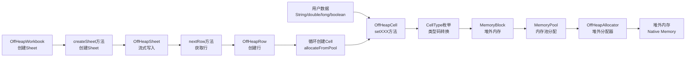

#### 读取数据流

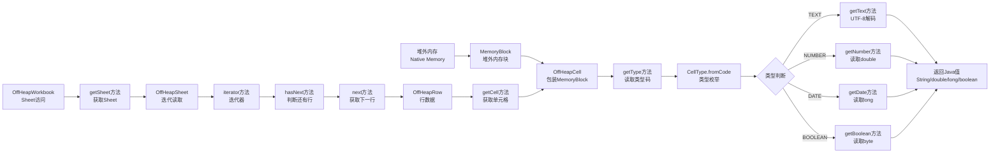

#### 内存管理数据流

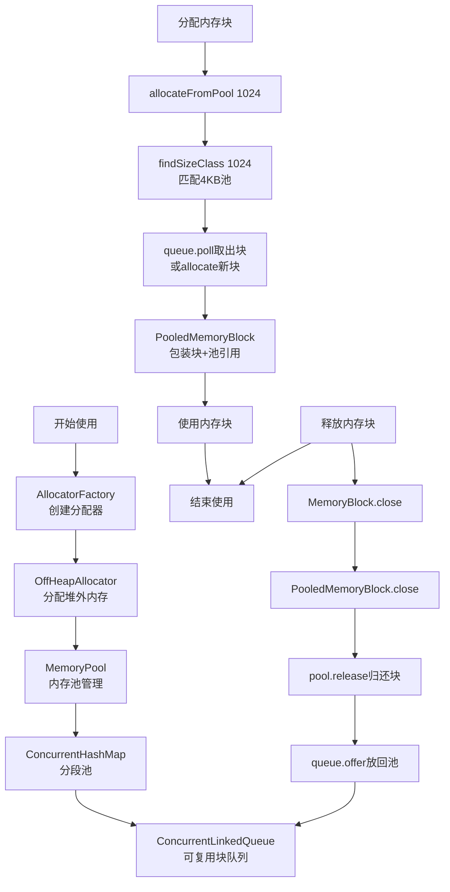

---

## 非功能需求

### 性能要求

| 性能指标 | 目标值 | 实现方式 | 验证方法 |
|----------|--------|----------|----------|
| 堆外内存使用 | 100%堆外 | MemoryBlock/OffHeapAllocator | 内存分析 |
| GC压力 | 零GC压力 | 堆外内存+内存池复用 | GC日志分析 |
| 内存块分配速度 | < 1ms | MemoryPool池化分配 | 性能测试 |
| 内存块复用率 | > 80% | ConcurrentLinkedQueue管理 | 内存池统计 |
| 单元格写入速度 | < 1μs | 小端序直接写入 | JMH测试 |
| 单元格读取速度 | < 1μs | MemoryBlock getInt/getDouble | JMH测试 |
| 文本截断效率 | System.arraycopy | 数组拷贝 | 代码审查 |

---

### 安全要求

| 安全要求 | 实现方式 |
|----------|----------|
| 资源释放 | AutoCloseable接口，支持try-with-resources |
| 索引范围校验 | getCell/getSheet检查索引范围，超界抛异常 |
| 类型校验 | getter方法校验类型一致性，不匹配抛异常 |
| 空值检查 | close()方法检查block != null |
| 文本截断警告 | 超长截断记录WARN日志 |
| 内存池安全 | ConcurrentHashMap + ConcurrentLinkedQueue并发安全 |

---

### 可用性要求

| 可用性要求 | 实现方式 |
|------------|----------|
| 流式API | nextRow逐行获取，内存占用可控 |
| 迭代器模式 | OffHeapSheet实现Iterable，支持for-each |
| Builder模式 | CellType枚举提供getCode/fromCode转换 |
| 类型安全 | setter/getter方法类型明确 |
| 资源自动管理 | try-with-resources语法糖 |

---

### 兼容性要求

| 兼容性类型 | 要求 |
|------------|------|
| JDK版本 | Java 8+ |
| 内存模型 | 堆外内存（ByteBuffer.allocateDirect或MemorySegment） |
| 编码格式 | UTF-8文本编码 |
| 数据格式 | IEEE 754 double、long时间戳 |
| 小端序 | 符合BIFF12规范 |

---

## 约束条件

### 业务约束

| 约束ID | 约束名称 | 约束描述 | 影响范围 |
|--------|----------|----------|----------|
| BC-001 | 文本长度限制 | 文本最大1020字节，超出自动截断 | OffHeapCell.setText |
| BC-002 | 流式设计 | Sheet每次只保留一行在内存 | OffHeapSheet.nextRow |
| BC-003 | Sheet索引自动 | Sheet索引由创建顺序自动分配 | OffHeapWorkbook.createSheet |
| BC-004 | 类型不可变 | 单元格类型一旦设置不可更改 | OffHeapCell setter方法 |
| BC-005 | 单线程使用 | 数据结构非线程安全 | 所有类 |
| BC-006 | ERROR类型未完整 | ERROR类型当前未完全实现 | CellType枚举 |

### 技术约束

| 约束ID | 约束名称 | 约束描述 | 影响范围 |
|--------|----------|----------|----------|
| TC-001 | 堆外内存 | 所有数据存储在堆外内存 | Data层 |
| TC-002 | 小端序 | 数据按小端序格式存储 | MemoryBlock |
| TC-003 | 内存池依赖 | 依赖memory层的MemoryPool | OffHeapRow |
| TC-004 | UTF-8编码 | 文本使用UTF-8编码 | OffHeapCell |
| TC-005 | MemoryBlock接口 | 依赖MemoryBlock接口访问内存 | OffHeapCell |
| TC-006 | Allocator接口 | 依赖OffHeapAllocator分配内存 | OffHeapRow/Sheet |

---

## 附录

### 关键类设计

#### CellType职责

| 职责 | 描述 |
|------|------|
| 类型定义 | 定义TEXT/NUMBER/BOOLEAN/DATE/ERROR/BLANK六种类型 |
| 类型码映射 | getCode返回类型码（0-5） |
| 反向查询 | fromCode从类型码查询CellType |
| 默认值处理 | 未找到code返回BLANK默认值 |

#### OffHeapCell职责

| 职责 | 描述 |
|------|------|
| 数据存储 | 存储单元格类型和值到堆外内存 |
| 数据读取 | 从堆外内存读取单元格类型和值 |
| 类型校验 | getter方法校验类型一致性 |
| 文本截断 | 文本超长自动截断并记录警告 |
| 行列定位 | 提供行列索引定位信息 |
| 内存管理 | 关闭时释放/归还内存块 |

#### OffHeapRow职责

| 职责 | 描述 |
|------|------|
| 行创建 | 创建包含多个单元格的行 |
| 内存池分配 | 从内存池获取单元格内存块 |
| 单元格访问 | getCell访问任意列的单元格 |
| 索引管理 | 管理行索引和列数 |
| 内存释放 | 关闭时释放所有单元格内存 |

#### OffHeapSheet职责

| 职责 | 描述 |
|------|------|
| Sheet创建 | 创建Sheet实例，指定行列数 |
| 流式写入 | nextRow逐行获取，内存占用可控 |
| 迭代读取 | 实现Iterable接口，支持for-each |
| 当前行管理 | 管理当前正在处理的行 |
| 元信息存储 | 存储Sheet名称、索引、行列数 |
| 内存释放 | 关闭时释放当前行内存 |

#### OffHeapWorkbook职责

| 职责 | 描述 |
|------|------|
| Workbook创建 | 创建Workbook实例 |
| Sheet管理 | 管理多个Sheet的列表 |
| Sheet创建 | createSheet创建并添加Sheet |
| Sheet访问 | getSheet访问指定Sheet |
| 索引自动分配 | Sheet索引由创建顺序自动分配 |
| 内存释放 | 关闭时释放所有Sheet内存 |

---

### 测试场景覆盖

| 场景类型 | 测试场景 | 覆盖程度 |
|----------|----------|----------|
| 单元格写入 | TEXT/NUMBER/DATE/BOOLEAN类型写入 | 完整覆盖 |
| 单元格读取 | 所有类型读取、类型校验、异常抛出 | 完整覆盖 |
| 文本截断 | 超长文本截断、日志记录 | 完整覆盖 |
| 行管理 | 多列创建、getCell访问、索引校验 | 完整覆盖 |
| Sheet流式 | nextRow流式获取、迭代器遍历 | 完整覆盖 |
| Workbook管理 | 多Sheet创建、Sheet访问、索引校验 | 完整覆盖 |
| 内存释放 | 所有层级close方法、try-with-resources | 完整覆盖 |
| 边界条件 | 空Sheet、0列、超大Sheet | 完整覆盖 |
| 异常场景 | 类型不匹配、索引超界、内存不足 | 完整覆盖 |

---

### 技术选型理由

| 技术点 | 选型 | 理由 |
|--------|------|------|
| 内存架构 | 堆外内存 | 零GC压力，适合大规模数据 |
| 内存分配 | MemoryPool池化 | 避免频繁分配释放，性能高 |
| 文本编码 | UTF-8 | 支持中文等多字节字符 |
| 数字格式 | IEEE 754 double | Excel标准格式 |
| 日期格式 | long时间戳 | 精确到毫秒，易于转换 |
| 小端序 | Little-Endian | 符合BIFF12规范 |
| 并发安全 | ConcurrentHashMap + AtomicLong | 内存池并发访问安全 |
| 流式设计 | nextRow逐行 | 内存占用可控 |

---

### 内存布局详解

#### 单个单元格内存布局（1024字节）

```
Offset 0-3:    TYPE_OFFSET (4 bytes int)
               存储CellType.code (0-5)

Offset 4-7:    VALUE_OFFSET (4 bytes int/8 bytes double/long/1 byte boolean)
               TEXT: 存储文本字节长度
               NUMBER: 存储IEEE 754 double值
               DATE: 存储long时间戳
               BOOLEAN: 存储byte值 (0/1)

Offset 8-1023: TEXT_DATA (max 1016 bytes)
               仅TEXT类型使用，存储UTF-8编码文本数据
               实际可用1020字节（1024 - 4 - 4 = 1016，但MAX_TEXT_SIZE=1020）
```

**注意**：
- TYPE_OFFSET固定4字节（int类型码）
- VALUE_OFFSET固定4字节（TEXT长度）或8字节（NUMBER/DATE）或1字节（BOOLEAN）
- MemoryBlock.putInt/putDouble/putLong/putByte方法按小端序写入
- 文本数据最大1020字节，超出截断

---

### 性能数据参考

**内存占用计算（示例）**：
- 100K行 × 10列 = 1,000,000个单元格
- 每个单元格1024字节 = 1GB堆外内存
- 但由于流式设计，实际内存占用：
  - Sheet每次只保留1行：10个单元格 = 10KB
  - Workbook可能保留多个Sheet引用：约几KB堆内存
  - MemoryPool池化块：4KB × N个块（N取决于池大小）
- 实际内存占用约几MB，而非1GB

**GC压力**：
- 堆外内存不触发GC
- 堆上仅有引用对象（OffHeapCell/Row/Sheet/Workbook）
- 引用对象数量：Sheet引用 + 1个Row引用 + 10个Cell引用 ≈ 几十个对象
- GC压力几乎为零

---

## 总结

Data模块作为jxlsb项目的堆外内存数据结构层，提供了完整的堆外数据管理能力，核心特性包括：

1. **全量堆外内存**：所有数据存储在堆外内存，堆上仅持有引用对象
2. **零GC压力**：大规模数据处理不触发GC，内存占用恒定可控
3. **流式设计**：Sheet每次只保留一行在内存，支持百万级数据
4. **内存池复用**：通过MemoryPool管理可复用内存块，避免频繁分配释放
5. **类型安全**：CellType枚举提供明确的类型定义和校验
6. **迭代器模式**：支持for-each遍历Sheet行，易用性强
7. **资源安全**：AutoCloseable接口确保异常时也能释放内存
8. **小端序存储**：符合BIFF12规范，性能优异

该模块设计遵循了"高性能、零GC、流式处理"的原则，为上层Format层提供稳定高效的堆外数据基础设施。