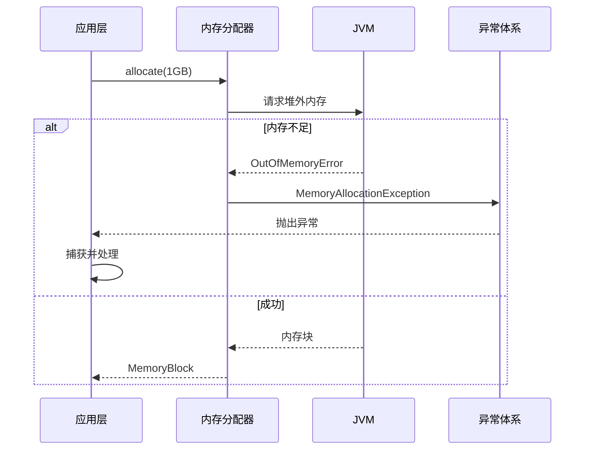
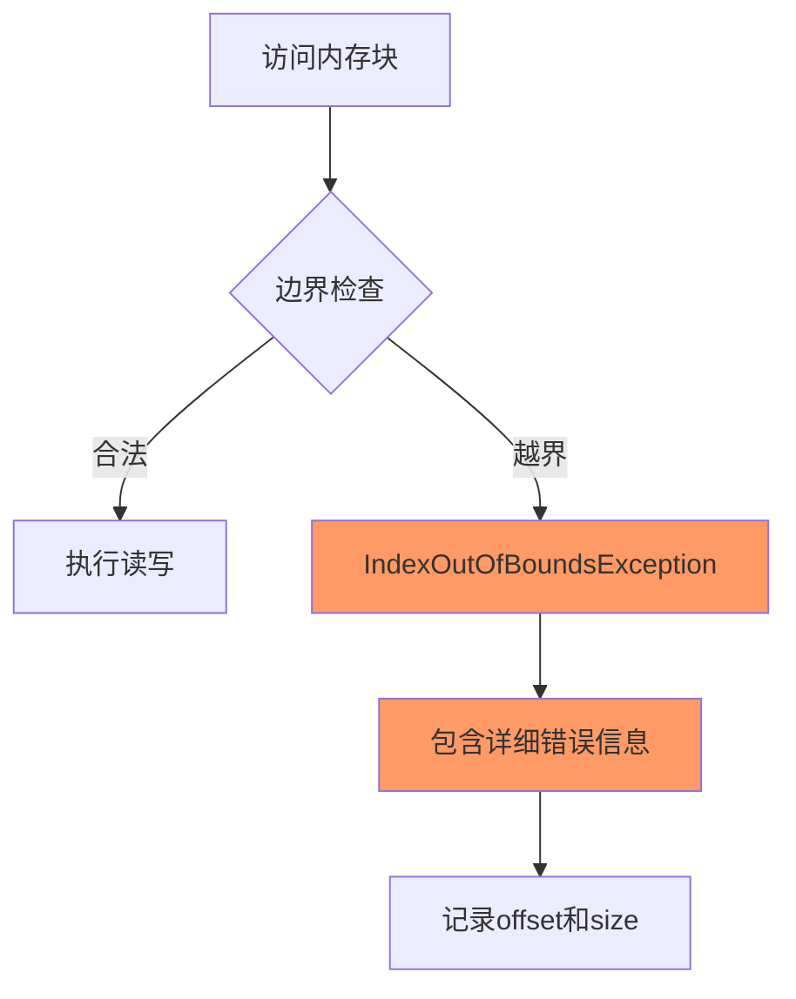
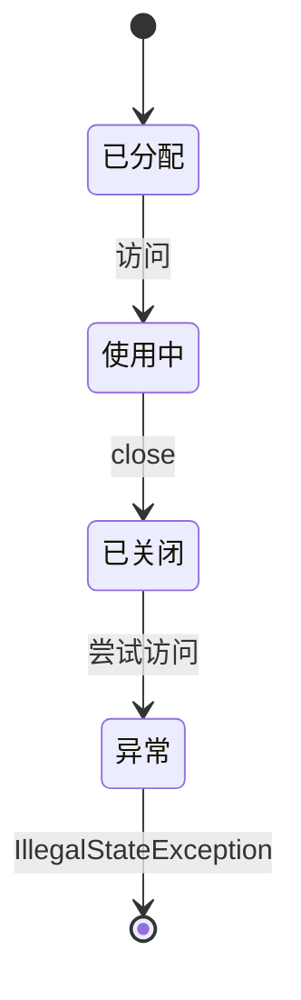
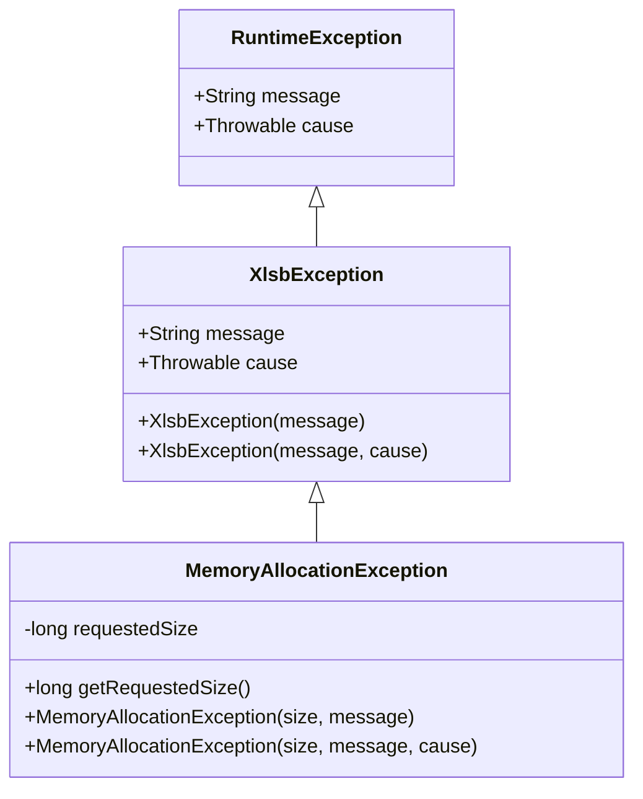
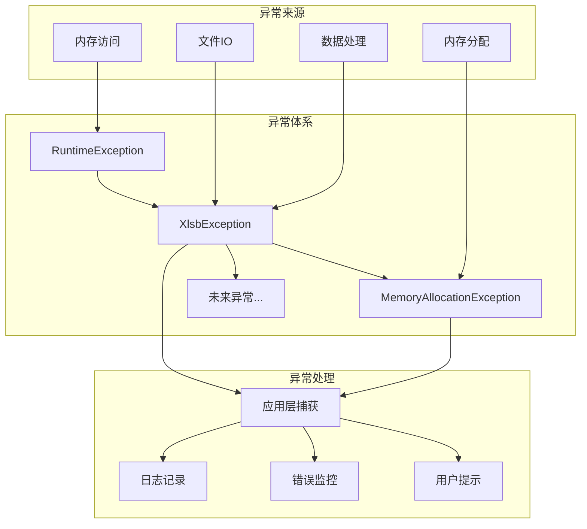
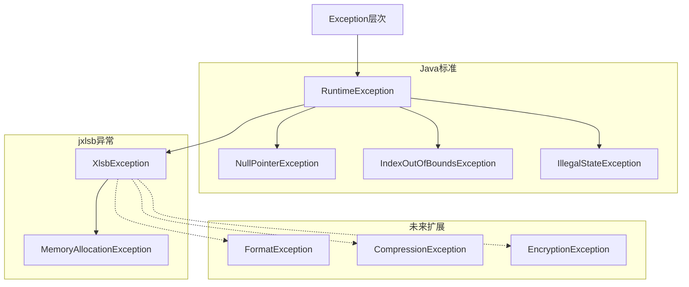

# Exception模块需求文档

## 模块概述

Exception模块定义了jxlsb项目的异常体系，提供统一的错误处理机制。该模块采用受检异常与非受检异常相结合的设计，确保关键错误必须处理，同时避免过度繁琐的异常声明。

**模块定位**：
- 基础设施层 - 提供统一异常体系
- 错误处理 - 规范化异常传播
- 可观测性 - 支持错误追踪和诊断

## 业务场景

### 场景列表

| 序号 | 场景名称 | 描述 | 优先级 |
|------|----------|------|--------|
| 1 | 内存分配失败 | 堆外内存分配失败时的错误处理 | P0 |
| 2 | 内存访问越界 | 访问超出内存块边界的错误处理 | P0 |
| 3 | 资源已释放 | 访问已关闭的内存块的错误处理 | P0 |
| 4 | 异常传播链 | 保持异常上下文，支持根因分析 | P1 |

### 场景详情

#### 场景1: 内存分配失败

**触发条件**：堆外内存不足，无法分配请求大小的内存块

**业务流程**：



**预期结果**：
- 异常包含请求的内存大小
- 异常信息清晰描述失败原因
- 支持异常链保留根因

#### 场景2: 内存访问越界

**触发条件**：访问内存块超出边界的位置

**业务流程**：



**预期结果**：
- 异常明确指出越界位置
- 包含内存块大小信息
- 防止内存损坏

#### 场景3: 资源已释放

**触发条件**：尝试访问已关闭的内存块

**业务流程**：



**预期结果**：
- 明确错误：内存块已关闭
- 防止访问已释放资源
- 提醒资源管理问题

#### 场景4: 异常传播链

**触发条件**：异常发生时，保留完整的异常上下文

**业务流程**：


**预期结果**：
- 异常链完整
- 根因可追溯
- 支持日志记录

## 功能需求

### 核心功能

| 序号 | 功能名称 | 描述 | 输入 | 输出 |
|------|----------|------|------|------|
| 1 | 异常构造 | 创建异常实例 | message, cause | Exception |
| 2 | 异常信息 | 获取异常详细信息 | 无 | message |
| 3 | 异常链 | 获取根因异常 | 无 | cause |
| 4 | 上下文信息 | 获取异常上下文数据 | 无 | context |

### 辅助功能

| 序号 | 功能名称 | 描述 | 输入 | 输出 |
|------|----------|------|------|------|
| 1 | 异常序列化 | 支持异常序列化传输 | 无 | serialVersionUID |
| 2 | 异常类型判断 | 判断异常类型 | 无 | boolean |

## 业务规则

| 序号 | 规则名称 | 规则描述 | 代码实现位置 |
|------|----------|----------|--------------|
| 1 | 非受检异常 | XlsbException继承RuntimeException | XlsbException:11 |
| 2 | 异常链保留 | 所有构造函数支持cause参数 | XlsbException:19-21 |
| 3 | 上下文数据 | MemoryAllocationException包含请求大小 | MemoryAllocationException:15 |
| 4 | 格式化消息 | 内存分配异常自动格式化消息 | MemoryAllocationException:17-18 |
| 5 | 不可变设计 | 异常属性final，创建后不可修改 | 所有异常类 |

## 数据需求

### 数据实体

| 实体名称 | 属性列表 | 来源 |
|----------|----------|------|
| XlsbException | message, cause | 基类RuntimeException |
| MemoryAllocationException | requestedSize, message, cause | 内存分配错误 |

### 异常层次结构



### 异常类型矩阵

| 异常类型 | 触发场景 | 严重程度 | 处理建议 |
|----------|----------|----------|----------|
| MemoryAllocationException | 内存分配失败 | 高 | 减少数据量/增加内存 |
| IllegalStateException | 资源已关闭 | 中 | 检查资源管理代码 |
| IndexOutOfBoundsException | 访问越界 | 中 | 检查边界计算 |
| NullPointerException | 空指针 | 高 | 检查对象初始化 |

## 非功能需求

### 性能要求

| 指标 | 要求 | 当前实现 |
|------|------|----------|
| 异常创建 | < 1μs | 简单构造函数 |
| 异常抛出 | 取决于JVM | 标准异常机制 |
| 异常捕获 | 取决于JVM | 标准异常机制 |

### 安全要求

| 要求 | 实现方式 |
|------|----------|
| 信息脱敏 | 异常消息不包含敏感数据 |
| 堆栈追踪 | 保留完整堆栈 |
| 日志记录 | 支持日志框架集成 |

### 兼容性要求

| 类型 | 要求 |
|------|------|
| Java版本 | Java 8+ |
| 序列化 | 支持序列化（serialVersionUID） |
| 国际化 | 预留国际化扩展点 |

## 约束条件

### 业务约束

1. **非受检异常**：避免强制try-catch，但建议处理
2. **不可变异常**：异常创建后属性不可修改
3. **异常链完整**：保留根因异常

### 技术约束

1. **继承层次**：最多3层继承
2. **序列化版本**：必须定义serialVersionUID
3. **线程安全**：异常对象线程安全（不可变）

## 架构设计

### 模块架构



### 类职责矩阵

| 类名 | 职责 | 设计模式 |
|------|------|----------|
| XlsbException | 库基础异常，统一异常基类 | 非受检异常模式 |
| MemoryAllocationException | 内存分配异常，包含上下文信息 | 特化异常模式 |

## 使用示例

### 异常捕获

```java
try {
    OffHeapAllocator allocator = AllocatorFactory.createDefaultAllocator();
    MemoryBlock block = allocator.allocate(1024 * 1024 * 1024); // 1GB
    // ...
} catch (MemoryAllocationException e) {
    // 获取请求的内存大小
    long requestedSize = e.getRequestedSize();
    log.error("内存分配失败，请求大小: {} bytes", requestedSize, e);
    // 处理逻辑：减少数据量或增加内存
} catch (XlsbException e) {
    // 处理其他XLSB异常
    log.error("XLSB处理异常", e);
}
```

### 异常创建

```java
// 基础异常
throw new XlsbException("XLSB文件格式错误");

// 带根因的异常
try {
    // ...
} catch (IOException e) {
    throw new XlsbException("读取文件失败", e);
}

// 内存分配异常
long size = 1024 * 1024 * 1024;
throw new MemoryAllocationException(size, "堆外内存不足");
```

### 异常处理最佳实践

```java
// 推荐：使用try-with-resources
try (MemoryBlock block = allocator.allocate(size)) {
    // 使用内存块
    block.putInt(0, value);
} catch (MemoryAllocationException e) {
    // 内存分配失败
    log.error("分配{}字节内存失败", e.getRequestedSize(), e);
    // 降级处理或重试
}

// 不推荐：忽略异常
try {
    MemoryBlock block = allocator.allocate(size);
    // ... 使用后忘记close
} catch (Exception e) {
    // 吞掉异常 - 不推荐！
}
```

## 技术特性

### 异常设计原则

**1. 非受检异常**
- 继承RuntimeException
- 不强制try-catch
- 但建议在关键位置处理

**2. 异常链保留**
- 所有构造函数支持cause参数
- 保留根因异常
- 支持异常链追踪

**3. 上下文信息**
- 异常包含诊断信息
- 格式化错误消息
- 支持错误恢复

### 异常层次设计



### 异常性能考虑

| 操作 | 性能影响 | 建议 |
|------|----------|------|
| 创建异常 | 低 | 可接受 |
| 填充堆栈 | 中 | 避免异常做流程控制 |
| 抛出异常 | 高 | 仅用于异常情况 |
| 捕获异常 | 中 | 精确捕获，避免宽泛catch |

## 测试要求

### 单元测试

- 覆盖率要求：> 95%
- 关键测试点：
  - 异常构造
  - 异常信息获取
  - 异常链保留
  - 上下文信息

### 集成测试

- 异常传播测试
- 异常日志测试
- 异常监控测试

### 性能测试

- 异常创建性能
- 异常抛出/捕获性能
- 堆栈填充性能

## 扩展指南

### 添加新异常

**场景**：需要添加新的异常类型（如格式异常）

**步骤**：
1. 创建新异常类继承XlsbException
2. 定义上下文属性
3. 实现构造函数
4. 添加格式化消息

**示例**：

```java
public final class FormatException extends XlsbException {
    private static final long serialVersionUID = 1L;
    
    private final String format;
    private final long position;
    
    public FormatException(String format, long position, String message) {
        super(String.format("格式错误 [%s] at position %d: %s", 
              format, position, message));
        this.format = format;
        this.position = position;
    }
    
    public String getFormat() { return format; }
    public long getPosition() { return position; }
}
```

### 异常设计原则

- **具体化**：异常应该具体，避免宽泛异常
- **上下文丰富**：包含诊断信息
- **不可变**：异常创建后不可修改
- **可序列化**：支持分布式传输