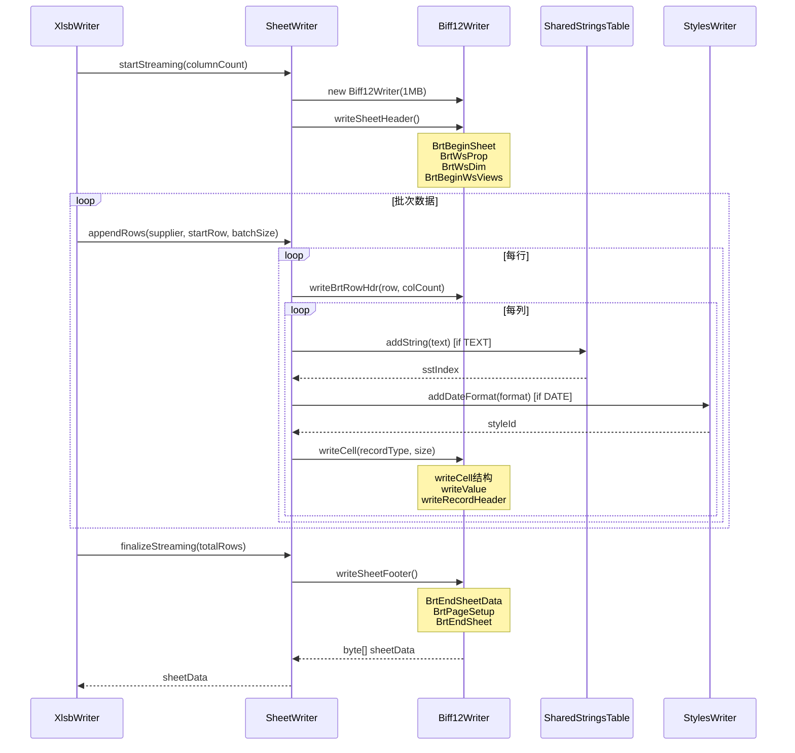
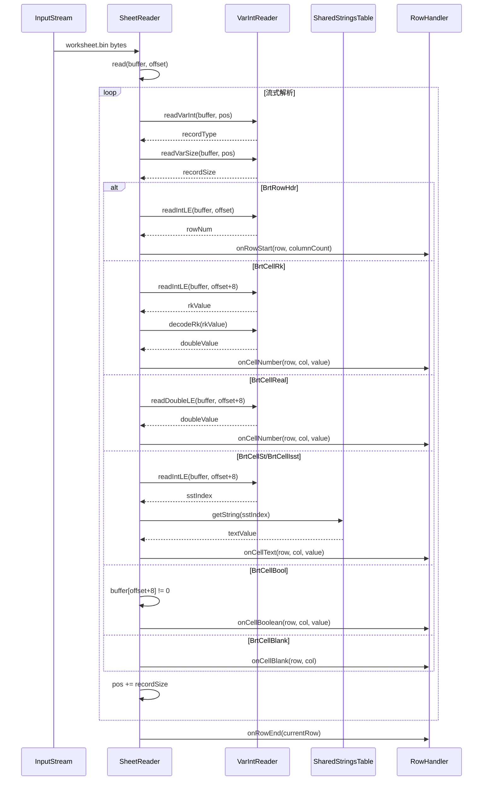
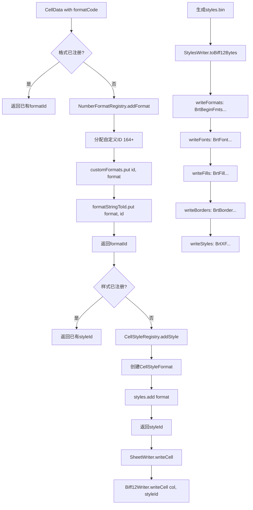
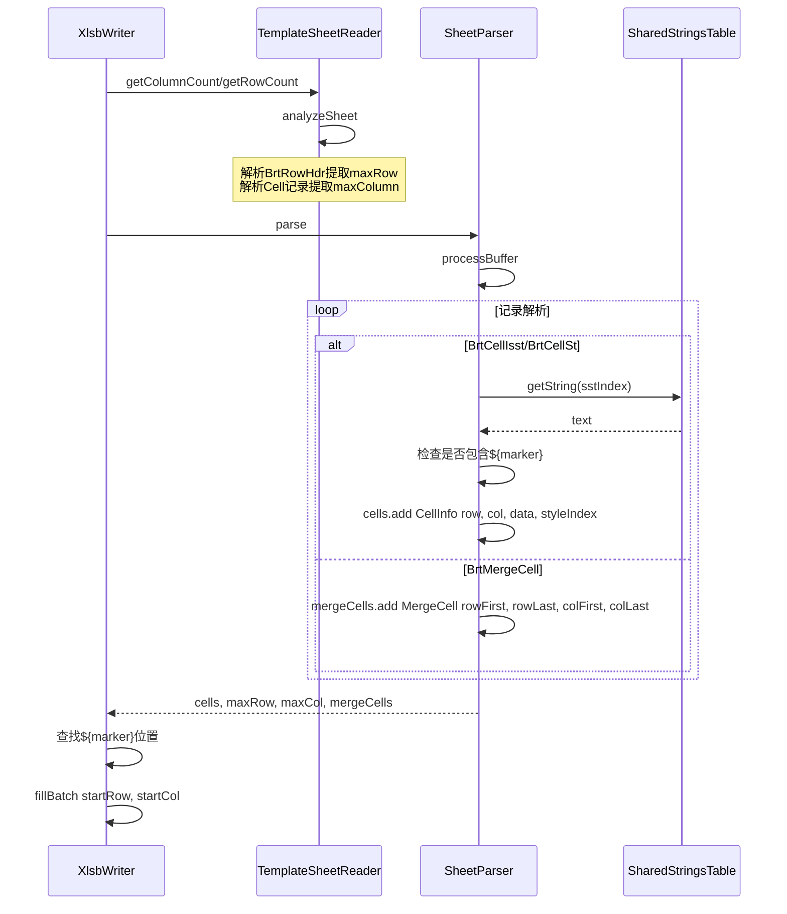
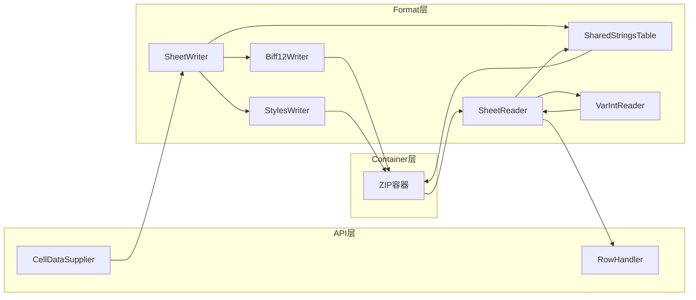

# Format模块（BIFF12格式层）需求文档

## 模块概述

format模块是jxlsb项目的核心格式层，负责实现Microsoft Excel Binary Workbook（XLSB）文件的BIFF12二进制格式读写。该模块严格遵循MS-XLSB规范，提供高性能、低内存消耗的流式处理能力。

**模块定位**：
- 向上：为api层提供Sheet/Workbook读写接口
- 向下：操作container层的ZIP文件结构
- 核心职责：BIFF12记录序列化/反序列化

**设计特点**：
- 堆外内存架构：使用MemoryBlock/OffHeapAllocator减少GC压力
- 流式处理：支持百万级数据行的增量写入/读取
- 零拷贝优化：实例级buffer避免循环内重复分配
- 规范遵循：严格按照MS-XLSB 2.1.4/2.3.2/2.5.6节实现

## 业务场景

### 场景列表

| 序号 | 场景名称 | 描述 | 优先级 | 关键类 |
|------|----------|------|--------|--------|
| 1 | Sheet流式写入 | 百万级数据行的增量写入，避免内存溢出 | P0 | SheetWriter |
| 2 | Sheet流式读取 | 逐行解析worksheet.bin，回调处理数据 | P0 | SheetReader |
| 3 | Workbook写入 | 创建workbook.bin，注册Sheet信息 | P1 | WorkbookWriter |
| 4 | Workbook读取 | 解析workbook.bin，提取Sheet列表 | P1 | WorkbookReader |
| 5 | SST管理 | 共享字符串表的构建与查询 | P1 | SharedStringsTable |
| 6 | 样式管理 | 数字格式/单元格样式的注册与生成 | P2 | StylesWriter, CellStyleRegistry |
| 7 | 模板解析 | 解析模板Sheet，提取单元格/合并区域信息 | P2 | SheetParser, TemplateSheetReader |
| 8 | 记录解析 | 流式解析BIFF12记录序列 | P2 | RecordParser, VarIntReader |

### 场景详情

#### 场景1: Sheet流式写入

**触发条件**：用户调用XlsbWriter.startSheet()后批量写入数据行

**业务流程**：



**关键步骤**：
1. **startStreaming**：初始化1MB缓冲区，写入Sheet头记录（BrtBeginSheet、BrtWsProp、BrtWsDim、视图记录）
2. **appendRows**：批量写入数据行
   - 写入BrtRowHdr（行头记录）：row + style + height + flags + colspan
   - 按列写入单元格记录：
     - NUMBER：判断RK编码范围，写入BrtCellRk或BrtCellReal
     - TEXT：查询/添加SST索引，写入BrtCellIsst
     - DATE：转换Excel日期序列号，应用样式索引，写入BrtCellReal
     - BOOLEAN：写入BrtCellBool
     - BLANK：写入BrtCellBlank
3. **finalizeStreaming**：写入Sheet尾记录（BrtEndSheetData、页面设置、BrtEndSheet）

**预期结果**：生成符合MS-XLSB规范的worksheet.bin二进制数据

#### 场景2: Sheet流式读取

**触发条件**：用户调用XlsbReader.readSheet()解析Sheet数据

**业务流程**：



**关键步骤**：
1. **缓冲区管理**：16KB固定缓冲区，处理不完整记录时保留剩余字节
2. **记录头解析**：readVarInt解析记录类型，readVarSize解析记录大小
3. **记录体解析**：
   - BrtRowHdr：提取rowNum、columnCount（从colspan计算）
   - BrtCellRk：decodeRk解码RK编码值
   - BrtCellReal：readDoubleLE读取IEEE 754 double
   - BrtCellSt/BrtCellIsst：查询SST索引获取字符串
   - BrtCellBool/BrtCellBlank：简单值处理
4. **回调触发**：按行触发RowHandler回调（onRowStart → onCellXxx → onRowEnd）

**预期结果**：逐行回调处理Sheet数据，无全量内存占用

#### 场景3: SST管理

**触发条件**：SheetWriter写入TEXT类型单元格或SheetReader解析字符串单元格

**业务流程**：

```mermaid
graph TD
    A[写入TEXT单元格] --> B{字符串已存在?}
    B -->|是| C[返回已有索引]
    B -->|否| D[添加新字符串]
    D --> E[strings.add str]
    E --> F[indexMap.put str, newIndex]
    F --> G[totalCount.incrementAndGet]
    G --> C
    
    H[读取TEXT单元格] --> I[获取SST索引]
    I --> J[sstIndex from BrtCellIsst]
    J --> K[查询字符串表]
    K --> L[getString sstIndex]
    L --> M[返回字符串值]
    
    N[写入SST.bin] --> O[Biff12Writer]
    O --> P[BrtBeginSst: cTotals, cUnique]
    P --> Q[loop: writeBrtSSTItem]
    Q --> R[BrtEndSst]
    R --> S[byte[] sstData]
```

**关键规则**：
- **字符串去重**：ConcurrentHashMap实现，避免重复存储
- **并发安全**：synchronized保护strings.add/indexMap.computeIfAbsent
- **引用计数**：AtomicInteger记录total引用次数
- **编码格式**：UTF-16LE（XLWideString），flags(1) + length(4) + chars

#### 场景4: 样式管理

**触发条件**：SheetWriter处理DATE/格式化NUMBER单元格

**业务流程**：



**关键规则**：
- **内置格式ID**：0-163（Excel预定义）
- **自定义格式ID**：164+（动态分配）
- **样式索引**：写入Cell结构的iStyleRef字段（24位）
- **去重机制**：formatStringToId/styles查询避免重复

#### 场景5: 模板解析

**触发条件**：用户调用fillAtMarker("${data}")查找填充位置

**业务流程**：



**关键功能**：
- **TemplateSheetReader**：快速分析Sheet维度（无需解析单元格内容）
- **SheetParser**：完整解析单元格内容、样式索引、合并区域
- **标记查找**：遍历cells查找包含${marker}的单元格
- **合并单元格保留**：mergeCells传递给SheetWriter.writeSheetWithTemplate

## 功能需求

### 核心功能

| 序号 | 功能名称 | 描述 | 输入 | 输出 | 实现类 |
|------|----------|------|------|------|--------|
| 1 | BIFF12记录写入 | 变长编码、小端序、记录头序列化 | recordType, recordSize, data | byte[] | Biff12Writer |
| 2 | BIFF12记录读取 | 变长解码、小端序、记录头解析 | byte[], offset | recordType, recordSize, value | VarIntReader |
| 3 | Sheet写入（一次性） | writeSheet全量写入模式 | CellDataSupplier, rowCount, colCount | byte[] worksheet.bin | SheetWriter.writeSheet |
| 4 | Sheet写入（流式） | startStreaming + appendRows + finalizeStreaming | CellDataSupplier, batchSize | byte[] worksheet.bin | SheetWriter |
| 5 | Sheet读取 | 流式解析worksheet.bin | InputStream, SharedStringsTable | RowHandler回调 | SheetReader |
| 6 | SST写入 | 序列化sharedStrings.bin | List<String> strings | byte[] SST.bin | SharedStringsTable.toBiff12Bytes |
| 7 | SST读取 | 解析sharedStrings.bin | InputStream SST.bin | List<String> strings | SharedStringsTable.load |
| 8 | Workbook写入 | 序列化workbook.bin | List<SheetInfo> sheets | byte[] workbook.bin | WorkbookWriter.toBiff12Bytes |
| 9 | Workbook读取 | 解析workbook.bin | InputStream workbook.bin | List<SheetInfo> sheets | WorkbookReader.parseSheetList |
| 10 | 样式写入 | 序列化styles.bin | NumberFormatRegistry, CellStyleRegistry | byte[] styles.bin | StylesWriter.toBiff12Bytes |
| 11 | 模板Sheet解析 | 提取单元格/合并区域信息 | InputStream worksheet.bin | CellInfo[], MergeCell[] | SheetParser.parse |
| 12 | RK编码/解码 | IEEE 754 double压缩格式 | int rkValue / double value | double value / int rkValue | VarIntReader.decodeRk, SheetWriter.writeBrtCellRk |

### 辅助功能

| 序号 | 功能名称 | 描述 | 输入 | 输出 | 实现类 |
|------|----------|------|------|------|--------|
| 1 | Cell结构写入 | 8字节结构：column + iStyleRef + flags | column, styleIndex | 8 bytes | Biff12Writer.writeCell |
| 2 | XLWideString写入 | UTF-16LE字符串格式 | String str | length(4) + chars | Biff12Writer.writeXLWideString |
| 3 | VarInt/VarSize编码 | 1-2/1-4字节变长编码 | int value | 1-2/1-4 bytes | Biff12Writer.writeVarInt/writeVarSize |
| 4 | VarInt/VarSize解码 | 读取变长编码值 | byte[], offset | int value | VarIntReader.readVarInt/readVarSize |
| 5 | Int/Double小端序 | 4/8字节小端序读写 | int/double value | 4/8 bytes | Biff12Writer/VarIntReader.writeIntLE/writeDoubleLE |
| 6 | 数字格式注册 | 添加/查询自定义格式 | formatString | formatId | NumberFormatRegistry |
| 7 | 样式格式注册 | 添加/查询单元格样式 | numFmtId, fontId, fillId, borderId | styleId | CellStyleRegistry |
| 8 | Sheet维度分析 | 快速获取maxRow/maxColumn | InputStream worksheet.bin | rowCount, columnCount | TemplateSheetReader |
| 9 | 记录类型映射 | Biff12RecordType常量定义 | - | recordType常量 | Biff12RecordType |

## 业务规则

### BIFF12编码规则

| 序号 | 规则名称 | 规则描述 | 代码实现位置 |
|------|----------|----------|--------------|
| 1 | VarInt编码 | 高位0x80表示续位，低7位存储值，最多2字节 | Biff12Writer.writeVarInt:50-57 |
| 2 | VarSize编码 | 高位0x80表示续位，低7位存储值，最多4字节 | Biff12Writer.writeVarSize:63-79 |
| 3 | 小端序Int | buffer[0]=低8位，buffer[3]=高8位，实例buffer优化 | Biff12Writer.writeIntLE:84-90 |
| 4 | 小端序Double | IEEE 754 bits按字节逆序写入 | Biff12Writer.writeDoubleLE:111-113 |
| 5 | RK编码规则 | Bit 0: isInt标志，Bit 1: div100标志，Bits 2-31: IEEE高30位或整数值 | VarIntReader.decodeRk:100-119 |
| 6 | Cell结构 | 4字节column + 3字节iStyleRef(24位) + 1字节flags | Biff12Writer.writeCell:140-146 |
| 7 | XLWideString | 4字节length(字符数) + UTF-16LE编码字符数据 | Biff12Writer.writeXLWideString:126-134 |
| 8 | 记录头结构 | VarInt(recordType) + VarSize(recordSize) + data | Biff12Writer.writeRecordHeader:41-44 |

### 记录边界处理规则

| 序号 | 规则名称 | 规则描述 | 代码实现位置 |
|------|----------|----------|--------------|
| 1 | 不完整记录保留 | pos + recordSize > length时返回pos - typeSize - sizeBytes，保留未处理字节 | SheetReader.processSheetBuffer:176-177 |
| 2 | 缓冲区大小 | SheetReader固定16KB，SheetWriter动态1MB初始+预估上限 | SheetReader:116, SheetWriter:84,60 |
| 3 | 剩余字节移动 | System.arraycopy移动未处理字节到buffer起始位置 | SheetReader:131-132 |
| 4 | 记录大小校验 | recordSize < 0或> length时跳过处理 | SheetReader.processSheetBuffer:170-172 |

### 内存管理规则

| 序号 | 规则名称 | 规则描述 | 代码实现位置 |
|------|----------|----------|--------------|
| 1 | 堆外内存 | RecordParser使用MemoryBlock/OffHeapAllocator解析记录 | RecordParser:31,47 |
| 2 | 实例buffer优化 | Biff12Writer.intBuffer避免循环内重复分配 | Biff12Writer:27-28 |
| 3 | ByteArrayOutputStream | SheetWriter/SST/Styles/Workbook使用ByteArrayOutputStream缓冲 | Biff12Writer:25, SharedStringsTable:132, StylesWriter:30 |
| 4 | 预估缓冲区大小 | rowCount * colCount * 30 + 1024，上限16MB避免过度分配 | SheetWriter:60,84 |
| 5 | SST并发安全 | ConcurrentHashMap.indexMap + AtomicInteger.totalCount + synchronized | SharedStringsTable:16-17,21-27 |

### SST管理规则

| 序号 | 规则名称 | 规则描述 | 代码实现位置 |
|------|----------|----------|--------------|
| 1 | 字符串去重 | computeIfAbsent原子操作，避免重复添加 | SharedStringsTable.addString:22-27 |
| 2 | 引用计数 | totalCount记录所有引用次数（含重复） | SharedStringsTable:20,17 |
| 3 | BrtSSTItem格式 | flags(1) + XLWideString，flags固定0x00 | SharedStringsTable.writeBrtSSTItem:155-166 |
| 4 | SST头结构 | BrtBeginSst: cTotals(4) + cUnique(4) | SharedStringsTable.toBiff12Bytes:136-138 |

### 样式管理规则

| 序号 | 规则名称 | 规则描述 | 代码实现位置 |
|------|----------|----------|--------------|
| 1 | 内置格式ID范围 | 0-163为Excel预定义格式 | NumberFormatRegistry:14 |
| 2 | 自定义格式ID分配 | 从164开始递增分配 | NumberFormatRegistry:36,58 |
| 3 | 格式去重 | formatStringToId查询避免重复注册 | NumberFormatRegistry.addFormat:53-56 |
| 4 | 样式索引24位 | iStyleRef写入Cell结构低24位，高字节为flags | Biff12Writer.writeCell:141-145 |
| 5 | 默认样式ID | 0号样式为默认样式，numFmtId=0 | CellStyleRegistry:55,24-29 |

## 数据需求

### 数据实体

| 实体名称 | 属性列表 | 来源 | 说明 |
|----------|----------|------|------|
| CellData | type, value, formatCode | api层 | 单元格数据输入 |
| CellInfo | row, col, data, styleIndex | SheetParser解析 | 模板单元格信息 |
| MergeCell | rowFirst, rowLast, colFirst, colLast | SheetParser解析 | 合并区域信息 |
| CellStyleFormat | numFmtId, fontId, fillId, borderId | CellStyleRegistry注册 | 样式格式定义 |
| SheetInfo | name, sheetId, relId | WorkbookReader解析 | Sheet元信息 |
| BiffRecord | recordType, recordSize, dataBlock | RecordParser解析 | BIFF12记录抽象 |
| MemoryBlock | 堆外内存块 | OffHeapAllocator分配 | 记录数据载体 |

### 数据流转



**写入数据流**：
1. API层：CellDataSupplier提供(row,col) → CellData
2. SheetWriter：判断cellType，查询SST/Styles索引
3. Biff12Writer：序列化记录头+Cell结构+值数据
4. ByteArrayOutputStream：累积字节数据
5. Container层：写入ZIP条目(worksheet.bin, SST.bin, styles.bin)

**读取数据流**：
1. Container层：InputStream读取worksheet.bin字节流
2. SheetReader：16KB缓冲区管理，流式解析记录
3. VarIntReader：解码记录头(recordType+recordSize)，读取值数据
4. SharedStringsTable：查询SST索引获取字符串
5. API层：RowHandler回调onCellNumber/onCellText/onCellBoolean/onCellBlank

### BIFF12记录类型映射

| 记录类型 | 记录名 | 用途 | 数据结构 |
|----------|--------|------|----------|
| 0 | BrtRowHdr | 行头记录 | rw(4) + ixfe(4) + miyRw(2) + flags(3) + ccolspan(4) + rgBrtColspan |
| 1 | BrtCellBlank | 空单元格 | cell(8) |
| 2 | BrtCellRk | RK编码数字 | cell(8) + rk(4) |
| 4 | BrtCellBool | 布尔单元格 | cell(8) + value(1) |
| 5 | BrtCellReal | Double数字 | cell(8) + xnum(8) |
| 6 | BrtCellSt | SST字符串引用 | cell(8) + isst(4) |
| 7 | BrtCellIsst | 内联字符串 | cell(8) + isst(4) |
| 19 | BrtSSTItem | SST条目 | flags(1) + XLWideString |
| 129 | BrtBeginSheet | Sheet开始标记 | 无数据 |
| 130 | BrtEndSheet | Sheet结束标记 | 无数据 |
| 145 | BrtBeginSheetData | Sheet数据开始 | 无数据 |
| 146 | BrtEndSheetData | Sheet数据结束 | 无数据 |
| 147 | BrtWsProp | Sheet属性 | 固定23字节 |
| 148 | BrtWsDim | Sheet维度 | firstRow(4) + lastRow(4) + firstCol(4) + lastCol(4) |
| 159 | BrtBeginSst | SST开始 | cTotals(4) + cUnique(4) |
| 160 | BrtEndSst | SST结束 | 无数据 |
| 176 | BrtMergeCell | 合并单元格 | rowFirst(4) + rowLast(4) + colFirst(4) + colLast(4) |

## 非功能需求

### 性能要求

| 指标 | 要求 | 实现方式 |
|------|------|----------|
| 堆外内存 | RecordParser使用堆外内存解析记录，避免GC压力 | MemoryBlock + OffHeapAllocator |
| 实例buffer优化 | Biff12Writer.intBuffer避免循环内重复分配，减少GC | 实例级byte[4] buffer |
| 预估缓冲区 | SheetWriter动态预估缓冲区大小，上限16MB避免过度分配 | rowCount * colCount * 30 + 1024 |
| 流式写入 | 支持百万级数据行增量写入，内存占用可控 | startStreaming + appendRows + finalizeStreaming |
| 流式读取 | 16KB固定缓冲区，逐行解析，无全量内存占用 | SheetReader 16KB buffer + RowHandler回调 |
| SST并发安全 | ConcurrentHashMap + AtomicInteger，支持并发写入 | indexMap + totalCount + synchronized |
| RK编码优化 | 整数范围[-536870912, 536870911]使用4字节RK编码 | MIN_RK_INTEGER/MAX_RK_INTEGER常量 |
| 字符串去重 | SST避免重复存储相同字符串，减少文件大小 | computeIfAbsent原子操作 |

**性能数据（参考AGENTS.md）**：
- 100K行×10列：2.72 MB文件，453 ms写入时间
- 对比POI：文件小30-50%，速度快2-3倍

### 安全要求

| 要求 | 实现方式 |
|------|----------|
| 记录大小校验 | recordSize < 0或> length时跳过处理，避免非法数据 |
| 边界检查 | pos + recordSize > length时保留未处理字节，避免数组越界 |
| 空值检查 | NumberFormatRegistry/CellStyleRegistry使用Objects.requireNonNull |
| 异常处理 | SheetReader/SheetParser使用try-catch处理解析异常，继续处理下一条记录 |

### 可用性要求

| 要求 | 实现方式 |
|------|----------|
| AutoCloseable | SheetReader/WorkbookReader/SheetParser实现AutoCloseable，确保资源释放 |
| 流式API | SheetWriter提供startStreaming/appendRows/finalizeStreaming三阶段API |
| 回调模式 | SheetReader使用RowHandler回调，用户自定义处理逻辑 |
| Builder模式 | CellStyleFormat使用Builder模式，简化样式构建 |

### 兼容性要求

| 类型 | 要求 |
|------|------|
| Excel兼容 | 生成的XLSB文件可在Excel 2007+/WPS中正常打开 |
| 规范遵循 | 严格按照MS-XLSB规范2.1.4/2.3.2/2.5.6节实现 |
| JDK版本 | 支持Java 8+ |
| POI对比 | 文件大小比POI小30-50%，速度快2-3倍 |

## 约束条件

### 业务约束

| 约束名称 | 约束描述 |
|----------|----------|
| 模板填充模式 | 仅支持表头模板，填充区域覆盖原有内容，不保留底部模板内容 |
| RK编码范围 | 仅整数范围[-536870912, 536870911]使用RK编码，超出范围使用BrtCellReal |
| 自定义格式ID | 从164开始分配，0-163为内置格式 |
| 样式索引范围 | Cell结构iStyleRef为24位，理论最大样式数16M |
| SST字符串编码 | 固定UTF-16LE编码，不支持UTF-8 |

### 技术约束

| 约束名称 | 约束描述 |
|----------|----------|
| 依赖 | 仅依赖SLF4J日志库 |
| 内存模型 | RecordParser使用堆外内存，SheetWriter/SheetReader使用堆内存 |
| 并发模型 | SST写入使用synchronized保护，读取无锁 |
| 异常处理 | 解析异常时跳过当前记录，继续处理下一条 |
| 缓冲区管理 | SheetReader固定16KB，SheetWriter动态预估 |

## 附录

### 相关文档

- AGENTS.md：项目README、构建规范、提交规范
- MS-XLSB规范：Microsoft Excel Binary Workbook格式规范
  - 2.1.4节：变长编码规则
  - 2.3.2节：记录类型定义
  - 2.5.6节：RK编码规则
- 设计文档：docs/deconstruct/format/design.md（待编写）
- 数据库设计：无（format模块不涉及数据库）

### 核心类文件清单

| 分类 | 类名 | 文件路径 | 行数 | 说明 |
|------|------|----------|------|------|
| 核心写入 | SheetWriter | format/SheetWriter.java | 525 | Sheet写入核心 |
| 核心读取 | SheetReader | format/SheetReader.java | 246 | Sheet读取核心 |
| 核心解析 | SheetParser | format/SheetParser.java | 228 | Sheet解析核心 |
| BIFF12写入 | Biff12Writer | format/Biff12Writer.java | 166 | BIFF12序列化 |
| 变长编码 | VarIntReader | format/VarIntReader.java | 122 | BIFF12解码 |
| SST管理 | SharedStringsTable | format/SharedStringsTable.java | 167 | SST读写 |
| 样式管理 | StylesWriter | format/StylesWriter.java | 178 | styles.bin生成 |
| Workbook写入 | WorkbookWriter | format/WorkbookWriter.java | 112 | workbook.bin生成 |
| Workbook读取 | WorkbookReader | format/WorkbookReader.java | 101 | workbook.bin解析 |
| 模板分析 | TemplateSheetReader | format/TemplateSheetReader.java | 116 | Sheet维度分析 |
| 记录类型 | Biff12RecordType | format/Biff12RecordType.java | 93 | 记录类型常量 |
| 样式注册 | CellStyleRegistry | format/CellStyleRegistry.java | 95 | 样式格式注册 |
| 格式注册 | NumberFormatRegistry | format/NumberFormatRegistry.java | 90 | 数字格式注册 |
| 记录解析 | RecordParser | format/RecordParser.java | 98 | 堆外内存解析 |
| 记录基类 | BiffRecord | format/BiffRecord.java | 45 | 记录抽象基类 |
| Record定义 | CellRecord等18个 | format/record/*.java | - | 记录类型定义 |
| Record解析 | BrtCellRk等7个 | format/record/reader/*.java | - | 记录解析实现 |

### 需求缺口分析

#### 未实现需求

| 序号 | 需求名称 | 描述 | 优先级 |
|------|----------|------|--------|
| 1 | 公式单元格 | 未支持BrtCellFmlc/BrtCellFmlcString等公式记录 | P3 |
| 2 | 错误单元格 | 未支持BrtCellError错误值记录 | P3 |
| 3 | 条件格式 | 未支持ConditionalFormatRecord条件格式 | P4 |
| 4 | 数据验证 | 未支持DataValidationRecord数据验证 | P4 |
| 5 | 图表记录 | 未支持BrtDrawing图表相关记录完整解析 | P4 |
| 6 | 页面设置 | 页面设置记录使用固定字节，未支持自定义 | P4 |
| 7 | 视图设置 | 视图记录使用固定字节，未支持自定义 | P4 |
| 8 | 列宽设置 | 未支持BrtColInfo列宽记录 | P3 |
| 9 | 行高设置 | BrtRowHdr行高固定270 twips，未支持自定义 | P3 |
| 10 | 字体自定义 | BrtFont使用固定字节，未支持自定义字体 | P4 |

#### 过实现需求

无。当前实现均为核心必需功能。

### 优化建议

| 序号 | 建议 | 优先级 |
|------|------|--------|
| 1 | SheetWriter/SheetReader使用堆外内存ByteArrayOutputStream替代，进一步减少GC | P2 |
| 2 | VarIntReader解码使用Unsafe直接内存访问，提升性能 | P3 |
| 3 | SST.load并行解析，提升大文件加载速度 | P3 |
| 4 | Cell结构写入使用预编码模板，减少编码开销 | P3 |
| 5 | 记录类型映射使用静态Map替代switch，提升可维护性 | P4 |