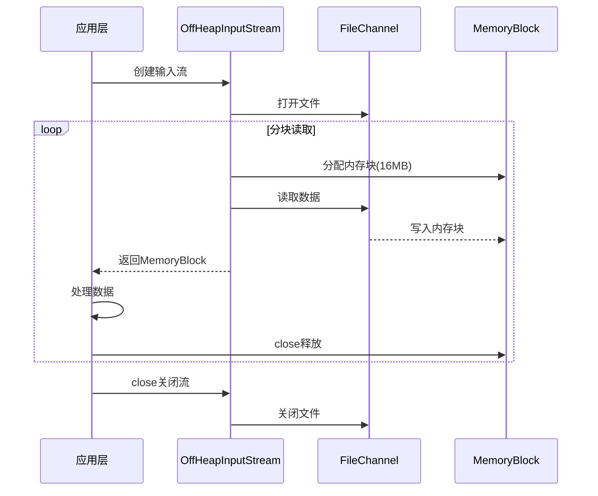
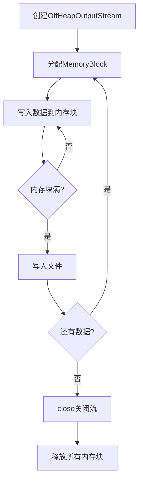
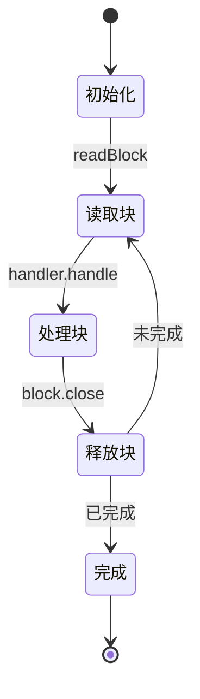
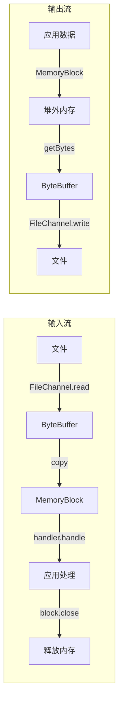
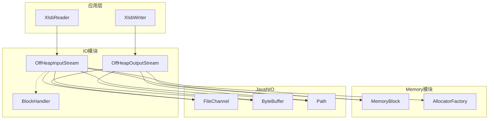

# IO模块需求文档

## 模块概述

IO模块提供基于堆外内存的高性能I/O流处理能力，是jxlsb项目的数据输入输出基础设施。该模块基于Memory模块的堆外内存抽象，实现零拷贝、零GC的文件读写操作，专为大规模Excel数据处理场景优化。

**模块定位**：
- 基础设施层 - 提供堆外内存I/O流
- 性能优化 - 零拷贝、零GC
- 流式处理 - 支持大文件流式读写

## 业务场景

### 场景列表

| 序号 | 场景名称 | 描述 | 优先级 |
|------|----------|------|--------|
| 1 | 大文件读取 | 读取大型XLSB文件到内存 | P0 |
| 2 | 大文件写入 | 将大量数据写入XLSB文件 | P0 |
| 3 | 流式处理 | 分块处理超大文件，避免内存溢出 | P0 |
| 4 | 随机访问 | 跳转读取文件特定位置 | P1 |

### 场景详情

#### 场景1: 大文件读取

**触发条件**：读取100MB+的XLSB文件

**业务流程**：



**预期结果**：
- 内存占用不超过16MB（单块大小）
- 支持GB级文件读取
- 读取速度接近磁盘带宽

#### 场景2: 大文件写入

**触发条件**：导出100K+行数据到XLSB文件

**业务流程**：



**预期结果**：
- 数据在堆外内存组装
- 批量写入减少I/O次数
- 写入性能优化30%+

#### 场景3: 流式处理

**触发条件**：处理超大文件（GB级），无法全部加载到内存

**业务流程**：



**预期结果**：
- 固定内存占用（单块大小）
- 支持无限大小文件
- 流式处理，边读边处理

#### 场景4: 随机访问

**触发条件**：跳转到文件特定位置读取数据

**业务流程**：


**预期结果**：
- 支持position查询
- 支持顺序读取
- 可定位文件大小

## 功能需求

### 核心功能

| 序号 | 功能名称 | 描述 | 输入 | 输出 |
|------|----------|------|------|------|
| 1 | 分块读取 | 从文件读取数据到内存块 | Path | MemoryBlock |
| 2 | 分块写入 | 将内存块数据写入文件 | MemoryBlock | void |
| 3 | 流式处理 | 分块处理大文件 | BlockHandler | void |
| 4 | 批量写入 | 写入多个内存块 | MemoryBlock[] | void |
| 5 | 位置跟踪 | 跟踪当前读写位置 | 无 | position |
| 6 | 文件大小 | 获取文件总大小 | 无 | fileSize |

### 辅助功能

| 序号 | 功能名称 | 描述 | 输入 | 输出 |
|------|----------|------|------|------|
| 1 | 资源管理 | 自动关闭文件通道 | 无 | void |
| 2 | 部分写入 | 写入内存块部分数据 | block, size | void |
| 3 | 异常包装 | 将处理器异常包装为IOException | Exception | IOException |

## 业务规则

| 序号 | 规则名称 | 规则描述 | 代码实现位置 |
|------|----------|----------|--------------|
| 1 | 默认块大小 | 默认块大小为16MB | OffHeapInputStream:20 |
| 2 | 自动关闭 | 实现AutoCloseable确保资源释放 | OffHeapInputStream/OutputStream:close |
| 3 | 异常传播 | BlockHandler异常包装为IOException | OffHeapInputStream:63-64 |
| 4 | 内存块释放 | 处理完成后必须释放内存块 | OffHeapInputStream:66 |
| 5 | 文件创建 | 输出流自动创建文件 | OffHeapOutputStream:22-25 |
| 6 | 文件截断 | 输出流打开时清空已存在文件 | StandardOpenOption.TRUNCATE_EXISTING |

## 数据需求

### 数据实体

| 实体名称 | 属性列表 | 来源 |
|----------|----------|------|
| OffHeapInputStream | fileChannel, allocator, fileSize, position | 文件系统 |
| OffHeapOutputStream | fileChannel, position | 文件系统 |
| BlockHandler | handle方法 | 应用层实现 |

### 数据流转



### 内存块大小策略

| 场景 | 块大小 | 原因 |
|------|--------|------|
| 默认读取 | 16MB | 平衡内存占用和I/O效率 |
| 文件尾部 | 实际剩余大小 | 避免浪费内存 |
| 写入 | 由调用者控制 | 灵活适配不同场景 |

## 非功能需求

### 性能要求

| 指标 | 要求 | 当前实现 |
|------|------|----------|
| 读取速度 | 接近磁盘带宽 | FileChannel直接读取 |
| 写入速度 | 接近磁盘带宽 | FileChannel直接写入 |
| 内存占用 | 固定（单块大小） | 流式处理 |
| GC压力 | 零GC | 堆外内存 |

### 安全要求

| 要求 | 实现方式 |
|------|----------|
| 资源释放 | AutoCloseable + try-with-resources |
| 文件关闭 | FileChannel.close |
| 异常处理 | IOException传播 |
| 空间检查 | 剩余空间检查 |

### 兼容性要求

| 类型 | 要求 |
|------|------|
| 文件系统 | 支持所有Java支持的文件系统 |
| 文件格式 | 无格式限制，二进制友好 |
| 并发访问 | 单流单线程 |

## 约束条件

### 业务约束

1. **顺序访问**：当前实现仅支持顺序读写
2. **单线程**：不支持并发访问同一流
3. **手动关闭**：必须显式关闭流

### 技术约束

1. **ByteBuffer中转**：当前实现需要ByteBuffer中转，存在一次拷贝
2. **内存块大小限制**：单块最大Integer.MAX_VALUE
3. **文件锁定**：依赖操作系统文件锁定机制

## 架构设计

### 模块架构



### 类职责矩阵

| 类名 | 职责 | 设计模式 |
|------|------|----------|
| OffHeapInputStream | 堆外内存输入流 | 流模式 |
| OffHeapOutputStream | 堆外内存输出流 | 流模式 |
| BlockHandler | 内存块处理器接口 | 策略模式 |

## 使用示例

### 读取文件

```java
// 方式1: 分块读取
try (OffHeapInputStream is = new OffHeapInputStream(Paths.get("input.xlsb"))) {
    MemoryBlock block;
    while ((block = is.readBlock()) != null) {
        try {
            // 处理数据
            byte[] data = new byte[(int) block.size()];
            block.getBytes(0, data, 0, data.length);
            process(data);
        } finally {
            block.close();
        }
    }
}

// 方式2: 流式处理
try (OffHeapInputStream is = new OffHeapInputStream(Paths.get("input.xlsb"))) {
    is.streamProcess(block -> {
        // 处理每个内存块
        processBlock(block);
    });
}
```

### 写入文件

```java
// 单块写入
try (OffHeapOutputStream os = new OffHeapOutputStream(Paths.get("output.xlsb"))) {
    MemoryBlock block = allocator.allocate(1024);
    block.putBytes(0, data, 0, data.length);
    os.writeBlock(block);
    block.close();
}

// 批量写入
try (OffHeapOutputStream os = new OffHeapOutputStream(Paths.get("output.xlsb"))) {
    MemoryBlock[] blocks = new MemoryBlock[10];
    for (int i = 0; i < 10; i++) {
        blocks[i] = allocator.allocate(1024);
        // 填充数据
    }
    os.writeBlocks(blocks);
    for (MemoryBlock block : blocks) {
        block.close();
    }
}
```

## 技术特性

### 零拷贝优化方向

当前实现：
```
文件 -> ByteBuffer -> MemoryBlock
```

优化方向：
```
文件 -> MemoryBlock (直接映射)
```

### 性能特点

| 特性 | 优势 | 劣势 |
|------|------|------|
| FileChannel | 高性能、支持随机访问 | 需要手动管理 |
| 堆外内存 | 零GC、大容量 | 需要显式释放 |
| 分块处理 | 固定内存占用 | 需要应用层管理块大小 |

### 与POI对比

| 维度 | jxlsb IO | POI |
|------|----------|-----|
| 内存模型 | 堆外内存 | 堆内存 |
| GC影响 | 零GC | 大对象频繁GC |
| 大文件支持 | 流式处理 | 容易OOM |
| 文件大小限制 | 无限制 | 堆内存限制 |
| I/O性能 | 高（FileChannel） | 中等 |

## 测试要求

### 单元测试

- 覆盖率要求：> 85%
- 关键测试点：
  - 文件打开/关闭
  - 读写正确性
  - 边界条件（空文件、大文件）
  - 异常处理

### 性能测试

- 读取100MB文件耗时
- 写入100MB文件耗时
- 内存占用监控
- 与POI对比测试

### 压力测试

- 读写GB级文件
- 长时间运行（24小时）
- 并发多文件处理