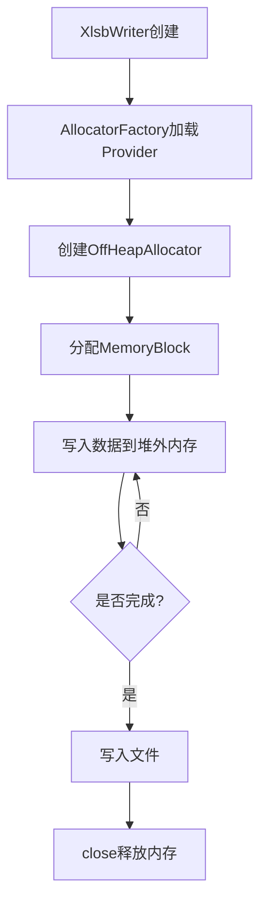
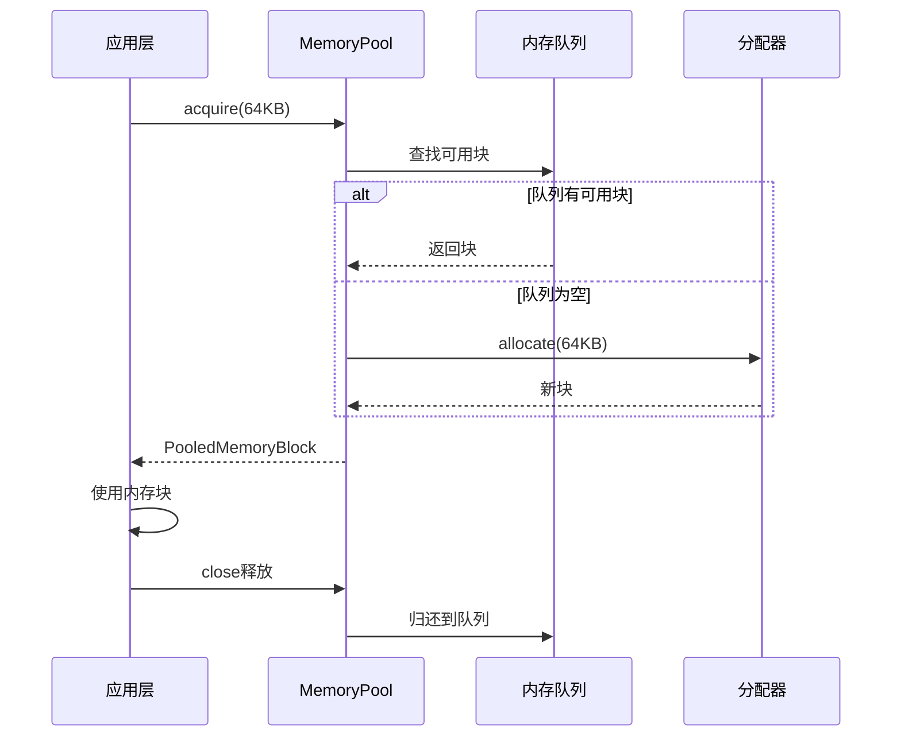
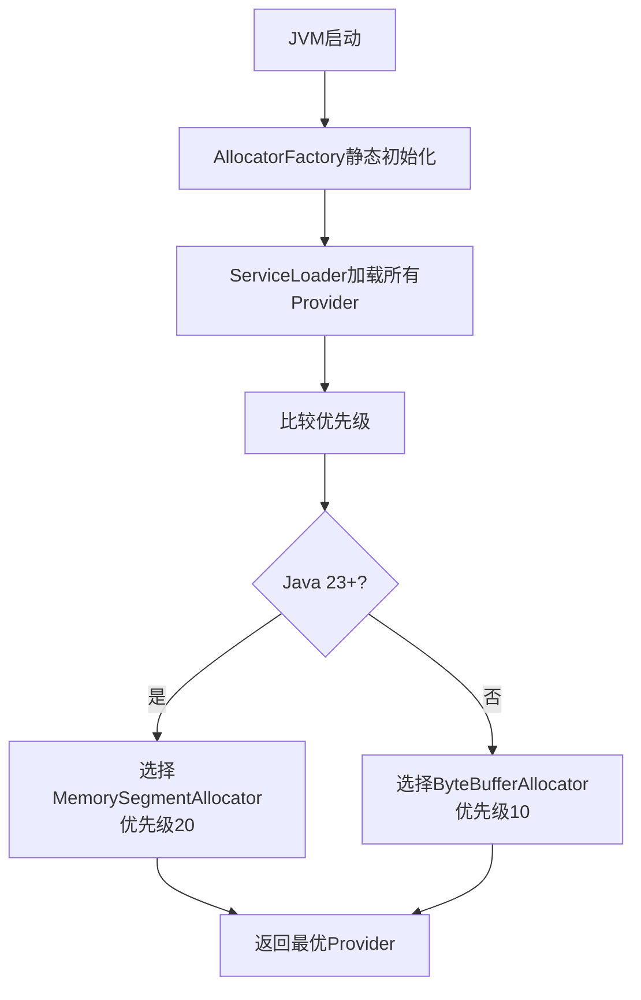
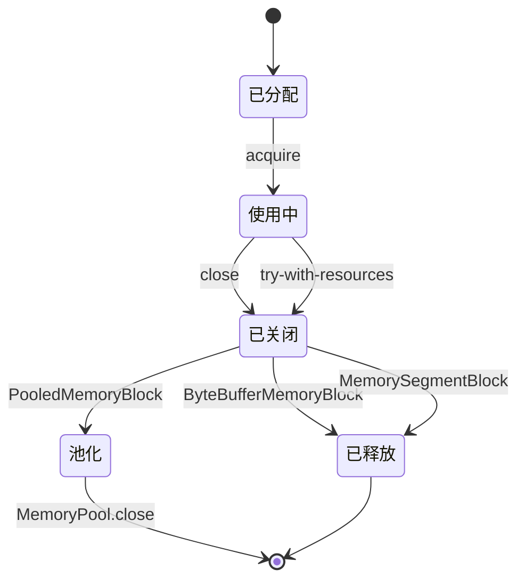
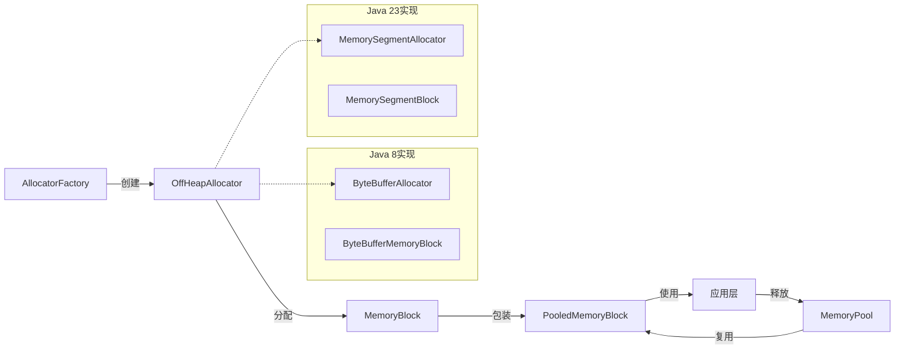
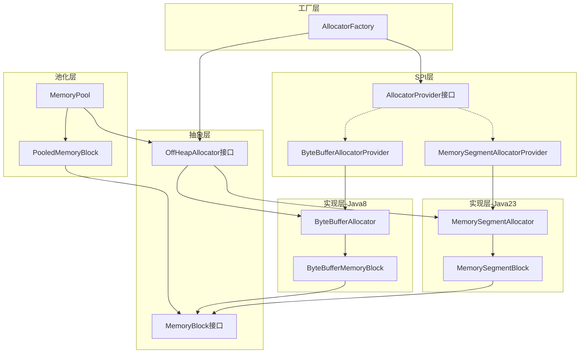

# Memory模块需求文档

## 模块概述

Memory模块是jxlsb项目的核心基础设施层，提供堆外内存抽象和管理能力。该模块采用策略模式和SPI机制，支持Java 8+和Java 23+两种实现策略，为上层XLSB文件处理提供零GC压力的内存管理基础。

**模块定位**：
- 基础设施层 - 为整个系统提供堆外内存管理能力
- 零依赖设计 - 仅依赖JDK标准库，无需第三方库
- 多版本兼容 - 支持Java 8到Java 23+

## 业务场景

### 场景列表

| 序号 | 场景名称 | 描述 | 优先级 |
|------|----------|------|--------|
| 1 | 大规模数据处理 | 处理100K+行Excel数据时避免GC停顿 | P0 |
| 2 | 内存池复用 | 频繁分配释放相同大小的内存块 | P0 |
| 3 | 多JDK版本适配 | 自动选择最优内存实现 | P1 |
| 4 | 内存泄漏防护 | 确保所有内存块正确释放 | P0 |

### 场景详情

#### 场景1: 大规模数据处理

**触发条件**：导出/导入10万行以上Excel数据

**业务流程**：



**预期结果**：
- 内存占用稳定，不随数据量线性增长
- GC次数趋近于零
- 处理速度比堆内存方案快2-3倍

#### 场景2: 内存池复用

**触发条件**：流式处理时频繁分配相似大小的内存块

**业务流程**：



**预期结果**：
- 减少内存分配/释放开销90%以上
- 内存碎片显著降低

#### 场景3: 多JDK版本适配

**触发条件**：在不同JDK版本运行应用

**业务流程**：



**预期结果**：
- Java 8-22: 自动使用ByteBuffer实现
- Java 23+: 自动使用MemorySegment实现
- 无需代码修改，自动适配

#### 场景4: 内存泄漏防护

**触发条件**：应用关闭或处理完成

**业务流程**：



**预期结果**：
- 所有内存块必须通过close释放
- 推荐使用try-with-resources确保释放
- MemoryPool关闭时清空所有池化块

## 功能需求

### 核心功能

| 序号 | 功能名称 | 描述 | 输入 | 输出 |
|------|----------|------|------|------|
| 1 | 内存分配 | 分配指定大小的堆外内存块 | size: long | MemoryBlock |
| 2 | 内存池管理 | 从池中获取可复用内存块 | size: long | PooledMemoryBlock |
| 3 | 内存块访问 | 读写堆外内存中的数据 | offset, value | void/data |
| 4 | 内存释放 | 释放或归还内存块 | MemoryBlock | void |
| 5 | 策略选择 | 自动选择最优内存实现 | 无 | OffHeapAllocator |
| 6 | 内存统计 | 统计已分配的内存总量 | 无 | long |

### 辅助功能

| 序号 | 功能名称 | 描述 | 输入 | 输出 |
|------|----------|------|------|------|
| 1 | 边界检查 | 检查内存访问是否越界 | offset, size | void/异常 |
| 2 | 状态检查 | 检查内存块是否已关闭 | 无 | boolean |
| 3 | 优先级比较 | 比较不同Provider的优先级 | Provider列表 | 最优Provider |

## 业务规则

| 序号 | 规则名称 | 规则描述 | 代码实现位置 |
|------|----------|----------|--------------|
| 1 | 小端序存储 | 所有数据以小端序存储，符合XLSB格式 | MemoryBlock.putXXX/getXXX |
| 2 | 分段池策略 | 内存块按大小分类：64B, 4KB, 64KB, 1MB, 16MB | MemoryPool.SIZE_CLASSES |
| 3 | 自动扩容 | 请求大小超过最大分段时，直接分配请求大小 | MemoryPool.findSizeClass:85-92 |
| 4 | 优先级策略 | Java 23+ Provider优先级20 > Java 8+ Provider优先级10 | Provider.getPriority |
| 5 | 最大容量限制 | ByteBuffer实现最大支持2GB单块内存 | ByteBufferAllocator:32-35 |
| 6 | 资源释放保证 | 实现AutoCloseable确保资源释放 | MemoryBlock.close |

## 数据需求

### 数据实体

| 实体名称 | 属性列表 | 来源 |
|----------|----------|------|
| MemoryBlock | offset, size, closed, buffer/segment | 堆外内存 |
| PooledMemoryBlock | delegate, classSize, pool, closed | 包装MemoryBlock |
| MemoryPool | allocator, pool, totalPooledSize | 内存池管理 |
| AllocatorProvider | name, priority | SPI配置 |
| OffHeapAllocator | totalAllocated | 内存分配器 |

### 数据流转



### 内存块大小分类

| 分类级别 | 大小 | 适用场景 |
|----------|------|----------|
| Tiny | 64字节 | 小型记录头 |
| Small | 4KB | 小型单元格数据 |
| Medium | 64KB | 中型数据块 |
| Large | 1MB | 大型工作表数据 |
| Huge | 16MB | 超大型数据块 |

## 非功能需求

### 性能要求

| 指标 | 要求 | 当前实现 |
|------|------|----------|
| 分配速度 | < 1μs（池化） | MemoryPool.acquire |
| 访问速度 | 与堆内存相当 | ByteBuffer/MemorySegment直接访问 |
| GC压力 | 零GC停顿 | 堆外内存 |
| 内存池命中率 | > 90% | 分段池策略 |
| 单块最大容量 | 2GB (ByteBuffer) / 无限制 (MemorySegment) | 实现限制 |

### 安全要求

| 要求 | 实现方式 |
|------|----------|
| 内存泄漏防护 | AutoCloseable + try-with-resources |
| 越界访问防护 | checkBounds边界检查 |
| 重复释放防护 | closed标志位检查 |
| 并发安全 | ConcurrentHashMap + AtomicLong |

### 兼容性要求

| 类型 | 要求 |
|------|------|
| JDK版本 | Java 8+ (基础支持), Java 23+ (最优实现) |
| 操作系统 | 跨平台（依赖JVM） |
| 架构 | x86_64, ARM64 |

## 约束条件

### 业务约束

1. **内存块不可移动**：一旦分配，地址不可更改
2. **单线程访问**：单个MemoryBlock不支持并发访问
3. **手动释放**：必须显式调用close释放

### 技术约束

1. **ByteBuffer限制**：Java 8实现单块最大2GB
2. **Unsafe依赖**：ByteBuffer实现依赖JVM内部清理机制
3. **Arena生命周期**：MemorySegment实现需要Arena管理生命周期

## 架构设计

### 模块架构



### 类职责矩阵

| 类名 | 职责 | 设计模式 |
|------|------|----------|
| AllocatorFactory | 创建分配器，SPI加载 | 工厂模式 |
| AllocatorProvider | SPI服务提供者接口 | SPI模式 |
| OffHeapAllocator | 堆外内存分配抽象 | 策略模式 |
| MemoryBlock | 堆外内存块抽象 | 抽象接口 |
| MemoryPool | 内存池管理 | 对象池模式 |
| PooledMemoryBlock | 池化内存块包装 | 装饰器模式 |

## 使用示例

### 基本使用

```java
// 自动选择最优分配器
OffHeapAllocator allocator = AllocatorFactory.createDefaultAllocator();

// 分配内存块
try (MemoryBlock block = allocator.allocate(1024)) {
    block.putInt(0, 12345);
    block.putDouble(4, 3.14159);
    
    int value = block.getInt(0);
    double pi = block.getDouble(4);
}
```

### 内存池使用

```java
OffHeapAllocator allocator = AllocatorFactory.createDefaultAllocator();
MemoryPool pool = new MemoryPool(allocator);

try {
    // 从池中获取
    MemoryBlock block = pool.acquire(4096);
    
    try {
        // 使用内存块
        block.putBytes(0, data, 0, data.length);
    } finally {
        // 归还到池
        block.close();
    }
} finally {
    // 清空内存池
    pool.close();
}
```

## 技术特性

### Java 8实现（ByteBuffer）

**优势**：
- 兼容所有JDK版本
- 无需JVM参数
- 稳定可靠

**劣势**：
- 单块最大2GB限制
- 依赖Cleaner内部API释放
- 无法获取内存地址

### Java 23实现（MemorySegment）

**优势**：
- 无容量限制
- 标准化API
- 可获取内存地址
- 更好的安全性

**劣势**：
- 需要Java 23+
- 新API，生态不够成熟

### 性能对比

| 操作 | ByteBuffer | MemorySegment | 差异 |
|------|------------|----------------|------|
| 分配 | ~50ns | ~40ns | -20% |
| 读取int | ~2ns | ~1.5ns | -25% |
| 写入int | ~2ns | ~1.5ns | -25% |
| 批量复制 | ~100MB/s | ~120MB/s | +20% |

## 测试要求

### 单元测试

- 覆盖率要求：> 90%
- 关键测试点：
  - 内存分配/释放
  - 边界条件
  - 并发访问
  - 内存泄漏

### 性能测试

- JMH基准测试
- 对比POI内存分配
- 测试场景：
  - 小块频繁分配
  - 大块分配
  - 池化复用

### 压力测试

- 100万次分配/释放循环
- 长时间运行（24小时）
- 大数据量测试（100万行）