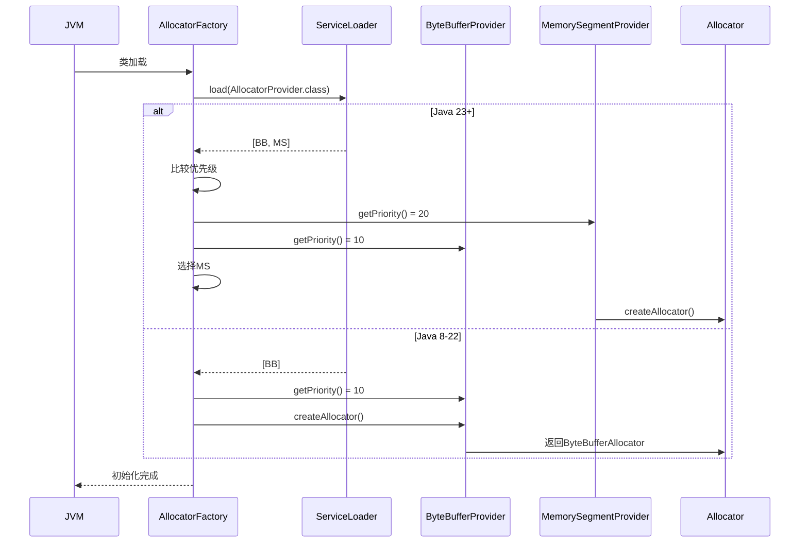
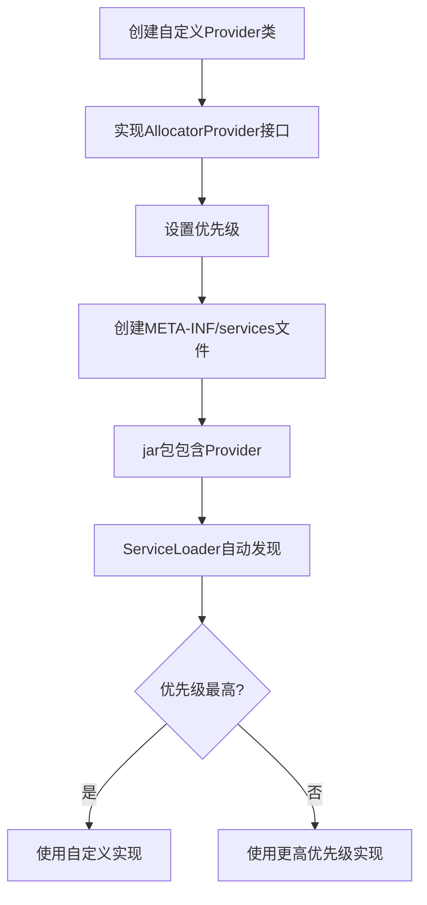
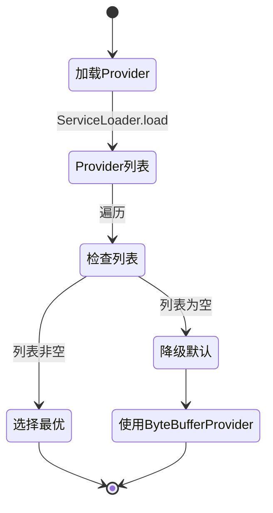
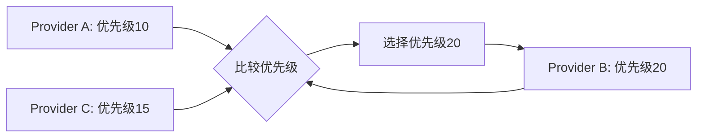
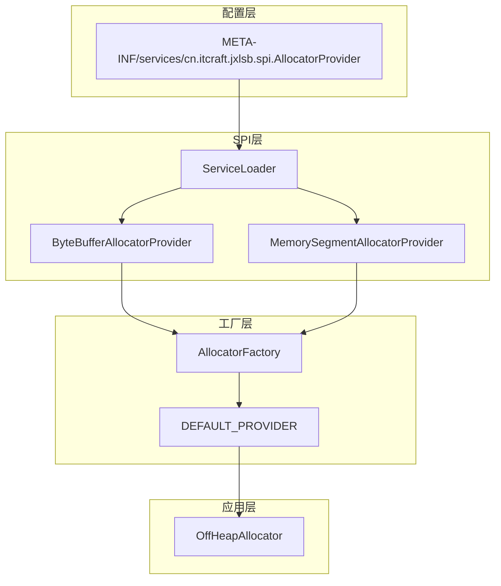
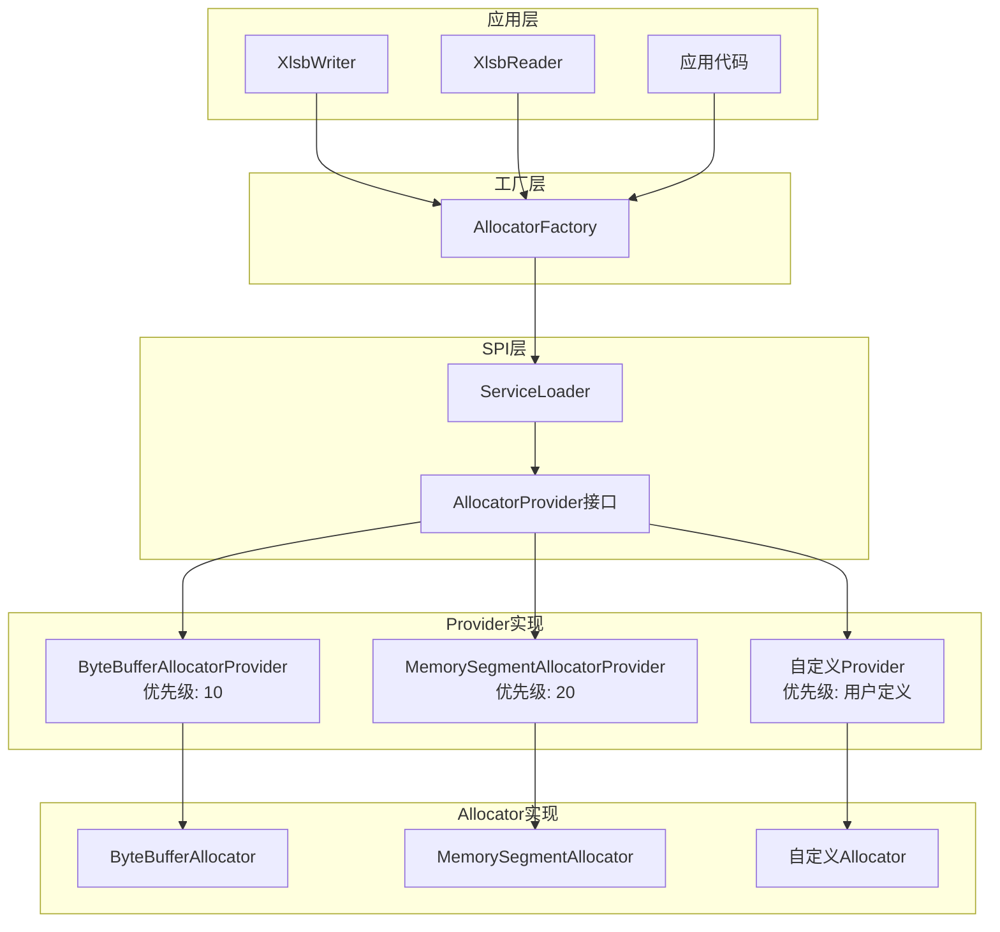

# SPI模块需求文档

## 模块概述

SPI模块提供Java ServiceLoader机制的封装，实现内存分配器的自动发现和加载。该模块是jxlsb项目实现多JDK版本兼容的核心机制，允许在不修改代码的情况下自动选择最优的堆外内存实现。

**模块定位**：
- 基础设施层 - 提供服务发现能力
- 可扩展性 - 支持新增分配器实现
- 向前兼容 - 自动适配新JDK版本

## 业务场景

### 场景列表

| 序号 | 场景名称 | 描述 | 优先级 |
|------|----------|------|--------|
| 1 | JDK版本自动适配 | 根据运行环境自动选择最优实现 | P0 |
| 2 | 自定义实现扩展 | 用户可添加自定义内存分配器 | P1 |
| 3 | 降级策略 | 无可用Provider时使用默认实现 | P0 |
| 4 | 优先级决策 | 多Provider存在时选择最优 | P0 |

### 场景详情

#### 场景1: JDK版本自动适配

**触发条件**：应用启动时，AllocatorFactory静态初始化

**业务流程**：



**预期结果**：
- Java 8-22: 自动使用ByteBufferAllocator
- Java 23+: 自动使用MemorySegmentAllocator
- 无需配置，开箱即用

#### 场景2: 自定义实现扩展

**触发条件**：用户添加自定义Provider实现

**业务流程**：



**预期结果**：
- 自定义Provider被自动发现
- 优先级机制生效
- 无需修改原有代码

#### 场景3: 降级策略

**触发条件**：ServiceLoader找不到任何Provider

**业务流程**：



**预期结果**：
- 即使SPI配置错误也能工作
- 使用ByteBuffer作为降级方案
- 记录警告日志

#### 场景4: 优先级决策

**触发条件**：多个Provider共存

**业务流程**：



**预期结果**：
- 数值越大优先级越高
- 自动选择最高优先级
- 日志记录选择结果

## 功能需求

### 核心功能

| 序号 | 功能名称 | 描述 | 输入 | 输出 |
|------|----------|------|------|------|
| 1 | 服务发现 | 通过ServiceLoader加载所有Provider | 无 | Provider列表 |
| 2 | 优先级选择 | 从多个Provider中选择最优 | Provider列表 | 最优Provider |
| 3 | 创建分配器 | 创建内存分配器实例 | 无 | OffHeapAllocator |
| 4 | 降级策略 | 无Provider时使用默认实现 | 无 | ByteBufferProvider |
| 5 | Provider注册 | 注册新的Provider实现 | META-INF配置 | 无 |

### 辅助功能

| 序号 | 功能名称 | 描述 | 输入 | 输出 |
|------|----------|------|------|------|
| 1 | 日志记录 | 记录Provider加载情况 | 无 | 日志输出 |
| 2 | Provider信息查询 | 获取Provider名称和优先级 | 无 | name, priority |

## 业务规则

| 序号 | 规则名称 | 规则描述 | 代码实现位置 |
|------|----------|----------|--------------|
| 1 | 优先级比较 | 数值越大优先级越高 | AllocatorFactory:39 |
| 2 | 降级条件 | ServiceLoader未发现任何Provider | AllocatorFactory:45-48 |
| 3 | 单例模式 | 默认Provider只加载一次 | AllocatorFactory:23-29 |
| 4 | Provider命名 | Provider必须有唯一名称 | AllocatorProvider:getName |
| 5 | 线程安全 | Provider加载是线程安全的 | static初始化块 |

## 数据需求

### 数据实体

| 实体名称 | 属性列表 | 来源 |
|----------|----------|------|
| AllocatorProvider | name, priority | 实现类定义 |
| AllocatorFactory | DEFAULT_PROVIDER | SPI加载 |

### 数据流转



### Provider注册表

| Provider名称 | 优先级 | JDK版本 | 实现类 |
|--------------|--------|----------|--------|
| ByteBuffer-Direct-Provider | 10 | Java 8+ | ByteBufferAllocator |
| MemorySegment-ForeignAPI-Provider | 20 | Java 23+ | MemorySegmentAllocator |

### SPI配置文件

```
# 文件路径: META-INF/services/cn.itcraft.jxlsb.spi.AllocatorProvider
# Java 8版本
cn.itcraft.jxlsb.spi.impl.ByteBufferAllocatorProvider

# Java 23版本（多模块jar）
cn.itcraft.jxlsb.spi.impl.ByteBufferAllocatorProvider
cn.itcraft.jxlsb.spi.impl.MemorySegmentAllocatorProvider
```

## 非功能需求

### 性能要求

| 指标 | 要求 | 当前实现 |
|------|------|----------|
| 加载速度 | < 100ms | static初始化块 |
| 内存占用 | < 1KB | Provider实例 |

### 安全要求

| 要求 | 实现方式 |
|------|----------|
| 类加载安全 | ServiceLoader内置安全机制 |
| 实例隔离 | 每次创建新实例 |
| 异常处理 | 降级到默认实现 |

### 兼容性要求

| 类型 | 要求 |
|------|------|
| JDK版本 | Java 8+ |
| 模块系统 | 支持JPMS |
| 类加载器 | 支持多类加载器 |

## 约束条件

### 业务约束

1. **单一默认Provider**：AllocatorFactory只持有一个默认Provider
2. **运行时不可更改**：Provider加载后不可动态更改
3. **全局共享**：所有调用共享同一个Provider实例

### 技术约束

1. **SPI机制限制**：依赖META-INF/services配置
2. **类加载器限制**：使用当前线程类加载器
3. **初始化时机**：类加载时初始化，不可延迟

## 架构设计

### 模块架构



### 类职责矩阵

| 类名 | 职责 | 设计模式 |
|------|------|----------|
| AllocatorProvider | 服务提供者接口 | SPI模式 |
| AllocatorFactory | 工厂，SPI加载 | 工厂模式 + 单例模式 |
| ByteBufferAllocatorProvider | Java 8+ Provider | 策略模式 |
| MemorySegmentAllocatorProvider | Java 23+ Provider | 策略模式 |

## 使用示例

### 基本使用

```java
// 自动选择最优分配器
OffHeapAllocator allocator = AllocatorFactory.createDefaultAllocator();

// 获取Provider信息
AllocatorProvider provider = AllocatorFactory.getDefaultProvider();
System.out.println("Provider: " + provider.getName());
System.out.println("Priority: " + provider.getPriority());
```

### 自定义Provider

```java
// 1. 创建自定义Provider
public class MyAllocatorProvider implements AllocatorProvider {
    @Override
    public OffHeapAllocator createAllocator() {
        return new MyAllocator();
    }
    
    @Override
    public String getName() {
        return "My-Allocator-Provider";
    }
    
    @Override
    public int getPriority() {
        return 30; // 最高优先级
    }
}

// 2. 创建META-INF/services/cn.itcraft.jxlsb.spi.AllocatorProvider
// 内容: com.mypackage.MyAllocatorProvider

// 3. 打包到jar，自动生效
```

## 技术特性

### ServiceLoader机制

**加载流程**：
1. 读取META-INF/services配置
2. 使用反射创建Provider实例
3. 按配置顺序加载
4. 支持多类加载器

**优势**：
- 无需硬编码实现类
- 支持运行时发现
- 易于扩展

**劣势**：
- 依赖配置文件
- 加载时机固定
- 性能开销

### 优先级策略

| Provider类型 | 优先级 | 选择条件 |
|--------------|--------|----------|
| MemorySegment | 20 | Java 23+可用 |
| ByteBuffer | 10 | 始终可用 |
| 自定义 | 用户定义 | 按需配置 |

### 模块化支持

**Java 8项目结构**：
```
src/main/java/
  cn.itcraft.jxlsb.spi.impl.ByteBufferAllocatorProvider
src/main/resources/
  META-INF/services/cn.itcraft.jxlsb.spi.AllocatorProvider
```

**Java 23项目结构（多模块）**：
```
src/main/java/
  cn.itcraft.jxlsb.spi.impl.ByteBufferAllocatorProvider
src/main/java23/
  cn.itcraft.jxlsb.spi.impl.MemorySegmentAllocatorProvider
src/main/resources/
  META-INF/services/cn.itcraft.jxlsb.spi.AllocatorProvider
```

## 测试要求

### 单元测试

- 覆盖率要求：> 90%
- 关键测试点：
  - Provider加载
  - 优先级比较
  - 降级策略
  - 异常处理

### 集成测试

- 多Provider共存测试
- 自定义Provider测试
- 类加载器隔离测试

### 兼容性测试

- Java 8环境测试
- Java 11环境测试
- Java 17环境测试
- Java 23环境测试

## 扩展指南

### 添加新Provider

1. 实现AllocatorProvider接口
2. 设置优先级（建议参考现有值）
3. 创建SPI配置文件
4. 打包到jar

### Provider设计原则

- **单一职责**：Provider只负责创建Allocator
- **轻量级**：Provider实例应该很轻
- **无状态**：不持有可变状态
- **线程安全**：支持多线程访问