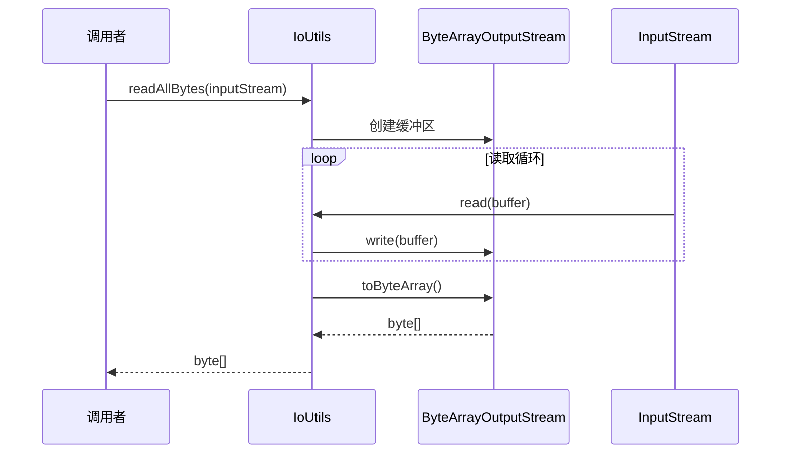
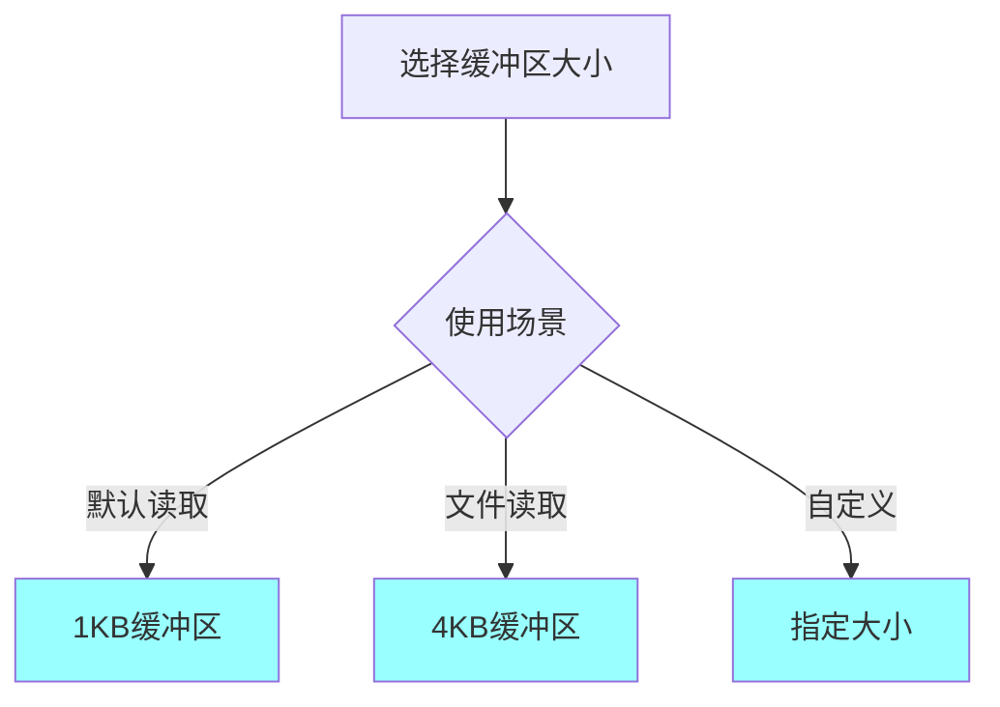
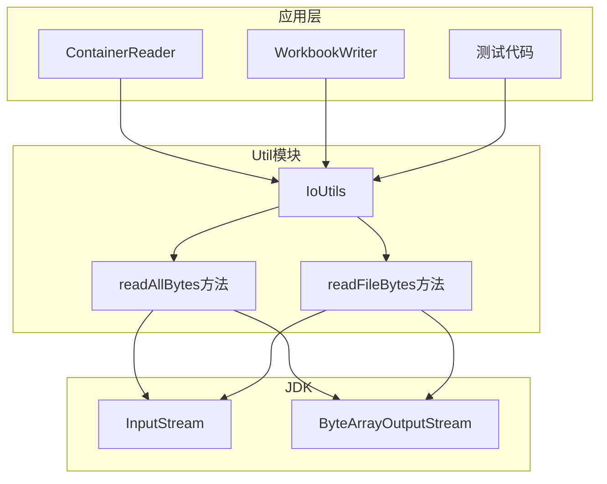

# Util模块需求文档

## 模块概述

Util模块提供jxlsb项目的通用工具类，封装常用的I/O操作。该模块遵循单一职责原则，每个工具类专注于特定功能领域，为上层模块提供简洁、高效的工具方法。

**模块定位**：
- 基础设施层 - 提供通用工具能力
- 工具封装 - 简化常用操作
- 零依赖 - 仅依赖JDK标准库

## 业务场景

### 场景列表

| 序号 | 场景名称 | 描述 | 优先级 |
|------|----------|------|--------|
| 1 | InputStream读取 | 将输入流全部读取为字节数组 | P0 |
| 2 | 文件读取 | 高效读取文件内容到内存 | P0 |
| 3 | 缓冲区大小优化 | 根据场景选择最优缓冲区大小 | P1 |

### 场景详情

#### 场景1: InputStream读取

**触发条件**：需要从InputStream读取所有数据

**业务流程**：



**预期结果**：
- 完整读取所有数据
- 支持大文件（自动扩容）
- 高效内存使用

#### 场景2: 文件读取

**触发条件**：从文件读取内容到内存

**业务流程**：


**预期结果**：
- 使用最优缓冲区大小（4KB）
- 单次调用完成读取
- 自动关闭资源（调用者负责）

#### 场景3: 缓冲区大小优化

**触发条件**：不同场景选择不同缓冲区大小

**业务流程**：



**预期结果**：
- 默认大小：1KB
- 文件读取：4KB
- 支持自定义大小

## 功能需求

### 核心功能

| 序号 | 功能名称 | 描述 | 输入 | 输出 |
|------|----------|------|------|------|
| 1 | 读取全部字节 | 读取InputStream所有数据 | InputStream | byte[] |
| 2 | 自定义缓冲读取 | 使用指定缓冲区大小读取 | InputStream, bufferSize | byte[] |
| 3 | 文件读取优化 | 使用最优缓冲区读取文件 | InputStream | byte[] |

### 辅助功能

| 序号 | 功能名称 | 描述 | 输入 | 输出 |
|------|----------|------|------|------|
| 1 | 资源管理 | 资源由调用者管理 | 无 | 无 |

## 业务规则

| 序号 | 规则名称 | 规则描述 | 代码实现位置 |
|------|----------|----------|--------------|
| 1 | 默认缓冲区 | 默认缓冲区大小为1KB | IoUtils:9 |
| 2 | 文件缓冲区 | 文件读取缓冲区大小为4KB | IoUtils:10 |
| 3 | 移动语义 | 不持有资源，由调用者管理 | 所有方法 |
| 4 | 异常传播 | IOException向上传播 | 所有方法 |

## 数据需求

### 数据实体

| 实体名称 | 属性列表 | 来源 |
|----------|----------|------|
| IoUtils | DEFAULT_BUFFER_SIZE, FILE_BUFFER_SIZE | 工具类常量 |

### 数据流转


### 缓冲区大小选择

| 场景 | 缓冲区大小 | 原因 |
|------|-----------|------|
| 默认读取 | 1KB | 平衡内存和性能 |
| 文件读取 | 4KB | 匹配操作系统页大小 |
| 自定义 | 用户指定 | 特殊场景优化 |

## 非功能需求

### 性能要求

| 指标 | 要求 | 当前实现 |
|------|------|----------|
| 读取速度 | 接近磁盘带宽 | ByteArrayOutputStream |
| 内存使用 | 线性增长 | 自动扩容 |
| GC压力 | 中等 | 创建byte[]和ByteArrayOutputStream |

### 安全要求

| 要求 | 实现方式 |
|------|----------|
| 资源管理 | 调用者负责关闭InputStream |
| 异常处理 | IOException向上传播 |
| 空指针检查 | 无（依赖调用者） |

### 兼容性要求

| 类型 | 要求 |
|------|------|
| Java版本 | Java 8+ |
| 并发访问 | 无状态，线程安全 |

## 约束条件

### 业务约束

1. **无状态**：工具类无实例状态
2. **移动语义**：不持有资源，调用者管理
3. **最小化功能**：只提供必要功能

### 技术约束

1. **InputStream限制**：不支持标记重置
2. **内存限制**：大文件可能OOM
3. **阻塞IO**：使用阻塞式IO

## 架构设计

### 模块架构



### 类职责矩阵

| 类名 | 职责 | 设计模式 |
|------|------|----------|
| IoUtils | I/O操作工具类 | 工具类模式（静态方法） |

## 使用示例

### 基本使用

```java
// 读取InputStream所有数据
try (InputStream is = new FileInputStream("data.bin")) {
    byte[] data = IoUtils.readAllBytes(is);
    // 处理数据
}

// 使用自定义缓冲区大小
try (InputStream is = new FileInputStream("large.bin")) {
    byte[] data = IoUtils.readAllBytes(is, 8192); // 8KB缓冲区
    // 处理数据
}

// 读取文件（最优缓冲区）
try (InputStream is = new FileInputStream("file.bin")) {
    byte[] data = IoUtils.readFileBytes(is);
    // 处理数据
}
```

### 与Java 9+对比

```java
// jxlsb IoUtils (兼容Java 8)
byte[] data = IoUtils.readAllBytes(inputStream);

// Java 9+ InputStream.readAllBytes()
byte[] data = inputStream.readAllBytes();

// 差异：
// - IoUtils: 兼容Java 8+
// - readAllBytes(): 需要Java 9+
// - 性能相当
```

## 技术特性

### 设计原则

**1. 静态工具类**
- 私有构造函数，防止实例化
- 所有方法静态
- 无状态

**2. 移动语义**
- 不持有资源
- 调用者负责资源管理
- 支持try-with-resources

**3. 最小化API**
- 只提供必要方法
- 避免过度设计
- 易于理解和维护

### 实现细节

**ByteArrayOutputStream选择**：
- 自动扩容
- 线程安全（单线程使用）
- 高效内存管理

**缓冲区大小选择**：
- 1KB：默认大小，平衡内存和性能
- 4KB：文件读取，匹配操作系统页大小
- 自定义：特殊场景优化

### 性能考虑

| 操作 | 性能 | 原因 |
|------|------|------|
| 小文件读取 | 高 | 缓冲区足够 |
| 大文件读取 | 中 | 需要多次扩容 |
| 网络读取 | 取决于网络 | 阻塞式IO |

**优化方向**：
- 预估大小避免扩容
- 直接堆外内存读取（已在IO模块实现）

## 测试要求

### 单元测试

- 覆盖率要求：> 90%
- 关键测试点：
  - 正常读取
  - 空流读取
  - 大文件读取
  - 自定义缓冲区大小

### 集成测试

- 与ContainerReader集成
- 与WorkbookWriter集成

### 性能测试

- 不同文件大小读取性能
- 不同缓冲区大小性能对比
- 与Java 9+ readAllBytes对比

## 扩展指南

### 添加新工具类

**场景**：需要添加其他类型的工具类（如字符串工具）

**步骤**：
1. 创建新的工具类
2. 私有构造函数
3. 添加静态工具方法
4. 编写单元测试

**示例**：

```java
public final class StringUtils {
    
    private StringUtils() {}
    
    public static boolean isEmpty(String str) {
        return str == null || str.isEmpty();
    }
    
    public static String trimToNull(String str) {
        if (str == null) {
            return null;
        }
        String trimmed = str.trim();
        return trimmed.isEmpty() ? null : trimmed;
    }
}
```

### 工具类设计原则

- **单一职责**：一个工具类只做一类事
- **无状态**：不持有实例状态
- **静态方法**：所有方法静态
- **私有构造**：防止实例化
- **命名清晰**：工具类以Utils结尾